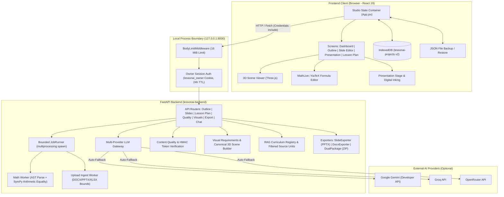
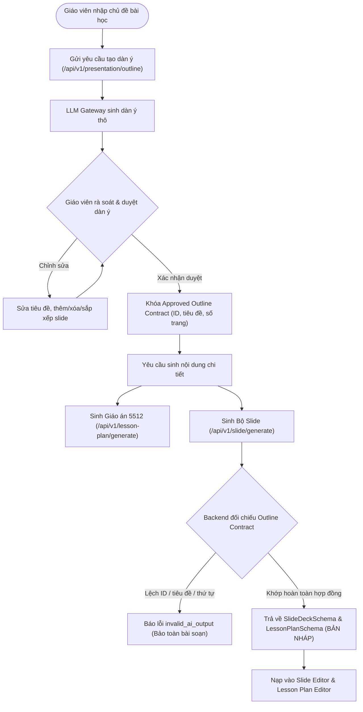

# LessonAI-5512

> **Local-first, AI-assisted teaching studio for Vietnamese high school teachers (Grade 12 Mathematics, GDPT 2018 / Official Dispatch 5512).**

Ứng dụng máy trạm cục bộ (local-first desktop studio) hỗ trợ giáo viên Toán lớp 12 soạn giáo án chuẩn Công văn 5512/BGDĐT, tạo slide bài giảng PowerPoint 16:9 đồng bộ, kiểm chứng biểu thức toán học và trực quan hóa hình học không gian. Hệ thống tuân thủ nghiêm ngặt nguyên tắc **Zero-Fallback**: AI chỉ đóng vai trò hỗ trợ tạo bản nháp — giáo viên là người trực tiếp kiểm tra, xác nhận và chịu trách nhiệm chuyên môn cuối cùng.

[](app/backend/pyproject.toml)
[](app/frontend/package.json)
[](LICENSE)
[](project-management/release-gates/remediation-acceptance-2026-11-03.md)

---

## Table of Contents

- [Overview](#overview)
  - [Problem Statement](#problem-statement)
  - [Target Users](#target-users)
  - [Core Philosophy](#core-philosophy)
- [Key Features](#key-features)
- [Architecture](#architecture)
  - [High-Level Architecture](#high-level-architecture)
  - [AI Generation Workflow](#ai-generation-workflow)
  - [Content Validation & Export Pipeline](#content-validation-export-pipeline)
- [Tech Stack](#tech-stack)
- [Project Structure](#project-structure)
- [Installation & Quick Start](#installation-quick-start)
  - [Prerequisites](#prerequisites)
  - [Installation Steps](#installation-steps)
  - [Running the Application](#running-the-application)
- [Environment Configuration](#environment-configuration)
- [User Workflow](#user-workflow)
- [Validation & Safety](#validation-safety)
  - [Verification Scope & Boundaries](#verification-scope-boundaries)
  - [Definition of Ready Status](#definition-of-ready-status)
- [Data & Security Model](#data-security-model)
- [Testing & Quality Assurance](#testing-quality-assurance)
- [Known Limitations](#known-limitations)
- [Documentation & Reports](#documentation-reports)
- [Roadmap & Project Status](#roadmap-project-status)
- [License & Contributing](#license-contributing)

---

## Overview

### Problem Statement

Soạn giáo án theo **Công văn 5512/BGDĐT** đòi hỏi cấu trúc chặt chẽ với 4 hoạt động sư phạm (Mở đầu, Hình thành kiến thức, Luyện tập, Vận dụng), phân định rõ hoạt động của Giáo viên và Học sinh, cùng yêu cầu cần đạt (YCCĐ). Đồng thời, việc chuyển đổi giáo án thành bài giảng trình chiếu PowerPoint 16:9 đồng bộ tốn nhiều thời gian của giáo viên Toán THPT.

Các công cụ AI tạo sinh thông thường trên thị trường thường gặp các vấn đề lớn:
1. **Ảo giác toán học (Mathematical Hallucination):** Tự tạo công thức sai, nhầm lẫn giữa đồng nhất thức và phương trình, hoặc vẽ đồ thị/hình học không đúng tỷ lệ và dữ kiện bài toán.
2. **Âm thầm thay thế nội dung (Fallback Padding):** Tự động chèn bài giảng mẫu hoặc dữ liệu mặc định khi gặp lỗi, làm giáo viên khó phân biệt phần nào do AI sinh và phần nào là dữ liệu đã kiểm chứng.
3. **Phụ thuộc vào nền tảng đám mây bên thứ ba:** Dữ liệu soạn giảng bị tải lên các máy chủ phân tích mà giáo viên không kiểm soát được quyền riêng tư.

### Target Users

- **Đối tượng chính:** Giáo viên giảng dạy môn Toán lớp 12 tại các trường THPT tại Việt Nam theo Chương trình Giáo dục Phổ thông 2018 (SGK Kết nối tri thức với cuộc sống).
- **Môi trường sử dụng:** Máy tính cá nhân hoặc máy tính trạm của giáo viên (triển khai cục bộ hoàn toàn, không phụ thuộc kết nối ngoài trừ khi gọi API nhà cung cấp AI).

### Core Philosophy

- **AI Draft, Teacher in the Loop:** Mọi nội dung từ LLM (dàn ý, lời giải, câu hỏi, đề xuất chỉnh sửa) luôn được đối xử như một **bản nháp chưa được kiểm chứng** (`BẢN NHÁP`). Giáo viên có toàn quyền biên tập và là người duy nhất chứng nhận chuyên môn trước khi đưa vào giảng dạy.
- **Chính sách Zero-Fallback:** Khi các nhà cung cấp AI gặp sự cố (quá hạn ngạch, lỗi mạng, từ chối định dạng), hệ thống trả về lỗi có cấu trúc (`invalid_ai_output`, `llm_configuration_error`, `generation_unavailable`) và **bảo toàn nguyên vẹn bản soạn thảo hiện hành** của giáo viên. Tuyệt đối không tự ý chèn bài mẫu, dàn ý dự phòng hay hình học ngẫu nhiên.
- **Local-First & Quyền riêng tư:** Bản thảo bài giảng, lịch sử biên tập và chú thích được lưu trữ ngay trong trình duyệt (IndexedDB) và máy cục bộ, không gửi dữ liệu dự án lên máy chủ ngoài.

---

## Key Features

Hệ thống được tổ chức thành các nhóm tính năng phục vụ trọn vẹn vòng đời soạn giảng:

| Nhóm tính năng | Khả năng thực tế trong mã nguồn |
|---|---|
| **AI-Assisted Lesson Planning** | Sinh kế hoạch bài dạy chuẩn CV 5512 (Mục tiêu, Thiết bị, 4 hoạt động sư phạm). Tích hợp multi-provider LLM gateway hỗ trợ Google Gemini, Groq và OpenRouter với cơ chế tự động chuyển đổi tuyến (auto-fallback) khi gặp lỗi. |
| **Outline Generation & Approval** | Sinh dàn ý phân bổ slide theo cấu trúc sư phạm; cho phép giáo viên chỉnh sửa, thêm/xóa/sắp xếp lại slide. Khóa dàn ý đã duyệt (`Approved Outline Contract`), buộc backend kiểm tra đối chiếu số trang, ID, thứ tự và tiêu đề slide. |
| **Slide Editing & MathLive** | Trình soạn thảo WYSIWYG hỗ trợ hệ thống khối dữ liệu (`SlideSchema.blocks`: văn bản, công thức, hình ảnh, bảng). Tích hợp bàn phím toán học ảo MathLive và hiển thị công thức thời gian thực bằng KaTeX. Khóa form đang sửa (`isDirty`) chặn đổi trang hoặc xuất bài khi chưa lưu. |
| **Project Management & Persistence** | Lưu trữ toàn bộ dự án trong IndexedDB (`lessonai-projects`, `schema_version: 2`) với cơ chế phát hiện xung đột ghi đè giữa các tab (`_storage_revision`). Hỗ trợ xuất/phục hồi tệp JSON dự phòng độc lập. |
| **Mathematical Validation** | Phân tích cú pháp biểu thức bằng parser AST thuần túy (`ExpressionBudget`), không chạy mã `eval()`. Thực thi kiểm tra trong tiến trình con cô lập (`spawn` worker). Kiểm tra đẳng thức số học thực tế qua SymPy; chặn việc gán nhãn đúng cho phương trình có biến chưa xác định điều kiện. |
| **Graph & Geometry Rendering** | Dựng đồ thị 2D (hàm số, đạo hàm, cấp số cộng rời rạc, hệ bất phương trình tuyến tính). Dựng chuẩn xác 3 khối đa diện quy chuẩn: hình lập phương, hình chóp đều đáy vuông, hình chóp đáy vuông có cạnh bên vuông góc đáy $SA \perp (ABCD)$ với hệ tọa độ dùng chung giữa Web Three.js và slide PPTX. |
| **RAG-based Educational Sources** | Lưu trữ học liệu theo đơn vị nguyên vẹn (whole unit) kèm mã băm SHA-256. Chỉ đưa nguồn vào ngữ cảnh gợi ý khi có chữ ký duyệt khớp hash trong `reviewed_sources.json`. Không tự động lấy nguồn từ các bài khác khi kho local trống. |
| **Presentation Mode** | Sân khấu trình chiếu 16:9 toàn màn hình; công cụ vẽ kỹ thuật số (digital inking) với làm mượt nét Bezier và tẩy xóa thông minh; câu hỏi trắc nghiệm tương tác tại lớp kèm phân tích phương án nhiễu; chế độ hiển thị lời giải từng bước và bảng phụ (whiteboard). |
| **DOCX/PPTX/ZIP Export** | Xuất Word (.docx) chuẩn thể thức CV 5512 kèm nhãn bản nháp; xuất PowerPoint (.pptx) 16:9 tự động phân trang tiếp nối cho lời giải dài; đóng gói song song Dual-Package (.zip) kèm tệp chỉ mục sư phạm (`MANIFEST.txt`) và mã kiểm tra SHA-256. |
| **Office Ingestion** | Nhập tệp `.docx`, `.pptx`, `.xlsx` có sẵn qua worker cô lập; kiểm soát nghiêm ngặt dung lượng (tối đa 12 MiB/tệp, 16 MiB/request, 60 MiB giải nén, tối đa 3.000 phần tử); bảo toàn nguyên vẹn XML OMML và MathType OLE gốc kèm cảnh báo. |

---

## Architecture

### High-Level Architecture

Hệ thống hoạt động theo mô hình đơn tiến trình cục bộ (single-process local runtime), phân định rõ ranh giới giữa giao diện trình duyệt, API nghiệp vụ và các tiến trình con cô lập:



### AI Generation Workflow

Quy trình sinh nội dung được kiểm soát chặt chẽ qua hai chặng: Dàn ý được duyệt đóng vai trò như hợp đồng ràng buộc đối với quá trình sinh slide và giáo án chi tiết:



### Content Validation & Export Pipeline

Trước khi xuất tài liệu hoặc thuyết trình, mọi đồ thị, hình khối và công thức số học đều phải trải qua kiểm định độc lập và xác nhận bằng token HMAC:

```mermaid
flowchart LR
    Draft["Bản nháp trong Studio"] --> VisualParam["Giáo viên nhập tham số đồ thị / hình 3D"]
    VisualParam --> ServerVisual["Xác nhận dữ kiện (/api/v1/visuals/confirm)"]
    ServerVisual --> VisualToken["Cấp HMAC Visual Token (24h)"]
    
    VisualToken --> QualityAudit["Chạy kiểm tra bài (/api/v1/quality/check)"]
    QualityAudit --> ASTWorker["Worker: AST Parse + SymPy Equality Check"]
    ASTWorker --> Report{"Báo cáo chất lượng"}
    
    Report -- "Có lỗi số học / sai lệch" --> BlockReview["Chặn duyệt (Yêu cầu sửa lỗi)"]
    Report -- "Không có lỗi chặn" --> TeacherSignOff{"Giáo viên xác nhận chuyên môn"}
    
    TeacherSignOff --> ApproveRoute["Gửi duyệt (/api/v1/quality/approve)"]
    ApproveRoute --> ReviewToken["Cấp HMAC Review Token (Status: ready)"]
    
    ReviewToken --> Exporters["Yêu cầu xuất tệp"]
    Exporters --> CheckStatus{"Kiểm tra Review Token"}
    CheckStatus -- "Token hợp lệ (ready)" --> CleanExport["Bản xuất chuẩn không nhãn nháp"]
    CheckStatus -- "Chưa duyệt / Hết hạn" --> DraftWatermark["Bản xuất gắn nhãn BẢN NHÁP"]
    
    CleanExport --> DualZip["Dual-Package Exporter (.zip + .docx + .pptx + SHA-256 Manifest)"]
    DraftWatermark --> DualZip
```



---

## Tech Stack

Dự án chỉ sử dụng các công nghệ và thư viện thực tế có trong cấu hình mã nguồn:

| Phân tầng | Công nghệ / Thư viện | Phiên bản | Mục đích sử dụng |
|---|---|---|---|
| **Frontend Core** | React | `^19.0.0` | Giao diện người dùng hướng thành phần |
| | Vite | `^6.0.0` | Công cụ đóng gói ứng dụng web và HMR |
| | Tailwind CSS | `^3.4.15` | Hệ thống thiết kế giao diện tiện ích |
| **Frontend Math & 3D** | Three.js | `^0.170.0` | Dựng và hiển thị khối hình học không gian 3D |
| | MathLive | `0.111.4` | Bàn phím ảo và bộ nhập công thức toán tương tác |
| | KaTeX | `^0.18.10` | Hiển thị biểu thức toán học tốc độ cao |
| | Lucide React | `^0.460.0` | Bộ biểu tượng giao diện người dùng |
| **Backend Core** | Python | `>=3.11` (CI: `3.13`) | Ngôn ngữ thực thi chính phía backend |
| | FastAPI | `>=0.100.0` | Khung ứng dụng RESTful API hiệu năng cao |
| | Uvicorn | `>=0.20.0` | ASGI Web Server đơn tiến trình |
| | Pydantic | `>=2.0.0` | Xác thực dữ liệu và ràng buộc JSON Schema v2 |
| **AI / LLM Routing** | google-genai | `>=0.1.0` | Kết nối Google Gemini Developer API |
| | openai | `>=1.50.0` | Kết nối các endpoint tương thích (Groq, OpenRouter) |
| | httpx | `>=0.27.0` | Thư viện HTTP client bất đồng bộ |
| **Math & Graphics** | SymPy | `>=1.13.0` | Đánh giá tính đúng đắn đại số số học |
| | NumPy | `>=2.0.0` | Tính toán số học ma trận và tọa độ 3D |
| | Matplotlib | `>=3.10.0` | Kết xuất đồ thị 2D độc lập màn hình |
| | latex2mathml / mathml2omml | `>=3.80.0` / `>=0.0.2` | Chuyển đổi định dạng công thức phục vụ Office |
| **Office Exporters** | python-docx | `>=1.0.0` | Xây dựng tệp tài liệu Kế hoạch bài dạy Word |
| | python-pptx | `>=0.6.21` | Xây dựng bài giảng trình chiếu PowerPoint 16:9 |
| | openpyxl / pillow | `>=3.1.0` / `>=13.0.0` | Xử lý bảng tính và tối ưu hóa hình ảnh nhúng |
| **Storage & Security** | Browser IndexedDB | `schema_version: 2` | Kho lưu trữ dữ liệu bền vững tại client |
| | HMAC-SHA256 | Python `secrets` | Chữ ký xác nhận dữ kiện và duyệt bài (RAM 24h) |
| **Testing & QA** | Pytest | `>=8.0.0` | Bộ kiểm thử đơn vị và hồi quy backend |
| | Node Test Runner | `node --test` | Kiểm thử đơn vị các hàm logic phía frontend |
| | Playwright | `1.64.1` | Kiểm thử tích hợp tự động trên trình duyệt thật |

---

## Project Structure

Cấu trúc thư mục thực tế của dự án:

```text
.
├── Makefile                        # Lệnh tự động hóa chính (dev, build, test, audit)
├── CONTRIBUTING.md                 # Hướng dẫn đóng góp mã nguồn và quy chuẩn commit
├── LICENSE                         # Giấy phép mã nguồn mở MIT
├── README.md                       # Tài liệu hướng dẫn kỹ thuật tổng quan
├── app/
│   ├── backend/                    # Package FastAPI (`lessonai-backend`)
│   │   ├── pyproject.toml          # Khai báo metadata, dependencies & pytest config
│   │   ├── requirements.txt        # Danh mục thư viện chính
│   │   ├── requirements-lock.txt   # Khóa phiên bản dependencies cho bản build xác định
│   │   ├── data/                   # Khung chương trình GDPT, kho RAG, reviewed_sources.json
│   │   ├── output/                 # Thư mục tạm lưu tệp DOCX, PPTX và ZIP xuất bản
│   │   ├── src/lessonai/           # Mã nguồn ứng dụng chính (`import lessonai.*`)
│   │   │   ├── main.py             # Khởi tạo FastAPI app, cấu hình CORS & boundary middleware
│   │   │   ├── core/               # config.py, ingress.py, jobs.py, ownership.py, render_runtime.py
│   │   │   ├── api/routes/         # Router API: chat, curriculum, exports, lesson_plan, quality, slides, visuals
│   │   │   ├── services/           # Logic nghiệp vụ: math_expression, math_worker, geometry_scene, content_quality
│   │   │   ├── llm/gateway.py      # Bộ định tuyến LLM đa nhà cung cấp có auto-fallback
│   │   │   ├── rag/                # Quản lý học liệu: CurriculumRegistry, Math12HybridRetriever, content_units
│   │   │   ├── parsers/            # Phân tích tệp DOCX/PPTX nhập vào (docx_parser, pptx_parser)
│   │   │   ├── exporters/          # Xuất bản tài liệu: docx_exporter, slide_exporter, dual_package_exporter
│   │   │   ├── schemas/            # Pydantic models (LessonPlanSchema, SlideDeckSchema, blocks, v.v.)
│   │   │   └── templates/          # Base template PPTX (template_5512.pptx, manifest.json)
│   │   └── tests/                  # Bộ kiểm thử Pytest & contract fixture (api_contract.json)
│   └── frontend/                   # Ứng dụng React 19 + Vite
│       ├── package.json            # Scripts phát triển (dev, build, test, test:e2e) & dependencies
│       ├── package-lock.json       # Khóa phiên bản thư viện frontend
│       ├── vite.config.js          # Cấu hình Vite & reverse proxy `/api` sang backend cổng 8000
│       ├── playwright.config.js    # Cấu hình kiểm thử tự động Playwright trên trình duyệt thật
│       ├── src/
│       │   ├── App.jsx             # State container trung tâm & bộ điều hướng màn hình
│       │   ├── features/           # Slices tính năng: dashboard, generation, slide-editor, lesson-plan, presentation, geometry, chat, exports, analytics
│       │   └── shared/             # Thành phần dùng chung: API client, IndexedDB store, math components
│       ├── tests/                  # Bộ kiểm thử đơn vị frontend (node --test)
│       └── e2e/                    # Kịch bản kiểm thử tích hợp Playwright (workflows.spec.js)
├── docs/                           # Tài liệu kiến trúc, đặc tả API và thiết kế giao diện
├── project-management/             # Nhật ký tiến độ (PROGRESS.md) và hồ sơ nghiệm thu (release-gates/)
├── reports/                        # Báo cáo bằng chứng kiểm thử và danh sách tệp thay đổi
└── scripts/                        # Kịch bản kiểm định dữ liệu và tạo danh sách rà soát nguồn RAG
```

---

## Installation & Quick Start

### Prerequisites

- **Hệ điều hành:** macOS (Apple Silicon hoặc Intel) hoặc Linux (Ubuntu 22.04 LTS trở lên).
- **Python:** Phiên bản `3.13` (khuyến nghị cho môi trường nghiệm thu chuẩn) hoặc tối thiểu `>=3.11`.
- **Node.js:** Phiên bản `22.x` kèm `npm`.
- **Trình duyệt web:** Google Chrome hoặc Chromium (cần thiết khi chạy kiểm thử E2E).

### Installation Steps

1. **Sao chép kho lưu trữ:**
   ```bash
   git clone https://github.com/NguyenNhan18/Lesson-Plan-Generator.git
   cd Lesson-Plan-Generator
   ```

2. **Khởi tạo và kích hoạt môi trường ảo Python:**
   ```bash
   python3.13 -m venv app/backend/venv
   source app/backend/venv/bin/activate
   ```

3. **Cài đặt các gói phụ thuộc backend từ tệp khóa (Reproducible Lock):**
   ```bash
   app/backend/venv/bin/python -m pip install -r app/backend/requirements-lock.txt
   app/backend/venv/bin/python -m pip install --no-deps -e app/backend
   ```

4. **Cài đặt các gói phụ thuộc frontend:**
   ```bash
   npm --prefix app/frontend ci
   ```

5. **Cấu hình biến môi trường:**
   Tạo tệp `app/backend/.env` để cấu hình API key AI nếu muốn sử dụng tính năng sinh tự động (xem mục [Environment Configuration](#environment-configuration)). Không cần API key nếu chỉ biên tập thủ công, kiểm tra số học và xuất tài liệu.

### Running the Application

#### Cách 1: Chế độ Chạy Cục bộ Chuẩn (Production-like Local Mode)
Xây dựng giao diện tĩnh và để FastAPI phục vụ trực tiếp toàn bộ ứng dụng trên một cổng duy nhất:

```bash
# 1. Build giao diện frontend
make build

# 2. Khởi động backend FastAPI
make backend
```

Mở trình duyệt tại địa chỉ: **`http://127.0.0.1:8000`**

#### Cách 2: Chế độ Phát triển (Development Mode với Hot Reload)
Chạy hai terminal song song để tận dụng Vite HMR khi sửa đổi mã nguồn giao diện:

- **Terminal 1 (Backend API):**
  ```bash
  make backend
  ```
  *(Backend lắng nghe tại `http://127.0.0.1:8000`)*

- **Terminal 2 (Frontend Dev Server):**
  ```bash
  make frontend
  ```
  *(Vite lắng nghe tại `http://127.0.0.1:5173` và tự động proxy các yêu cầu `/api` sang cổng `8000`)*

---

## Environment Configuration

Cấu hình runtime được quản lý qua tệp **`app/backend/.env`**.

> [!IMPORTANT]
> Toàn bộ API key của nhà cung cấp AI **chỉ được khai báo tại backend** (`app/backend/.env`). Hệ thống tuyệt đối không đưa các khóa này vào mã nguồn frontend hay gửi qua client browser.

| Biến môi trường | Mục đích / Mô tả | Bắt buộc | Giá trị mặc định |
|---|---|:---:|---|
| `GEMINI_API_KEY` | Khóa xác thực Google Gemini Developer API (AI Studio) | Không | *(Trống)* |
| `GROQ_API_KEY` | Khóa xác thực Groq Cloud API | Không | *(Trống)* |
| `OPENROUTER_API_KEY` | Khóa xác thực OpenRouter API | Không | *(Trống)* |
| `LESSONAI_DATA_DIR` | Đường dẫn thư mục dữ liệu RAG và khung chương trình | Không | `app/backend/data` |
| `LESSONAI_OUTPUT_DIR` | Thư mục lưu trữ tạm thời các tệp xuất DOCX/PPTX/ZIP | Không | `app/backend/output` |
| `LESSONAI_LOG_LEVEL` | Cấp độ ghi nhật ký hệ thống (`DEBUG`, `INFO`, `WARNING`, `ERROR`) | Không | `INFO` |
| `LESSONAI_LOCAL_ORIGINS` | Danh sách bổ sung các HTTP Origin cục bộ (phân tách bởi dấu phẩy) | Không | *(Trống)* |
| `LESSONAI_TEST_PORT` | Cổng HTTP chỉ định khi chạy kiểm thử Playwright E2E | Không | `8000` |

### Ví dụ tệp `app/backend/.env` mẫu:

```dotenv
# Cấu hình khóa nhà cung cấp AI (Cần ít nhất một khóa để bật tính năng sinh AI)
GEMINI_API_KEY=AIzaSyYourGeminiApiKeyHere
GROQ_API_KEY=gsk_YourGroqApiKeyHere
OPENROUTER_API_KEY=sk-or-YourOpenRouterKeyHere

# Cấu hình đường dẫn lưu trữ cục bộ (Tùy chọn)
# LESSONAI_DATA_DIR=/Users/username/data
# LESSONAI_OUTPUT_DIR=/Users/username/output
# LESSONAI_LOG_LEVEL=INFO
```

---

## User Workflow

Quy trình chuẩn khi sử dụng LessonAI-5512 trong công tác soạn giảng:

```text
[1. Tạo/Phục hồi dự án] ──► [2. Nhập chủ đề & Sinh dàn ý] ──► [3. Rà soát & Duyệt dàn ý]
                                                                        │
[6. Kiểm tra chất lượng] ◄── [5. Biên tập Slide/Giáo án] ◄── [4. Sinh bài chi tiết]
        │
[7. Xác nhận tham số Hình/Đồ thị] ──► [8. Trình chiếu lớp học] ──► [9. Xuất DOCX / PPTX / ZIP]
```

1. **Tạo hoặc phục hồi dự án (Create or Restore Project):**
   Khởi tạo dự án bài giảng mới từ Dashboard hoặc nạp lại tệp JSON đã lưu trước đó. Có thể bắt đầu soạn thủ công trực tiếp tại **Biên Tập Slide** mà không cần AI.
2. **Sinh dàn ý (Generate Outline):**
   Nhập chủ đề bài học, khối lớp (mặc định Lớp 12) và yêu cầu trọng tâm. Hệ thống gọi AI để tạo dàn ý phân bổ số slide và các mục kiến thức cốt lõi.
3. **Rà soát và duyệt dàn ý (Review & Approve Outline):**
   Giáo viên trực tiếp chỉnh sửa tiêu đề, phân chia lại các hoạt động hoặc thêm/xóa mục. Khi bấm **Duyệt dàn ý**, một bản hợp đồng (`Approved Outline Contract`) được khóa lại.
4. **Sinh giáo án và slide chi tiết (Generate Lesson Content & Slides):**
   Backend sinh Kế hoạch bài dạy 5512 và bộ slide tương ứng. Backend tự động đối chiếu từng slide với dàn ý đã duyệt; nếu AI làm lệch tiêu đề hoặc thứ tự, yêu cầu bị từ chối và bản thảo cũ được bảo toàn.
5. **Biên tập và lưu trữ nội dung (Edit & Save Draft):**
   Chỉnh sửa nội dung các khối (văn bản, công thức Toán qua MathLive, bảng biểu). Nếu có thay đổi chưa bấm **Lưu thay đổi Slide**, hệ thống sẽ khóa điều hướng để tránh mất mát dữ liệu.
6. **Kiểm tra chất lượng toán học (Validate Mathematical Content):**
   Chạy công cụ **Kiểm tra bài**. Bộ phân tích cú pháp AST và SymPy sẽ quét toàn bộ công thức trong slide, các bước giải và phương án trắc nghiệm. Các phép tính số học sai sẽ chặn việc phê duyệt bài.
7. **Xác nhận tham số đồ thị và hình học (Review Diagrams & Assumptions):**
   Đối chiếu dữ kiện bài toán với đồ thị hoặc khối hình học 3D. Nhập rõ độ dài cạnh đáy, chiều cao hoặc miền vẽ của hàm số, sau đó bấm **Xác nhận**. Hệ thống cấp một chữ ký điện tử HMAC có thời hạn 24 giờ.
8. **Trình chiếu slide tại lớp (Present Slides):**
   Chuyển sang chế độ trình chiếu toàn màn hình. Giáo viên sử dụng bút vẽ số (digital inking) để viết chú thích, hiển thị từng bước giải (step-by-step reveal) hoặc mở câu hỏi trắc nghiệm tương tác cho học sinh.
9. **Xuất tài liệu (Export Documents):**
   Xuất tệp Word (.docx) chuẩn quy cách văn bản Công văn 5512, tệp PowerPoint (.pptx) 16:9 đồng bộ, hoặc gói kép Dual-Package (.zip) kèm bản tóm tắt sư phạm và mã kiểm tra tính toàn vẹn SHA-256.

---

## Validation & Safety

### Verification Scope & Boundaries

Hệ thống xác định ranh giới kỹ thuật rõ ràng giữa những gì có thể tự động kiểm chứng bằng thuật toán và những phần bắt buộc phải có sự thẩm định của giáo viên:

| Thành phần kiểm định | Cơ chế đã hỗ trợ thực tế | Giới hạn kỹ thuật & Ranh giới an toàn |
|---|---|---|
| **Expression Parser** | Bộ phân tích cú pháp AST thuần túy; hỗ trợ số, biến `x`, các toán tử số học cơ bản và tập hàm giới hạn (`sin`, `cos`, `tan`, `log`, `exp`, `sqrt`, `Abs`). | Cú pháp nằm ngoài tập ngữ pháp bị từ chối; không bao giờ thực thi mã Python do LLM sinh ra. |
| **Graph Validation** | Kiểm định đồ thị hàm số và đạo hàm dựa trên biểu thức phân tích được; cấp số cộng rời rạc; hệ bất phương trình bậc nhất từ hệ số. | Miền nghiệm đồ thị chỉ biểu diễn trong cửa sổ hiển thị đã chọn; không chấp nhận các nét vẽ đa giác tự do do AI tự sinh làm căn cứ toán học. |
| **3D Geometry** | Dựng tọa độ giải tích chuẩn cho 3 khối đa diện: Hình lập phương (`cube`), Hình chóp đều đáy vuông (`square_pyramid_regular`), Hình chóp đáy vuông có cạnh bên vuông góc đáy (`square_pyramid_at_a`). | Các khối đa diện khác chưa được bật. Web và PPTX dùng chung một bộ tọa độ giải tích; góc nhìn phối cảnh và tỷ lệ co giãn không cam kết giống nhau từng pixel. |
| **Mathematical Formulas** | Duyệt công thức ở toàn bộ các trường: bước giải, nội dung, bảng và đáp án trắc nghiệm. Chặn các đẳng thức số học sai (ví dụ: $2 + 2 = 5$). | Phương trình có biến cần giáo viên xác định rõ vai trò và điều kiện; các suy luận logic, lời giải hình học và bước chứng minh chưa được chứng minh tự động. |
| **RAG Source Approval** | Lưu giữ đơn vị học liệu nguyên vẹn kèm mã băm SHA-256; chỉ đưa nguồn có bản ghi phê duyệt hợp lệ trong `reviewed_sources.json` vào ngữ cảnh prompt. | Khi kho học liệu local chưa có phê duyệt chuyên môn của giáo viên, hệ thống giữ ngữ cảnh trống; việc chạy linter dữ liệu đạt không đồng nghĩa nội dung đúng toán học. |
| **Office Ingestion** | Giới hạn kích thước tệp tải lên, dung lượng giải nén và số phần tử; bảo toàn XML OMML và asset media gốc. | Chưa tự động chuyển đổi hoàn chỉnh các đối tượng OMML/MathType OLE thành khối công thức có thể chỉnh sửa; API trả về danh sách cảnh báo đối chiếu. |
| **Document Export** | Không tự ý chèn các hoạt động còn thiếu; tự động gắn nhãn cảnh báo bản nháp (`BẢN NHÁP`), tạo manifest sư phạm và tính mã SHA-256. | Các công thức không thể chuyển sang MathML/OMML sẽ giữ nguyên mã nguồn LaTeX; giáo viên cần kiểm tra lại bố cục sau khi xuất, nhất là công thức dài. |

### Definition of Ready Status

> [!WARNING]
> Thuật ngữ **`ready`** trong hệ thống chỉ biểu thị rằng:
> 1. Không phát hiện lỗi chặn nào trong phạm vi các quy tắc kiểm tra tự động đã hỗ trợ (cú pháp AST, đẳng thức số học hằng số, khớp ràng buộc hình học).
> 2. Giáo viên đã bấm nút xác nhận chuyên môn cho chính bản sửa đổi (revision) hiện hành đó.
>
> Trạng thái `ready` **không** đồng nghĩa với việc mô hình AI hay hệ thống phần mềm đã chứng minh được tính đúng đắn toàn diện về mặt lập luận, tính chặt chẽ của giả thiết hoặc sự chuẩn mực sư phạm của bài giảng.

---

## Data & Security Model

- **Lưu trữ phía Client (IndexedDB Persistence):**
  Toàn bộ dữ liệu dự án (dàn ý, bài soạn giáo án, bộ slide, chú thích vẽ tay) được lưu trữ tại trình duyệt trong cơ sở dữ liệu `lessonai-projects` (`schema_version: 2`). Xóa dữ liệu trình duyệt sẽ xóa bài soạn local; giáo viên cần sử dụng nút **Tải JSON dự phòng** để lưu trữ lâu dài hoặc chuyển máy.
- **Kiểm soát xung đột phiên bản (Optimistic Storage Concurrency):**
  Mỗi dự án, bộ slide và slide mang một UUIDv4 độc lập kèm số hiệu bản sửa đổi (`revision`). Khi ghi dữ liệu vào IndexedDB, hệ thống kiểm tra trường `_storage_revision`. Nếu phát hiện dự án đã bị thay đổi ở tab trình duyệt khác, thao tác ghi sẽ bị chặn lại kèm cảnh báo để tránh ghi đè dữ liệu.
- **Ranh giới phiên cục bộ (Local Owner Session):**
  Ứng dụng hoạt động theo mô hình máy trạm đơn người dùng cục bộ. Phiên làm việc được phân định bằng cookie `lessonai_owner` (thuộc tính `SameSite=Strict`, `HttpOnly`, thời hạn 24 giờ) quản lý tối đa 256 phiên đồng thời trong RAM.
  *Lưu ý: Hệ thống không tuyên bố hỗ trợ xác thực và phân quyền đa người dùng trên môi trường mạng công cộng.*
- **Thời hạn chữ ký xác thực (Token Expiration):**
  Chữ ký HMAC xác nhận dữ kiện hình học (`visuals/confirm`) và duyệt chất lượng bài giảng (`quality/approve`) được ký bằng khóa ngẫu nhiên trong RAM máy chủ với thời hạn tối đa 24 giờ. Khi khởi động lại tiến trình backend, khóa này được tạo mới và các chữ ký trước đó sẽ hết hiệu lực. Dữ liệu bài soạn của giáo viên trong IndexedDB vẫn được giữ nguyên, chỉ cần bấm xác nhận lại.
- **Ràng buộc an toàn tài nguyên (Ingress & Worker Limits):**
  - **Giới hạn yêu cầu HTTP:** `BodyLimitMiddleware` chặn các body vượt quá **16 MiB** hoặc quá thời hạn nhận 15 giây.
  - **Giới hạn tệp tải lên:** Tệp Office tải lên tối đa **12 MiB/tệp**, tối đa **60 MiB** sau khi giải nén trong bộ nhớ, tối đa **3.000 thành phần nén**, từ chối các đường dẫn chứa ký tự bất thường (`..`, symbolic links).
  - **Tiến trình worker cô lập:** Các tác vụ tính toán toán học và phân tích tệp tải lên được thực thi trong tiến trình con độc lập (`multiprocessing.Process` qua `lessonai.core.jobs.JobRunner`) với thời gian chờ (timeout) nghiêm ngặt. Trên Linux, tiến trình con được áp trần tài nguyên hệ điều hành (`RLIMIT_AS` 1.5 GiB và `RLIMIT_CPU` 20 giây).

---

## Testing & Quality Assurance

Hệ thống sở hữu bộ kiểm thử tự động nhiều tầng, bao gồm kiểm thử đơn vị, kiểm thử hồi quy nghiêm ngặt và kiểm thử đầu cuối trên trình duyệt thật:

```bash
# 1. Chạy toàn bộ kiểm thử đơn vị & tích hợp (Yêu cầu cả kho học liệu local):
make test

# 2. Chạy kiểm thử portable (Không phụ thuộc vào kho học liệu local chưa công bố):
make test-portable

# 3. Chạy kiểm thử hồi quy chặn phát hành (Critical regressions gate):
make test-critical

# 4. Chạy kiểm thử giao diện đầu cuối Playwright (Khởi động backend thật và trình duyệt):
make test-e2e

# 5. Chạy kịch bản nghiệm thu và thu thập bằng chứng kiểm định:
make audit-acceptance REVIEW_OUTPUT=/tmp/lessonai-acceptance-unique
```

### Cấu hình kiểm thử Playwright:

- **Trên macOS:** Bộ kiểm thử tự động nhận diện và sử dụng Google Chrome đã cài đặt sẵn trên máy (`/Applications/Google Chrome.app`).
- **Trên Linux hoặc môi trường CI:** Cài đặt Chromium độc lập trước khi chạy:
  ```bash
  npx --prefix app/frontend playwright install --with-deps chromium
  ```
- **Xử lý xung đột cổng khi chạy E2E:**
  Nếu cổng 8000 đang được tiến trình khác sử dụng, có thể chỉ định cổng kiểm thử riêng biệt:
  ```bash
  LESSONAI_TEST_PORT=18080 npm --prefix app/frontend run test:e2e
  ```

---

## Known Limitations

Nhằm đảm bảo tính minh bạch và an toàn khi đưa vào sử dụng, dưới đây là bảng tổng hợp các giới hạn kỹ thuật đã được ghi nhận:

| Hạng mục | Hiện trạng & Giới hạn kỹ thuật thực tế | Hướng xử lý hoặc Khuyến nghị |
|---|---|---|
| **Mốc nghiệm thu M1–M4** | **Chưa đủ điều kiện ký nhận bàn giao chính thức** (ghi nhận ngày 04/11/2026). Việc toàn bộ test tự động vượt qua là điều kiện cần nhưng chưa đủ; dự án bắt buộc phải có biên bản nghiệm thu chuyên môn từ giáo viên và kiểm tra thực tế trên máy chiếu vật lý. | Tuân thủ quy trình nghiệm thu 5 bước tại `project-management/release-gates/remediation-acceptance-2026-11-03.md`. |
| **Kho học liệu RAG** | Tệp `app/backend/data/reviewed_sources.json` chưa được phê duyệt (`0 / 2,741` đơn vị học liệu có xác nhận). Do đó, ngữ cảnh RAG thời gian chạy đang để trống theo chính sách bảo toàn độ chính xác. | Giáo viên chạy lệnh `make prepare-source-review REVIEW_OUTPUT=/tmp/lessonai-review-unique` để xuất danh sách và rà soát thủ công. |
| **Nhập công thức Office** | Bộ phân tích `.docx`/`.pptx` chỉ bảo toàn nguyên vẹn XML OMML và MathType OLE gốc kèm cảnh báo, chưa chuyển đổi hoàn chỉnh thành công thức LaTeX/MathLive có thể sửa trực quan. | Giáo viên kiểm tra lại các công thức trong phần đối chiếu sau khi nhập tệp tài liệu cũ. |
| **Xác thực toán học tự động** | Hệ thống chỉ kiểm tra tự động cú pháp AST và đẳng thức số học hằng số ($a = b$). Các phương trình chứa biến, lời giải hình học và bước chứng minh chưa được chứng minh tự động. | Giáo viên bắt buộc phải đọc kỹ các bước suy luận và lời giải chi tiết trước khi giảng dạy. |
| **Xuất bảng biểu và công thức phức tạp** | Trên PowerPoint (.pptx), một số bảng biểu phức tạp hoặc công thức LaTeX quá dài có thể bị ngắt dòng không tối ưu hoặc rơi về dạng văn bản thô. | Kiểm tra lại bố cục trực quan của tệp `.pptx` bằng Microsoft PowerPoint hoặc LibreOffice sau khi xuất. |
| **Khóa điều hướng Slide Editor** | Khi có chỉnh sửa chưa lưu trong form slide, hệ thống chặn việc chuyển trang, đổi dự án hoặc xuất bài (`isDirty`). | Bấm **Lưu thay đổi Slide** trước khi chuyển sang thao tác khác. |
| **Chữ ký hết hạn khi restart** | Khởi động lại backend sẽ làm mới khóa HMAC trong RAM, khiến các token xác nhận hình ảnh và duyệt bài bị hết hiệu lực. | Bản soạn thảo trong IndexedDB vẫn còn nguyên; giáo viên chỉ cần bấm xác nhận lại trong giao diện. |

---

## Documentation & Reports

Các tài liệu kỹ thuật, báo cáo khắc phục lỗi và kế hoạch nghiệm thu chi tiết trong kho mã nguồn:

- 📋 [Báo cáo triển khai khắc phục lỗi (Remediation Implementation Report)](reports/remediation-implementation-2026-11-03.md)
- 📂 [Danh mục các tệp tin thay đổi (Changed Files Report)](reports/remediation-changed-files-2026-11-03.md)
- 🎯 [Kế hoạch và tiêu chuẩn nghiệm thu sau khắc phục (Remediation Acceptance Plan)](project-management/release-gates/remediation-acceptance-2026-11-03.md)
- 📐 [Đặc tả hợp đồng API Dictionary Endpoints](docs/architecture/api-dict-contracts.md)
- 🏛️ [Cẩm nang kiến trúc kho mã nguồn (Repository Architecture Guide)](docs/architecture/repository.md)
- 🤝 [Hướng dẫn đóng góp mã nguồn (Contributing Guidelines)](CONTRIBUTING.md)

---

## Roadmap & Project Status

Tiến độ dự án được phân định minh bạch theo các mốc kỹ thuật ghi nhận tại `project-management/PROGRESS.md`:

```text
[M0: Kiến trúc nền tảng] ──► [M1: Toán học & 3D] ──► [M2: Lưu trữ & Session]
         (Hoàn thành)           (Pending Acceptance)      (Pending Acceptance)
                                         │
[M5: Đóng gói & Bàn giao] ◄── [M4: Trình chiếu & Xuất] ◄── [M3: RAG & Kiểm định]
        (Đang mở)               (Pending Acceptance)      (Pending Acceptance)
```

| Hạng mục | Trạng thái kỹ thuật | Chi tiết tiến độ thực tế |
|---|:---:|---|
| **M0: Kiến trúc & Đóng gói** | ✅ Completed | Đóng gói `lessonai-backend`, chuẩn hóa modular monolith, khóa hợp đồng OpenAPI. |
| **M1: Kiểm định Toán & Hình 3D** | ⏳ Pending Acceptance | AST parser, worker cô lập, 3 khối đa diện quy chuẩn đã hoàn thành kỹ thuật. Chờ bộ đề chuẩn và phản ví dụ có chữ ký giáo viên chuyên môn. |
| **M2: Lưu trữ cục bộ & Copilot** | ⏳ Pending Acceptance | IndexedDB v2, khóa xung đột đa tab, cookie phiên local đã hoàn thành. Chờ thử nghiệm tràn quota và di chuyển dữ liệu bài giảng thực tế. |
| **M3: Khung RAG & Cổng chất lượng** | ⏳ Pending Acceptance | Hợp đồng dàn ý và cổng duyệt bài đã hoàn thành. Điểm nghẽn: Cần thẩm định danh mục nguồn RAG (`reviewed_sources.json`) và hoàn thiện semantic converter OMML. |
| **M4: Trình chiếu & Xuất bản Office** | ⏳ Pending Acceptance | Sân khấu trình chiếu, inking, xuất DOCX, PPTX và ZIP kép đã hoàn thành. Chờ nghiệm thu chất lượng hiển thị thực tế trên máy chiếu lớp học. |
| **M5: Tích hợp CI & Bàn giao** | 🚧 In Progress | Toàn bộ kiểm thử local đã vượt qua (`352` backend, `32` frontend, `15` Playwright E2E). Đang chuẩn bị đẩy nhánh lên Hosted GitHub Actions CI. |

---

## License & Contributing

### License

Dự án được phân phối theo giấy phép mã nguồn mở **MIT License**. Toàn văn giấy phép có tại tệp [LICENSE](LICENSE).

### Contributing

Chúng tôi hoan nghênh mọi đóng góp nhằm hoàn thiện công cụ phục vụ cộng đồng giáo viên Toán THPT:

1. **Quy chuẩn commit:** Tuân thủ chuẩn [Conventional Commits](https://www.conventionalcommits.org/) (`feat:`, `fix:`, `refactor:`, `test:`, `docs:`).
2. **Quy trình nhánh:** Khởi tạo nhánh tính năng từ `main` theo định dạng `feature/<ten-tinh-nang>` hoặc `fix/<ten-loi>`.
3. **Kiểm tra bắt buộc trước khi tạo PR:**
   ```bash
   make test-portable
   make test-critical
   make test-frontend
   make build
   ```
4. Đọc chi tiết quy trình đóng góp tại [CONTRIBUTING.md](CONTRIBUTING.md).
