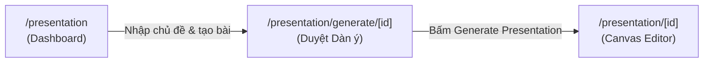
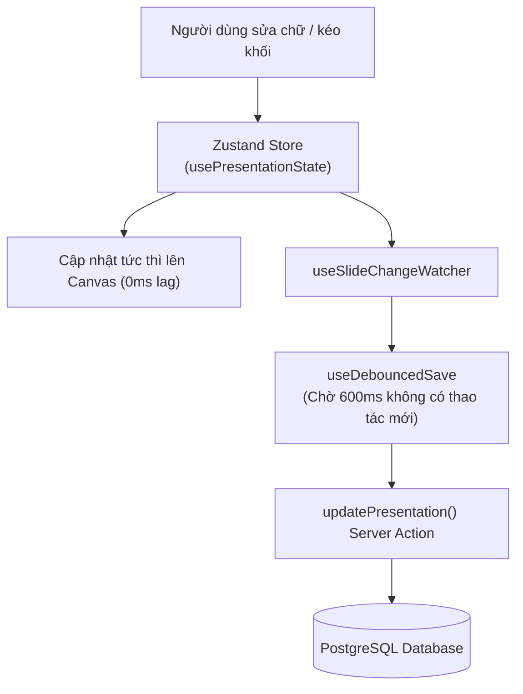

# KIẾN TRÚC & THIẾT KẾ FRONT-END DỰ ÁN PRESENTATION AI

> **Tài liệu tham chiếu kỹ thuật toàn diện về tầng giao diện người dùng (Front-End Layer), cơ chế quản lý trạng thái, lõi Canvas Editor và quy trình xử lý dữ liệu đầu vào.**

> ⚠️ **Tài liệu này không phản ánh frontend hiện tại của `LessonAI-5512`.** Chính tiêu đề đã ghi "DỰ ÁN PRESENTATION AI" — một dự án khác. Stack mô tả ở đây (Next.js 16, Plate.js/Slate.js, Zustand, TanStack Query, Apache ECharts, AntV Infographic, cấu trúc thư mục `presentation-ai/src/`) không khớp với bất kỳ dependency nào trong [`app/frontend/package.json`](../../app/frontend/package.json).
>
> Lịch sử Git (`git log --follow`) chỉ có một commit duy nhất cho file này — `c26e20a` ("chore(repo): track mặc định..."), commit đảo `.gitignore` theo ADR 0012 để đưa các tệp trước đó chỉ có ở máy vào Git cùng một lúc. Không có commit hay nội dung nào trong file gắn nhãn đây là đề xuất/kế hoạch chưa triển khai ("đề xuất", "dự kiến", "roadmap"...); file trình bày như tài liệu kiến trúc hiện hành. Vì vậy nhiều khả năng đây là tài liệu bị chép nhầm từ một dự án khác, không phải bản thảo viết lại cho `LessonAI-5512`.
>
> **Kiến trúc frontend thật đang chạy** (xem [`app/frontend/package.json`](../../app/frontend/package.json), [`app/frontend/src/App.jsx`](../../app/frontend/src/App.jsx), [`AGENTS.md`](../../AGENTS.md) mục 4 và 7):
> - **Stack:** React 19 + Vite 6 thuần (không Next.js), Tailwind CSS 3, KaTeX + MathLive cho công thức toán, Three.js cho hình 3D, Lucide React cho icon. Không có Zustand, TanStack Query, Plate.js, ECharts, AntV, hay Vercel AI SDK trong `package.json`.
> - **Quản lý state:** một state container duy nhất — `useState` trong [`App.jsx`](../../app/frontend/src/App.jsx) (biến `workbench`), với các action được tạo bởi `createWorkbenchActions()`. AGENTS.md mục 7 nói rõ: *"Do not create a second state store in `src/features/*`"* — không dùng Zustand hay store riêng trong từng feature.
> - **Giao diện:** Bàn làm việc (`src/features/workbench/`, component `Workbench.jsx`) là giao diện mặc định và duy nhất của ứng dụng — không có router kiểu Next.js App Router, không có nhiều trang `page.tsx` như tài liệu mô tả.
>
> Giữ nguyên nội dung file dưới đây để tham khảo lịch sử; đừng dùng nó để suy ra kiến trúc frontend hiện tại.

---

## MỤC LỤC
1. [Tổng Quan Công Nghệ (Tech Stack)](#1-tổng-quan-công-nghệ-tech-stack)
2. [Cấu Trúc Thư Mục Front-End](#2-cấu-trúc-thư-mục-front-end)
3. [Kiến Trúc Điều Hướng & Giao Diện (Routing & Pages)](#3-kiến-trúc-điều-hướng--giao-diện-routing--pages)
4. [Quản Lý Trạng Thái (State Management & Data Sync)](#4-quản-lý-trạng-thái-state-management--data-sync)
5. [Lõi Soạn Thảo Canvas: Plate.js (Slate.js Engine)](#5-lõi-soạn-thảo-canvas-platejs-slatejs-engine)
6. [Hệ Thống Đồ Họa & Trực Quan Hóa (Visual Engines)](#6-hệ-thống-đồ-họa--trực-quan-hóa-visual-engines)
7. [Đường Ống Dữ Liệu Đầu Vào (Input Data Pipeline)](#7-đường-ống-dữ-liệu-đầu-vào-input-data-pipeline)
8. [Các Tính Năng Chuyên Sâu Khác](#8-các-tính-năng-chuyên-sâu-khác)
9. [Hướng Dẫn Mở Rộng Hệ Thống (Developer Guide)](#9-hướng-dẫn-mở-rộng-hệ-thống-developer-guide)

---

## 1. TỔNG QUAN CÔNG NGHỆ (TECH STACK)

Front-end của dự án được viết hoàn toàn bằng **TypeScript 5+** với kiến trúc **Component-Driven**:

| Phân hệ | Công nghệ sử dụng | Vai trò & Mục đích |
| :--- | :--- | :--- |
| **Framework** | **Next.js 16 (App Router)** | Rendering, Server Actions, Route Handlers (SSE Streaming), Turbopack |
| **UI Library** | **React 19** | Xây dựng các UI Component hiệu năng cao, Server/Client components |
| **Styling** | **Tailwind CSS v4** + **Radix UI** | Thiết kế giao diện utility-first, hệ thống component accessible headless |
| **Canvas Editor** | **Plate.js** (xây dựng trên Slate.js) | Lõi trình soạn thảo khối dạng Rich-Text tương tác (WYSIWYG) |
| **State Manager** | **Zustand** | Quản lý state toàn cục trong bộ nhớ client (Single source of truth) |
| **Server Cache** | **TanStack Query (React Query)** | Cache và đồng bộ dữ liệu bài thuyết trình từ server/database |
| **Biểu đồ (Charts)**| **Apache ECharts** (`echarts-for-react`) | Vẽ hơn 20 loại biểu đồ dữ liệu vector tương tác |
| **Sơ đồ (Diagrams)**| **AntV Infographic** (`@antv/infographic`) | Tự động dàn trang các sơ đồ quan hệ, quy trình, mindmap |
| **Kéo thả (DnD)** | **@dnd-kit** | Kéo thả sắp xếp thứ tự các slide và thành phần giao diện |
| **Streaming Client** | **Vercel AI SDK (`@ai-sdk/react`)** | Nhận luồng Server-Sent Events (SSE) theo thời gian thực |
| **Code Tooling** | **Biome** | Linter và Formatter siêu tốc viết bằng Rust |

---

## 2. CẤU TRÚC THƯ MỤC FRONT-END

```text
presentation-ai/src/
├── app/presentation/                  # Các trang của App Router
│   ├── page.tsx                       # Dashboard chính, danh sách bài thuyết trình
│   ├── create/page.tsx                # Trang khởi tạo và chuyển hướng ban đầu
│   ├── generate/[id]/page.tsx         # Trang xem & duyệt Dàn ý (Outline) và Theme
│   └── [id]/page.tsx                  # Trang soạn thảo Canvas Editor chính
│
├── components/
│   ├── presentation/                  # Khung giao diện chính của bài thuyết trình
│   │   ├── core/                      # PresentationPage, PresentationCompletionFeedback
│   │   ├── slides/                    # SlidesContainer, SlideItem, SlideWrapper
│   │   ├── sidebar/                   # SlideSidebar (danh sách slide thu nhỏ bên trái)
│   │   ├── edit-panel/                # RightEditPanel (panel tinh chỉnh bên phải)
│   │   ├── present-mode/              # Chế độ trình chiếu toàn màn hình
│   │   └── floating-toolbar/          # Thanh công cụ nổi khi chọn khối
│   │
│   ├── notebook/presentation/         # Lõi Canvas Editor & xử lý AI
│   │   ├── components/                # PresentationGenerationManager, Dashboard, Outline
│   │   ├── editor/                    # Lõi Plate.js Editor
│   │   │   ├── plugins/               # Hơn 30+ plugin khối (Chart, Infographic, Timeline...)
│   │   │   ├── custom-elements/       # Component render cho từng khối (ECharts, AntV, Images)
│   │   │   └── hooks/                 # Hooks khởi tạo instance editor, fonts
│   │   ├── utils/                     # SlideParser.ts (bóc tách XML), serializer, templates
│   │   └── recording/                 # WebcamOverlay, RecordingControls, PreviewDialog
│   │
│   └── plate/                         # Bộ UI components cơ bản của Plate.js
│
├── states/                            # Quản lý State bằng Zustand
│   ├── presentation-state.ts          # State cốt lõi (slides, activeSlide, model, theme...)
│   ├── presentation-history-state.ts  # Quản lý Undo / Redo
│   └── presentation-recording-state.ts# Quản lý ghi hình bài giảng
│
├── hooks/presentation/                # Custom React Hooks
│   ├── usePresentationData.ts         # Nạp và khởi tạo dữ liệu bài thuyết trình
│   ├── useDebouncedSave.ts            # Tự động lưu ngầm (Debounce 600-1000ms)
│   ├── useSlideChangeWatcher.ts       # Theo dõi thay đổi của mảng slide
│   ├── useSlideContentScaling.ts      # Tính toán tỷ lệ co giãn slide theo màn hình
│   └── usePresentationNavigation.ts   # Điều hướng lật trang bằng phím mũi tên
│
└── lib/presentation/                  # Tiện ích bổ trợ (Theme, Layout catalog, Fonts)
    ├── themes.ts                      # Định nghĩa bảng màu và biến CSS Theme
    ├── layout-catalog.ts              # Danh mục layout định sẵn
    └── customization.ts               # Bộ chuyển đổi cài đặt tùy biến
```

---

## 3. KIẾN TRÚC ĐIỀU HƯỚNG & GIAO DIỆN (ROUTING & PAGES)

Quy trình giao diện được chia thành **3 trạm làm việc (Workspaces)** tương ứng với 3 tuyến đường (routes):



### 1. Trạm 1: Dashboard (`/presentation`)
* **Thành phần chính**: `PresentationDashboard.tsx`.
* **Chức năng**:
  * Hiển thị danh sách các bài thuyết trình gần đây của người dùng.
  * Hộp nhập lệnh (`NotebookInputBox`) hỗ trợ các nút cấu hình (Pill Settings): Số trang, Ngôn ngữ, Tỷ lệ hiển thị, Bật/tắt Web Search, Bộ chọn mô hình AI (`ModelPicker`).
* Khi bấm Submit: Gọi Server Action `createEmptyPresentation` tạo tài liệu trống trong database và điều hướng sang Trạm 2.

### 2. Trạm 2: Duyệt Dàn ý & Bảng màu (`/presentation/generate/[id]`)
* **Thành phần chính**: `Header.tsx`, `OutlineList.tsx`, `ThemeSettings.tsx`.
* **Chức năng**:
  * Đón luồng stream dàn ý từ `POST /api/presentation/outline`.
  * Hiển thị từng slide dưới dạng thẻ (Card) Markdown có thể kéo thả thay đổi vị trí.
  * Tự động áp dụng bảng màu `<THEME>` được AI tính toán theo nội dung bài.
  * Cho phép người dùng chỉnh sửa từng gạch đầu dòng trước khi sinh slide chi tiết.

### 3. Trạm 3: Trình Soạn Thảo Canvas (`/presentation/[id]`)
* **Thành phần chính**: `PresentationPage.tsx`, `SlidesContainer.tsx`, `SlideSidebar.tsx`, `RightEditPanel.tsx`.
* **Bố cục 3 cột**:
  * **Cột trái**: Danh sách thumbnail thu nhỏ giúp định vị nhanh slide.
  * **Chính giữa**: Canvas soạn thảo trực quan.
  * **Cột phải**: Panel chỉnh sửa sâu về biểu đồ, giao diện, hình ảnh, infographic.

---

## 4. QUẢN LÝ TRẠNG THÁI (STATE MANAGEMENT & DATA SYNC)

Hệ thống kết hợp **Zustand** (quản lý bộ nhớ tạm thời của client) và **React Query** (đồng bộ với cơ sở dữ liệu):



### 1. Store cốt lõi: `usePresentationState` ([`src/states/presentation-state.ts`](file:///Users/nguyennhan18/Documents/github/presentation-ai/src/states/presentation-state.ts))
Lưu trữ toàn bộ trạng thái trong suốt phiên làm việc:
* `slides: PlateSlide[]`: Mảng chứa toàn bộ dữ liệu của tất cả các slide.
* `currentSlideId: string`: ID của slide đang được kích hoạt/chỉnh sửa.
* `modelProvider` & `modelId`: Cấu hình LLM (`ollama / openai`).
* `theme` & `customThemeData`: Bảng màu đang áp dụng.
* `isGeneratingPresentation`: Cờ trạng thái AI đang sinh nội dung.
* `zoomLevel`: Mức thu phóng của màn hình canvas (từ 50% đến 200%).

### 2. Cơ chế lưu trữ ngầm tối ưu (Debounced Optimistic Sync)
* **Vấn đề**: Khi người dùng gõ phím liên tục, nếu mỗi phím gõ đều gửi request về server sẽ làm sập database.
* **Giải pháp**: Hook [`useDebouncedSave.ts`](file:///Users/nguyennhan18/Documents/github/presentation-ai/src/hooks/presentation/useDebouncedSave.ts) sử dụng hàm debounce 600ms. Chỉ khi người dùng dừng thao tác 0.6 giây, một bản cập nhật `updatePresentation` mới được đóng gói gửi về PostgreSQL.

### 3. Trình quản lý toàn cục: `PresentationGenerationManager`
* Được gắn tại Root Layout [`src/app/layout.tsx`](file:///Users/nguyennhan18/Documents/github/presentation-ai/src/app/layout.tsx).
* Giúp tiến trình gọi API AI và stream dữ liệu **không bao giờ bị gián đoạn** khi người dùng chuyển trang giữa các route.

---

## 5. LÕI SOẠN THẢO CANVAS: PLATE.JS (SLATE.JS ENGINE)

Điểm khác biệt lớn nhất của dự án này so với các công cụ tạo slide thông thường là: **Slide là một Canvas tương tác đầy đủ, không phải file ảnh hay HTML tĩnh.**

### 1. Cấu trúc một Slide (PlateSlide AST)
Mỗi slide được lưu dưới dạng cây JSON AST:
```typescript
interface PlateSlide {
  id: string;                    // Định danh slide duy nhất (nanoid)
  content: PlateNode[];          // Cây các phần tử con bên trong slide
  layoutType?: "left" | "right" | "vertical" | "background";
  rootImage?: {                  // Ảnh nền hoặc ảnh lớn của slide
    url?: string;
    query?: string;
    imageSource?: "search" | "generate";
  };
  alignment?: "center" | "left" | "right";
  isImageSlide?: boolean;
}
```

### 2. Hệ thống Plugin tùy biến đồ sộ ([`src/components/notebook/presentation/editor/plugins/`](file:///Users/nguyennhan18/Documents/github/presentation-ai/src/components/notebook/presentation/editor/plugins))
Dự án mở rộng Plate.js bằng hơn 30 plugin độc quyền:

| Tên Plugin | Thẻ XML tương ứng | Thành phần giao diện được render |
| :--- | :--- | :--- |
| `ChartPlugin` | `<CHART>` | Đồ thị vector Apache ECharts |
| `AntvInfographicPlugin` | `<INFOGRAPHIC>` | Sơ đồ cấu trúc tự động AntV |
| `TimelinePlugin` | `<TIMELINE>` | Trục thời gian mốc lịch sử/dự án |
| `CyclePlugin` | `<CYCLE>` | Chu trình tuần hoàn tròn 3 - 6 bước |
| `StepsPlugin` | `<STEPS>` | Các bước tiến trình tuần tự |
| `ComparePlugin` | `<COMPARE>` | Bảng đối chiếu 2 cột |
| `BeforeAfterPlugin` | `<BEFORE-AFTER>` | So sánh Trước - Sau |
| `ProsConsPlugin` | `<PROS-CONS>` | Bảng Ưu điểm - Nhược điểm |
| `PyramidPlugin` | `<PYRAMID>` | Tháp phân cấp hình kim tự tháp |
| `StatsPlugin` | `<STATS>` | Khối số liệu KPI khổng lồ (*+150%*, *10M+*) |
| `ArrowPlugin` | `<ARROWS>` | Chuỗi mũi tên chỉ hướng |
| `ColumnPlugin` | `<COLUMNS>` | Chia cột nội dung cân bằng |

---

## 6. HỆ THỐNG ĐỒ HỌA & TRỰC QUAN HÓA (VISUAL ENGINES)

Front-end tích hợp 2 thư viện đồ họa mạnh mẽ để biến số liệu và sơ đồ thành trực quan:

### 1. Apache ECharts (`ChartRenderer.tsx`)
* **Cách tích hợp**: Component bọc [`EChartWrapper.tsx`](file:///Users/nguyennhan18/Documents/github/presentation-ai/src/components/notebook/presentation/editor/custom-elements/charts/echart-wrapper.tsx).
* **Cơ chế**: AI chỉ cần xuất bảng Markdown bên trong thẻ `<CHART>`:
  ```markdown
  <CHART charttype="bar">
    | Năm | Doanh thu |
    | 2023 | 50 |
    | 2024 | 90 |
  </CHART>
  ```
  `SlideParser` bóc tách bảng Markdown thành mảng đối tượng và đưa vào cấu hình của ECharts để render ra đồ thị vector SVG/Canvas sắc nét.
* **Hỗ trợ hơn 20 loại biểu đồ**: Cột (`bar`), Đường (`line`), Tròn (`pie`), Donut (`donut`), Vùng (`area`), Radar, Phễu (`funnel`), Thác nước (`waterfall`), Sankey, Heatmap, Candlestick, Treemap...

### 2. AntV Infographic (`AntvInfographicPlugin.tsx`)
* Sử dụng thư viện `@antv/infographic` của Alibaba.
* Khi gặp thẻ `<INFOGRAPHIC>`, engine của AntV sẽ tự động tính toán tọa độ vector để vẽ các sơ đồ quan hệ, cấu trúc tổ chức hoặc sơ đồ tư duy mà không cần lập trình thủ công.

---

## 7. ĐƯỜNG ỐNG DỮ LIỆU ĐẦU VÀO (INPUT DATA PIPELINE)

Toàn bộ quá trình từ lúc người dùng nhập yêu cầu đến khi slide hiển thị trải qua 5 bước chuyển tiếp:

```mermaid
sequenceDiagram
    autonumber
    User as Người dùng
    UI as UI Form (/presentation)
    Store as Zustand Store
    OutlineAPI as POST /api/presentation/outline
    GenAPI as POST /api/presentation/generate
    Parser as SlideParser (Client)
    Canvas as Plate.js Editor

    User->>UI: 1. Nhập Prompt & chọn cấu hình (Model, Tone, Slides...)
    UI->>Store: 2. Lưu vào state (setPresentationInput, setNumSlides...)
    Store->>OutlineAPI: 3. Gửi Prompt + Metadata (useChat / appendOutlineMessage)
    OutlineAPI-->>UI: 4. Stream Markdown Outline ➔ Người dùng xem & sửa
    User->>UI: 5. Bấm "Generate Presentation"
    UI->>GenAPI: 6. Gửi Body: { prompt, outline, language, tone, audience... }
    GenAPI-->>Parser: 7. Stream chuỗi XML (<PRESENTATION><SECTION>...)
    Parser->>Store: 8. Parse từng chunk XML ➔ Cây PlateSlide AST
    Store->>Canvas: 9. Render tức thì lên màn hình qua requestAnimationFrame
```

### Chi tiết các tham số đầu vào được đóng gói:
1. `presentationInput`: Chuỗi văn bản đề tài do người dùng nhập.
2. `outline`: Mảng các mục nội dung đã được người dùng duyệt tại Trạm 2.
3. `language`: Ngôn ngữ đầu ra (`vi`, `en-US`...).
4. `modelProvider` & `modelId`: Tên nhà cung cấp (`ollama / openai`) và ID mô hình (`llama3.2:latest`, `qwen2.5:7b`).
5. `tone`, `audience`, `scenario`: Ngữ cảnh giao tiếp (Học thuật, học sinh, lớp học).
6. `textContent`: Mật độ chữ (`minimal`, `concise`, `detailed`).
7. `generationAspectRatio`: Tỷ lệ slide (`16:9` hoặc `dynamic`).

---

## 8. CÁC TÍNH NĂNG CHUYÊN SÂU KHÁC

### 1. Ghi hình bài giảng kèm Webcam (Lecture Recording)
* **File:** [`src/components/notebook/presentation/recording/`](file:///Users/nguyennhan18/Documents/github/presentation-ai/src/components/notebook/presentation/recording)
* `WebcamOverlay.tsx`: Tạo một khung tròn nổi bật hiển thị camera của giáo viên ở góc màn hình (có thể kéo thả vị trí).
* `RecordingControls.tsx`: Ghi lại đồng thời video màn hình canvas, âm thanh micro và webcam giáo viên thành file video hoàn chỉnh để tải về.

### 2. Hệ thống Theme & Biến CSS Động
* **File:** [`src/lib/presentation/themes.ts`](file:///Users/nguyennhan18/Documents/github/presentation-ai/src/lib/presentation/themes.ts)
* Khi AI sinh mã `<THEME>`, hàm `setThemeVariables()` sẽ tự động tính toán và gán đè các biến CSS vào `:root`:
  * `--presentation-primary`: Màu chủ đạo.
  * `--presentation-background`: Màu nền slide.
  * `--presentation-text`: Màu chữ chính.
  * `--presentation-heading`: Màu tiêu đề.
  * `--presentation-accent`: Màu điểm nhấn.

### 3. Tự Động Co Giãn Màn Hình (`useSlideContentScaling`)
* **File:** [`src/hooks/presentation/useSlideContentScaling.ts`](file:///Users/nguyennhan18/Documents/github/presentation-ai/src/hooks/presentation/useSlideContentScaling.ts)
* Tự động tính toán tỷ lệ zoom và scale dựa theo độ phân giải màn hình (Laptop, Desktop, Máy chiếu), đảm bảo slide luôn hiển thị vừa vặn mà không bị tràn viền hay vỡ layout.

---

## 9. HƯỚNG DẪN MỞ RỘNG HỆ THỐNG (DEVELOPER GUIDE)

### Cách tạo thêm một Khối / Plugin mới cho Slide:
1. **Định nghĩa kiểu dữ liệu**: Mở [`src/components/notebook/presentation/editor/lib.tsx`](file:///Users/nguyennhan18/Documents/github/presentation-ai/src/components/notebook/presentation/editor/lib.tsx), khai báo tên node (ví dụ: `export const MY_BLOCK = "my-block" as const`).
2. **Viết React Component hiển thị**: Tạo file component trong `src/components/notebook/presentation/editor/custom-elements/`.
3. **Đăng ký Plugin Plate**: Tạo file plugin trong `src/components/notebook/presentation/editor/plugins/` sử dụng `createTPlatePlugin`.
4. **Cập nhật Bộ bóc tách cú pháp (SlideParser)**: Mở [`parser.ts`](file:///Users/nguyennhan18/Documents/github/presentation-ai/src/components/notebook/presentation/utils/parser.ts), thêm xử lý thẻ XML mới vào `processTopLevelNode()` để tự động chuyển thẻ XML thành Plate Node tương ứng.
5. **Cập nhật Prompt System**: Mở [`generation-prompt.ts`](file:///Users/nguyennhan18/Documents/github/presentation-ai/src/lib/presentation/generation-prompt.ts), bổ sung tài liệu hướng dẫn thẻ XML mới vào để LLM biết cách sinh ra khối đó khi cần.
