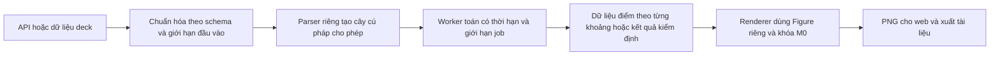

**Kế hoạch thực hiện M1 — Khôi phục toán và render an toàn**

> **Cập nhật 04/11/2026: CHƯA ĐỦ ĐIỀU KIỆN BÀN GIAO.** Các phần triển khai và kiểm thử cục bộ không đồng nghĩa đóng mốc M1–M4. Xem [review sau triển khai và điều kiện đóng mốc](remediation-acceptance-2026-11-03.md) cùng [báo cáo thực hiện](../../reports/remediation-implementation-2026-11-03.md). Những trạng thái bên dưới mô tả thời điểm lập kế hoạch nếu chưa có ghi chú cập nhật.

Ngày soạn: 02/11/2026. Cập nhật kế hoạch thực hiện: **03/11/2026**. Trạng thái: **đang triển khai PR01-A; chưa nghiệm thu M1**. Phạm vi gốc: **R01, R02, R12**, tương ứng PR01–PR02 trong [kế hoạch tổng thể](/Users/nguyennhan18/Documents/Lesson-Plan-Generator/docs/plans/project-remediation-post-refactor.md). Theo yêu cầu làm rõ, M1 bổ sung cổng kiểm tra hình khớp yêu cầu/công thức và chống thay hình, kéo một phần R11/R15 từ M3 lên; chưa đóng toàn bộ R11/R15.

M1 giữ bố cục và công nghệ trình bày slide hiện tại. Công việc tập trung khôi phục đồ thị, kiểm định đại số trong phạm vi hỗ trợ và tính đúng đắn của render. Việc xây layout theo block/canvas, sửa chiều sâu toàn bộ học liệu và khôi phục patch Copilot thuộc các mốc sau.

**Bổ sung ngày 03/11/2026:** áp dụng yêu cầu loại bỏ nội dung mẫu trong [kế hoạch tổng thể](project-remediation-post-refactor.md). Trước khi mở renderer, gỡ scene/loại khối/số đo mặc định ở App, OutlineWorkspace, ThreeCanvas, RightToolsDock và UnfoldedNetViewer cùng fallback backend. Không có spec hợp lệ thì hiển thị thiếu dữ kiện/chưa hỗ trợ; không tự dựng cube/chóp hoặc chọn hình gần giống. Các constructor hình học nhận tham số từ đề thật vẫn được giữ và kiểm tra. Gỡ mẫu là thay đổi dữ liệu/trạng thái rỗng trong bố cục hiện có. Fixture test đặt riêng khỏi production.

**Phạm vi bổ sung — Ngăn hình sai yêu cầu hoặc do AI tự bịa**

Một parser an toàn có thể nhận công thức AI chọn sai; một renderer ổn định vẫn có thể vẽ hình trái giả thiết. Do đó, đóng M1 còn cần các đầu ra sau:

1. Tách **yêu cầu gốc** và **đề xuất hình**: có định danh bài/slide, loại đối tượng cần minh họa (hàm gốc/đạo hàm/hình học), công thức/dữ kiện/miền/giả thiết và tham chiếu nguồn. Yêu cầu gốc phải lấy từ dữ liệu người dùng hoặc nguồn đã duyệt theo phiên bản; một trường `source_ref` hay `verified` do AI tự sinh không phải bằng chứng. Trường hợp không đối chiếu được yêu cầu văn xuôi phải ghi chưa kiểm chứng và cần người dùng xác nhận dữ kiện, không coi LLM kiểm tra lại là chứng minh độc lập.
2. Với đồ thị, so sánh đề xuất với biểu thức gốc và phép biến đổi được yêu cầu. Nếu yêu cầu đạo hàm, engine tính đạo hàm từ hàm gốc trong phạm vi hỗ trợ; AI không cung cấp một hàm thay thế tùy ý. Điểm đặc biệt và nhãn lấy từ cùng dữ liệu tính toán. Không có công thức thì báo thiếu dữ kiện, không gán parabol mặc định.
3. Với hình học, chốt tập đầu tiên gồm hình lập phương, chóp đáy vuông có SA vuông góc đáy và chóp đều đáy vuông. Hai loại chóp là hai cấu hình riêng: đỉnh nằm trên A không được dùng thay cho đỉnh trên tâm đáy. Mô hình phải có đỉnh/cạnh/ràng buộc và các số đo được tính từ cùng tọa độ; kiểm tra độ dài, vuông góc, vị trí chân đường cao trước khi dùng. Loại khác giữ chưa hỗ trợ ở cổng này, không chọn hình gần giống.
4. Ràng buộc ảnh với định danh slide, phiên bản dữ liệu và fingerprint scene/spec. Ảnh thiếu căn cứ hoặc khác fingerprint không được dùng làm hình đã xác minh. Không lan ảnh chụp slide hiện tại sang các slide khác hoặc lấy ảnh cấp deck làm minh chứng cho mọi scene. Cùng dữ liệu được kiểm tra phải đi qua web, enrich, PPTX và ZIP.
5. Trạng thái tách riêng: cú pháp hợp lệ, toán đã kiểm tra, khớp yêu cầu, render thành công. Chỉ đưa hình vào luồng đã xác minh khi các kiểm tra cần thiết đều đạt; thiếu căn cứ hoặc có mâu thuẫn thì chặn hình, giữ nội dung và ghi lý do tại slide/bản xuất nháp. Không có một trường `verified` chung thay cho bốn bước này.

Fixture bắt buộc bổ sung: nhầm f với f'; công thức và nhãn khác nhau; thiếu công thức nhưng tự gán `x**2 - 4`; chóp đều bị thay bằng chóp SA vuông góc đáy; tọa độ không khớp độ dài; hai slide khác scene dùng cùng snapshot; nguồn không tồn tại hoặc do AI tự nhận đã duyệt. Cả ca đúng và ca sai phải đi qua luồng thực tế, không chỉ kiểm tra prompt hoặc sự có mặt của trường metadata.

**Tiến độ khởi động 03/11/2026:** đã bổ sung parser tạo cây dữ liệu cùng fixture grammar/an toàn/ngân sách; bỏ công thức và nhãn parabol mặc định ở FunctionPlotter của bài giảng. Parser chưa được nối vào runtime: graph/validator tiếp tục trạng thái tạm ngắt của M0 cho tới khi worker và các cổng liên quan đạt. Đây là bàn giao PR01-A, chưa phải đã giải quyết việc AI chọn sai hình hoặc công thức.

**Lịch thực hiện đề xuất**

Dự toán gốc **12–15 ngày công** cho parser/render, cộng **6–10 ngày công** cho cổng đối chiếu yêu cầu và hình học giới hạn ở trên: tổng **18–25 ngày công**, giả định một người thực hiện lần lượt backend, frontend và kiểm thử. Đây là ước lượng lập kế hoạch, chưa phải cam kết ngày hoàn thành; ngày 1 là ngày bắt đầu triển khai được chọn. Dành thêm **3–5 ngày công dự phòng** nếu miền xác định, quản lý worker đa nền tảng, nguồn dữ kiện hoặc Mathtext cần xử lý bổ sung. Chốt lại dự toán sau khi hoàn thành parser, thử nghiệm worker và hợp đồng nguồn dữ kiện.

| Chặng | Ngày công | Việc thực hiện và đầu ra | Điều kiện chuyển chặng |
| --- | --- | --- | --- |
| 1. Phạm vi và baseline | 1 | Kiểm kê caller; chốt grammar, fixture, budget và hợp đồng lỗi; chạy baseline mới với prefix evidence riêng | Có mẫu đúng/sai/ngoài phạm vi cho từng đường vào; tách rõ kỳ vọng tạm ngắt M0 |
| 2. Parser giới hạn — PR01-A | 2–3 | `math_expression.py`, adapter LaTeX, cây dữ liệu và lỗi có kiểu; test ưu tiên toán tử, miền gốc, marker và ngưỡng tài nguyên | Fixture đạt; chưa bật lại graph/validator chỉ bằng việc bỏ guard |
| 3. Worker và tích hợp — PR01-B | 4–5 | `math_worker.py`; lifespan trong `lessonai/main.py`; API graph, validator, enrich và exporter cùng dùng đường xử lý mới | Timeout dừng tiến trình thật; job sau còn chạy; đồ thị hợp lệ và kiểm định trong phạm vi có kết quả thật |
| 4. Vòng đời render — PR02-A | 2 | Figure/buffer có ownership; cache có giới hạn và fingerprint; trạng thái lỗi/nháp thống nhất | Graph/công thức chạy xen kẽ, cleanup và lỗi save không nhầm ảnh hoặc rò tài nguyên |
| 4b. Đối chiếu yêu cầu và hình học — phần bổ sung M1 | 6–10 | Hợp đồng yêu cầu/nguồn; đối chiếu graph; engine/ràng buộc các scene hỗ trợ; snapshot theo slide/spec; test cố ý sai | Không tự chứng nhận nguồn do AI sinh; hình sai hoặc thiếu căn cứ bị chặn, hình đúng có bằng chứng kiểm tra và xuất đúng |
| 5. Frontend dùng API — PR02-B | 2 | FunctionPlotter nhận đầy đủ spec; trạng thái tải/lỗi, hủy request, chống phản hồi cũ; cập nhật caller | Hàm hỗ trợ hiển thị đúng; A→B đảo phản hồi vẫn giữ B; giải phóng object URL |
| 6. Nghiệm thu M1 | 1–2 | Audit profile M1, CI, test trình duyệt qua backend thật, log và báo cáo đóng lỗi | Toàn bộ checklist đóng M1 bên dưới đạt, không skip test trọng yếu |

Test và audit được bổ sung trong từng chặng; chặng 6 dùng để chạy nghiệm thu tổng hợp. Runner trình duyệt được thiết lập từ chặng 5 và chạy trong CI ở chặng 6. Hai PR là đơn vị review chính cho phạm vi gốc; chặng 4b tách thành diff/PR kiểm tra nguồn, hình học và snapshot để review độc lập. Đường phụ thuộc thực hiện: **fixture → parser → worker/tích hợp → render/cache → cổng khớp yêu cầu/hình học → frontend → nghiệm thu**.

**Cách bắt đầu và hồ sơ bàn giao**

1. Ghi nhận trạng thái worktree và chạy lại `make test-critical`, `make test`, `make build`; lưu log mới, phân biệt lỗi có sẵn với lỗi do M1. Worktree hiện có nhiều thay đổi tái cấu trúc/M0, nên khoanh diff M1 theo tệp và không reset hoặc gom toàn bộ thay đổi vào cùng một PR.
2. Lập bảng caller cho graph, capability, validator, enrich và mọi định dạng xuất; mỗi caller phải có test hợp lệ cùng test từ chối hoặc trạng thái ngoài phạm vi. Chốt schema cây, kết quả worker và lỗi API trước khi nối caller.
3. Thực hiện từng chặng theo bảng; chỉ chuyển khả năng từ tạm ngắt sang hoạt động khi test tương ứng đạt. Khi lỗi, giữ dữ liệu và trả trạng thái nháp/chưa kiểm chứng.
4. Bàn giao `reports/remediation-m1-<ngày-nghiệm-thu>.md` cùng evidence/log dùng prefix mới cho từng lượt chạy; ghi revision hoặc trạng thái diff nếu chưa commit, budget thực tế, môi trường, phạm vi đã bật và phần còn chưa hỗ trợ. Cập nhật README và bảng R01/R02/R12 theo kết quả đã đo.

Rủi ro ảnh hưởng lịch lớn nhất là giữ đúng miền xác định sau biến đổi, dừng/thu hồi worker trên nền tảng hỗ trợ và tránh cache/response cũ. Giảm rủi ro bằng fixture miền ngay từ chặng 1, thử timeout/startup/shutdown trước khi nối mọi caller và kiểm tra fingerprint/race khi triển khai frontend. Không giảm các tiêu chí an toàn để bù tiến độ; nếu một nhóm biểu thức chưa đạt, giữ trạng thái chưa hỗ trợ và ghi rõ tác động tới điều kiện đóng M1.

**Điểm xuất phát thực tế**

Theo [báo cáo M0](/Users/nguyennhan18/Documents/Lesson-Plan-Generator/reports/remediation-m0-2026-11-02.md), M0 đã có:

- Parser biểu thức bị ngắt; API graph biểu thức trả 503, validator trả `algebra_unverified`.
- FunctionPlotter chỉ hiển thị biểu thức và thông báo tạm ngắt, không thực thi chuỗi.
- `core.render_runtime` đã có `RLock` và decorator tuần tự hóa; renderer dùng `fig.savefig`; cleanup không còn đóng mọi figure.
- Enrich loại ảnh cũ; PPTX có đồ thị chưa render được được ghi nhãn bản nháp; lỗi xuất không đổi bài.
- Audit CLI, `test-critical` và CI đã có. Báo cáo M0 ghi nhận backend 301 đạt/1 bỏ qua, frontend 28 đạt; đây là số liệu của M0, chưa phải kết quả chạy M1.

M1 kế thừa các phần này. Không thêm một cơ chế bật lại parser cũ. Chức năng chỉ được mở theo khả năng đã có implementation và test; không coi việc trả 503 cho mọi biểu thức là M1 hoàn thành.

**Kết quả nghiệm thu M1**

| Nhóm | Kết quả phải nhìn thấy |
| --- | --- |
| R01 | Biểu thức được hỗ trợ đi qua parser giới hạn; input nguy hiểm bị từ chối trước tác dụng phụ ở mọi đường vào |
| R02 | Đồ thị hợp lệ hiển thị trở lại qua backend; lỗi không sinh đường giả hoặc dùng ảnh của biểu thức cũ |
| R12 | Job graph/công thức sở hữu đúng figure, buffer và cache; đồng thời hoặc cleanup không làm nhầm nội dung |
| Kiểm định | Các đẳng thức thuộc phạm vi hỗ trợ có kết quả kiểm tra thực; phần ngoài phạm vi vẫn là chưa kiểm chứng |
| Đúng yêu cầu | Hình có căn cứ độc lập với đề xuất AI; đúng loại đối tượng/công thức/giả thiết; thiếu căn cứ bị chặn |
| Hình học và ảnh | Scene hỗ trợ thỏa ràng buộc; snapshot đúng slide và phiên bản, không dùng hình mẫu hoặc ảnh của bài khác |
| Hồi quy M0 | Không đổi bài khi xuất lỗi, không khôi phục patch mẫu, không mất nội dung bản nháp |

**Quyết định kiến trúc**

- Module parser mới `lessonai.services.math_expression` chỉ tokenize, kiểm tra và tạo cây dữ liệu. Không import router/exporter, không gọi LLM và không đánh giá mã nguồn.
- Module worker mới `lessonai.services.math_worker` dựng biểu thức bằng constructor cho phép và thực hiện các phép toán nặng. `simplify/expand/factor/solve` còn được sử dụng phải nằm trong giới hạn job, kể cả khi chuỗi đã parse an toàn.
- `core.render_runtime` hiện có tiếp tục là nơi quản lý khóa và vòng đời Matplotlib. `services.rendering` tiếp tục điều phối enrich, không trở thành module thấp tầng để exporter import ngược lại.
- Backend là nơi duy nhất diễn giải biểu thức để vẽ. Frontend hiển thị ảnh và trạng thái của chính cấu hình đang chọn.
- Kết quả parse hợp lệ, vẽ được và chứng minh đúng toán là ba việc riêng. Không suy ra biểu thức hoặc lời giải đúng chỉ vì tạo được PNG.

**Bước 1 — Chốt phạm vi và fixture trước khi bật lại chức năng**

Đầu ra: fixture có input, ngữ cảnh, kết quả mong muốn hoặc lý do từ chối; danh sách tất cả caller của parser và renderer.

| Năng lực | Phạm vi M1 |
| --- | --- |
| Cú pháp biểu thức | Số hữu hạn, ngoặc, dấu một ngôi, `+ - * / ^ **`, phép nhân ngầm có quy tắc rõ |
| Hàm/hằng | `sin`, `cos`, `tan`, `log`, `exp`, `sqrt`, `Abs`, `pi`, `E`; alias `ln→log`, `abs→Abs` |
| Biến | Graph hàm số chỉ `x`; validator dùng tập ký hiệu được khai báo theo ngữ cảnh, không tự tạo tên tùy ý |
| LaTeX | Phân số, căn bậc hai, lũy thừa, ký hiệu/nhân ngầm đã có fixture; lệnh ngoài phạm vi báo chưa hỗ trợ |
| Đồ thị hàm | Đa thức, phân thức và các hàm cơ bản trong miền xác định được xử lý trong ngân sách |
| Đường biên bất phương trình | Biểu thức tường minh theo x của đường thẳng; polygon đầu vào được kiểm tra tọa độ và số đỉnh. M1 vẽ dữ liệu được cung cấp, không coi polygon đó là miền nghiệm đã được chứng minh |
| Dãy số cấp số cộng | Chỉ dạng tuyến tính theo chỉ số n trên tập chỉ số nguyên hữu hạn; vẽ điểm rời rạc. Alias biến x cũ chỉ chuyển theo loại biểu đồ này |
| Biểu đồ dữ liệu | Giữ biểu đồ cột/tròn hiện có với dữ liệu và tài nguyên được giới hạn |
| Kiểm định đại số | Đẳng thức số học, đồng nhất thức đa thức bậc thấp; phân thức chỉ kết luận khi điều kiện miền đã được giữ và so sánh |
| Phần chưa khôi phục | Kiểm định tổng quát tích phân/giới hạn, suy luận từ văn xuôi, chứng minh hình học, giải/tương đương phương trình ngoài phạm vi xác định. Vẫn trả chưa kiểm chứng |

Khóa nghĩa bằng fixture: `-x^2 = -(x^2)`, `(-x)^2`, `2^3^2 = 2^(3^2)`, `2x`, `2sin(x)`, `4ac` khi a/c được khai báo, `x_1` khi được khai báo. Không suy đoán tên đa ký tự mơ hồ. Hai toán hạng cạnh nhau được phép nhân ngầm chỉ theo quy tắc token, không sửa chuỗi tùy tiện.

Các case miền bắt buộc: `1/x`, `log(x)`, `sqrt(x)`, `tan(x)`, `(x^2-1)/(x-1)`. Phải giữ điểm x=1 bị loại của biểu thức cuối dù rút gọn được thành x+1. `sqrt(x^2)=x` không được chứng nhận trên toàn R. Không tự xóa điều kiện sau `\quad` để biến một mệnh đề có điều kiện thành mệnh đề vô điều kiện.

Điều kiện xong bước 1: có fixture cho cú pháp đúng, cú pháp mơ hồ, input nguy hiểm, miền xác định, dữ liệu ngoài phạm vi và từng loại graph hiện có; không cần khóa API nhà cung cấp.

**Bước 2 — Parser an toàn và giới hạn tài nguyên — PR01**

1. Viết tokenizer và parser với danh sách token/node cho phép. Dùng grammar rõ ràng hoặc parser Pratt; không dùng `sympify/parse_expr/eval/exec/compile` để nhận chuỗi người dùng. Kiểm tra đầy đủ cây trước khi dựng đối tượng toán.
2. Từ chối import, attribute, indexing, chuỗi, tuple/list/dict đầu vào biểu thức, lambda/comprehension, gán, gọi hàm lạ và ký hiệu không khai báo. Kiểm tra `free_symbols` sau parse không thay thế bước này.
3. Tạo adapter LaTeX giới hạn; xử lý ngoặc lồng bằng cấu trúc, không dùng thay thế regex có thể làm mất điều kiện hoặc thay đổi nghĩa. Lỗi chuyển đổi trả lý do theo vị trí.
4. Worker chỉ nhận cây dữ liệu/operation đã kiểm tra; không nhận hàm Python hoặc mã cần thực thi. Dựng số/ký hiệu/phép toán/hàm bằng constructor cho phép; nếu còn `lambdify`, chỉ dùng cây đã kiểm tra, ký hiệu an toàn và module số học cố định.
5. Mọi thao tác symbolic có thể tốn tài nguyên chạy trong tiến trình có thể kết thúc. Dùng cơ chế spawn với entry point import được; không fork từ tiến trình đang có thread/render. Hết thời hạn phải dừng và thu hồi worker, không chỉ hủy chờ Future.
6. Giới hạn số job đang chạy và chờ; tránh tạo không giới hạn process cho mỗi request. Job timeout/crash không làm hỏng các request tiếp theo; shutdown thu hồi worker. Quản lý runtime theo lifespan FastAPI và context của CLI; không tạo worker lúc import module. Kiểm tra cả startup/shutdown lặp lại, reload và subprocess của test. Worker toán không giữ khóa render trong lúc tính.

Ngân sách khởi điểm dưới đây là cấu hình đề xuất cho PR01, cần đo trên fixture và commit cùng test biên trước nghiệm thu:

| Tài nguyên | Mức khởi điểm |
| --- | --- |
| Biểu thức | 2.048 ký tự; 512 token; 256 node; độ sâu 32 |
| Số | Tối đa 32 chữ số cho literal; từ chối NaN/Infinity; kiểm tra giới hạn trước khi tính hằng/lũy thừa lớn |
| Lũy thừa | Mũ số nguyên hằng có trị tuyệt đối ≤100; mũ khác cần thuộc nhóm xử lý được trong worker. Lũy thừa hằng lồng nhau còn phải qua kiểm tra độ lớn kết quả dự kiến |
| Kiểm định đa thức | Tối đa 3 ký hiệu, bậc tổng ≤8; trường hợp khác trả chưa kiểm chứng |
| Job symbolic | Deadline tổng mặc định 5 giây/job, gồm khởi động và tính; timeout phải giải phóng job |
| Đồng thời | Tối đa 2 job toán/process API; tối đa 8 job chờ; chờ nhận chỗ tối đa 1 giây |
| Lấy mẫu graph | Tối đa 2.000 điểm/job; số đoạn và bước chia thích nghi có giới hạn |
| Ảnh graph | Tối đa 3 triệu pixel/ảnh; không nhận DPI/kích thước tùy ý không giới hạn từ client |

Phải giới hạn bộ nhớ worker ở môi trường triển khai hỗ trợ và giới hạn tổng worker theo số process API. Nếu một nền tảng chưa có giới hạn bộ nhớ cứng, ghi rõ giới hạn đó; không quảng bá timeout/độ sâu là bảo vệ bộ nhớ đầy đủ. Khi điều chỉnh ngân sách, chạy lại test quá ngưỡng và workload hợp lệ; không nới vô hạn để làm fixture đạt.

Điều kiện xong bước 2: toàn bộ fixture parser đạt; marker vô hại không được đặt; quá giới hạn không treo tiến trình API; worker kết thúc đúng deadline và job kế tiếp vẫn thành công.

**Bước 3 — Nối vào mọi đường vào, khôi phục kiểm định có giới hạn — PR01**

Tệp thực hiện: [graph_generator.py](/Users/nguyennhan18/Documents/Lesson-Plan-Generator/app/backend/src/lessonai/exporters/graph_generator.py), [validation.py](/Users/nguyennhan18/Documents/Lesson-Plan-Generator/app/backend/src/lessonai/services/validation.py), [routes/slides.py](/Users/nguyennhan18/Documents/Lesson-Plan-Generator/app/backend/src/lessonai/api/routes/slides.py), [rendering.py](/Users/nguyennhan18/Documents/Lesson-Plan-Generator/app/backend/src/lessonai/services/rendering.py), [slide_exporter.py](/Users/nguyennhan18/Documents/Lesson-Plan-Generator/app/backend/src/lessonai/exporters/slide_exporter.py), [docx_exporter.py](/Users/nguyennhan18/Documents/Lesson-Plan-Generator/app/backend/src/lessonai/exporters/docx_exporter.py), [dual_package_exporter.py](/Users/nguyennhan18/Documents/Lesson-Plan-Generator/app/backend/src/lessonai/exporters/dual_package_exporter.py).

- Thay guard tạm ngắt bằng khả năng parser thực tế ở `safe_eval_expression`, `is_plottable`, graph hàm, đường biên, sequence và các đường enrich/export. Không giữ một parser nguy hiểm riêng trong capability check.
- Tạo kết quả phân tích có kiểu để parse một lần/job. `is_plottable` giữ adapter bool nếu caller còn cần; nội bộ giữ cả lý do unsupported/error, không dùng `False` làm lý do bỏ mất đồ thị.
- Adapter dữ liệu cũ `kind/plot_type`, `expression/formula`, `x_min/x_max/x_range` chuẩn hóa tại biên; xung đột phải báo rõ. Kiểm tra finite, thứ tự miền, số điểm, nhãn và dữ liệu bar/pie trước khi vẽ.
- Worker trả từng đoạn graph theo miền, giữ các điểm loại trừ từ cây gốc. Không nối đường qua tiệm cận/điểm không xác định. Dùng chia khoảng và lấy mẫu có giới hạn; nếu không xác định được miền đáng tin cậy trong ngân sách, trả chưa hỗ trợ, không đoán đường liên tục.
- Refactor caller kiểm định để nhận kết quả worker: `verified/failed/unverified` kèm phạm vi và lý do. Mọi đường `expand/simplify/factor/solve` cũ phải được chuyển vào job hoặc tiếp tục ngắt; không bật lại đồng loạt chỉ vì parser đã an toàn.
- Các công thức định nghĩa hàm/phương trình cần giải không được tự coi là đồng nhất thức sai. Một biểu thức parse được chưa phải một mệnh đề đã được kiểm tra.
- Thu thập cả `worked_solution_steps`, bên cạnh trường công thức/bullet/quiz hiện có. `1+1=3` ở riêng lời giải phải báo lỗi; phần lời giải không nằm trong engine vẫn báo chưa kiểm chứng. Đây là bảo toàn mức thận trọng M0, chưa thay thế validator sư phạm đầy đủ ở M3.
- Hàm nội bộ cũ như `latex_to_sympy_expr` được đổi adapter hoặc loại bỏ cùng toàn bộ caller/test/probe. Không giữ đường xử lý nặng trong request chỉ để tránh thay import của test.
- Tách lỗi render/enrich khỏi lỗi sinh nội dung: graph không render được không được làm router sinh lại một deck khác. Giữ deck hiện hành và báo lỗi đúng slide. Khi xuất, giữ nhãn nháp/lý do cho phần chưa render được theo M0; chỉ bỏ nhãn tạm ngắt cho graph thực sự đã tạo thành công.

Điều kiện xong PR01: test an toàn đi qua API render, capability, validator, đường biên, enrich, generate được inject gateway, PPTX, Word và ZIP; graph hợp lệ tạo kết quả thật. Các loại/biểu thức không hỗ trợ bị từ chối rõ và dữ liệu gốc không đổi. PR01 có thể hoàn tất trước khi frontend được bật ở PR02.

**Hợp đồng API dùng trong M1**

Giữ URL POST `/api/v1/chart/render` và PNG khi thành công. Bổ sung request schema giới hạn cho endpoint, dùng lại/adapter `ChartSpec` để tránh hai cách diễn giải; hỗ trợ alias đã kiểm kê. Schema phản hồi lỗi được khai báo và cập nhật fixture OpenAPI có chủ đích, không bỏ test so sánh hợp đồng.

| Tình huống | HTTP/kết quả |
| --- | --- |
| Chart hợp lệ | 200, `image/png`, ảnh thuộc đúng request; có fingerprint cấu hình chuẩn hóa để đối chiếu cache |
| Cú pháp hoặc node/tên không được phép | 422, `expression_invalid` hoặc `expression_forbidden` |
| Ngoài nhóm hỗ trợ/miền không thể xử lý | 422, `expression_unsupported` hoặc `expression_domain_invalid` |
| Vượt giới hạn cấu trúc/độ lớn tính toán | 422, `expression_budget_exceeded` |
| Hết thời hạn hoặc hàng đợi đầy | 503, `math_job_timeout` hoặc `math_worker_busy` |
| Lỗi renderer nội bộ | 500, `chart_render_failed` |

Lỗi có dạng `detail: {code, message}` tương thích cách frontend đọc lỗi hiện tại; có vị trí trường nếu xác định được. 503 tạm ngắt của M0 chỉ còn dùng cho khả năng thực sự chưa bật, không là kết quả mặc định cho graph hợp lệ. Validator báo `unverified` khi unsupported/timeout; không đổi trạng thái đó thành verified hoặc coi là mệnh đề sai.

**Bước 4 — Hoàn thiện vòng đời render — PR02 phần backend**

Tệp thực hiện: [render_runtime.py](/Users/nguyennhan18/Documents/Lesson-Plan-Generator/app/backend/src/lessonai/core/render_runtime.py), [graph_generator.py](/Users/nguyennhan18/Documents/Lesson-Plan-Generator/app/backend/src/lessonai/exporters/graph_generator.py), [slide_exporter.py](/Users/nguyennhan18/Documents/Lesson-Plan-Generator/app/backend/src/lessonai/exporters/slide_exporter.py), [temp_file_cleaner.py](/Users/nguyennhan18/Documents/Lesson-Plan-Generator/app/backend/src/lessonai/utils/temp_file_cleaner.py).

- Dùng lại khóa M0 cho mọi graph/công thức; giữ khóa từ tạo figure/style/font tới lưu/đóng. Không khóa việc chờ worker toán, gọi LLM hoặc chuẩn bị Word/PPTX không dùng Matplotlib.
- Chuyển các nhánh render sang ownership figure/buffer rõ, đóng trong `finally`, kể cả fallback công thức. Bỏ phụ thuộc figure hiện hành; không đưa `plt.savefig`/`close('all')` trở lại.
- Tách một kết quả render thành công khỏi PNG 1×1/Unicode fallback. Trường hợp công thức không render được phải có trạng thái/lý do; không trả ảnh rỗng rồi đánh dấu như render toán thành công.
- Giới hạn độ dài/độ sâu LaTeX, nhãn và số pixel; không bật external TeX từ cấu hình đầu vào. Font/style cấu hình ở một nơi. Nếu thử nghiệm cho thấy một loại Mathtext vẫn có thể chạy quá ngân sách, đưa loại render đó vào worker có thể dừng trước khi bật lại.
- Cache khóa theo biểu thức/cây chuẩn hóa, miền, kích thước và phiên bản renderer; cache lỗi/timeout không được ghi đè kết quả của nội dung khác. Dùng cache có giới hạn dung lượng, không tích lũy ảnh vô hạn.
- Enrich phải xóa cache cũ khi spec đổi, giữ `chart_spec` và nội dung; chỉ gắn `has_chart=true` sau khi có ảnh hợp lệ của spec hiện hành. Công thức chính thay đổi cũng vô hiệu hóa ảnh công thức cũ.

Nghiệm thu backend PR02: job graph và công thức chạy xen kẽ vẫn giữ đúng nội dung; cleanup giữa job không đóng figure khác; lỗi tại tạo/lưu/fallback không rò figure/buffer; sau đợt chạy giới hạn tài nguyên đang giữ quay về mức ban đầu. Barrier khởi động các job đặt ngoài vùng khóa để test không tự gây deadlock. So sánh các đường vẽ/data thực với tham chiếu, không chỉ số bytes ảnh.

**Bước 5 — Khôi phục FunctionPlotter qua API — PR02 phần frontend**

Tệp thực hiện: [FunctionPlotter.jsx](/Users/nguyennhan18/Documents/Lesson-Plan-Generator/app/frontend/src/shared/math/FunctionPlotter.jsx), [client.js](/Users/nguyennhan18/Documents/Lesson-Plan-Generator/app/frontend/src/shared/api/client.js), [PresentationStage.jsx](/Users/nguyennhan18/Documents/Lesson-Plan-Generator/app/frontend/src/features/presentation/PresentationStage.jsx), [RightToolsDock.jsx](/Users/nguyennhan18/Documents/Lesson-Plan-Generator/app/frontend/src/features/geometry/RightToolsDock.jsx).

- Giữ vùng đặt component và bố cục slide; nhận chart spec đầy đủ, gồm expression, loại và miền. Caller không chỉ truyền expression rồi tự dùng miền mặc định khác PPTX.
- Trạng thái `idle/loading/rendered/error/unsupported`; giữ nội dung người dùng đang nhập. Tên biểu đồ phản ánh hàm thực tế, không mặc định mọi hàm là parabol.
- Bổ sung `signal` tùy chọn vào HTTP client hiện có, bảo toàn các caller cũ; gửi request có debounce khi chỉnh biểu thức.
- Kết hợp AbortController với sequence/request ID. Kể cả request không hủy được ở server, phản hồi cũ cũng không được cập nhật component. Unmount phải hủy chờ và giải phóng object URL.
- Kiểm tra `.ok` và content type trước khi đọc blob; đọc JSON lỗi có code. Khi biểu thức B lỗi sau biểu thức A thành công, UI không trình ảnh A như ảnh của B.
- Dùng fingerprint spec để nhận biết ảnh enrich còn phù hợp. Không chỉ ưu tiên `chart_image_base64` vì nó tồn tại. Dữ liệu cũ thiếu fingerprint phải render lại/xác nhận trước khi tái sử dụng.
- Không khôi phục `new Function/eval` hoặc phần suy luận parabol bằng regex. Thông tin đỉnh/nghiệm chưa có endpoint phân tích được kiểm tra thì tiếp tục không hiển thị.

Nghiệm thu frontend: `log(x)/exp(x)/Abs(x)` hiển thị ảnh backend trên miền hợp lệ; input nguy hiểm không thực thi; đồ thị lỗi không có đường giả; đổi A→B nhanh và trả kết quả đảo thứ tự vẫn giữ B; unmount không cập nhật state/rò URL. Có test trình duyệt với backend thật, provider không cần tham gia, ngoài bộ Node test hiện có.

**Bước 6 — Cập nhật audit/CI và đóng M1**

Tệp thực hiện: [backend critical tests](/Users/nguyennhan18/Documents/Lesson-Plan-Generator/app/backend/tests/test_critical_regressions.py), [frontend critical tests](/Users/nguyennhan18/Documents/Lesson-Plan-Generator/app/frontend/tests/critical-regressions.test.js), [probe Python](/Users/nguyennhan18/Documents/Lesson-Plan-Generator/scripts/quality/project-review-probes.py), [probe frontend](/Users/nguyennhan18/Documents/Lesson-Plan-Generator/scripts/quality/project-review-frontend-probes.mjs), [Makefile](/Users/nguyennhan18/Documents/Lesson-Plan-Generator/Makefile), [CI](/Users/nguyennhan18/Documents/Lesson-Plan-Generator/.github/workflows/ci.yml).

- Tách bất biến an toàn khỏi kỳ vọng tạm ngắt. Test M0 đang yêu cầu 503 hoặc không có ảnh phải được thay bằng hai ca: đầu vào độc hại bị từ chối và đầu vào hợp lệ có kết quả thật. Không xóa marker test và không dùng skip để bật tính năng.
- Thêm profile nghiệm thu M1, giữ bằng chứng M0 lịch sử. Có thể mở rộng CLI bằng `--stage m0|m1` với mặc định/make target được ghi rõ; CI dùng profile M1 khi M1 hoàn tất. M0 có thể không còn đạt kỳ vọng tạm ngắt trên mã M1, không chạy lẫn hai kỳ vọng trái nhau.
- Profile M1 vẫn giữ kiểm tra M0 ngoài phạm vi: không fallback đổi bài, không patch mẫu, giữ bản nháp khi lỗi; cập nhật các test/probe sử dụng adapter parser đã thay đổi.
- Lưu evidence mới ghi stage, revision mã, cấu hình budget, nền tảng, số test/skip và giới hạn tính năng. Không ghi đè JSON baseline/M0 hoặc xem một file evidence cũ là kết quả chạy mới.
- Mở khả năng lần lượt: parser/worker → graph và validator hỗ trợ → API/enrich/export → frontend. Khi hồi quy, quay về trạng thái tạm ngắt theo capability và giữ nội dung; không quay về cơ chế đánh giá chuỗi cũ.

**Ma trận test bắt buộc**

| Nhóm | Ca kiểm tra tối thiểu | Kết quả mong muốn |
| --- | --- | --- |
| An toàn R01 | Marker ở capability, graph, đường biên, validator, enrich, generate, PPTX/Word/ZIP | Không tác dụng phụ; lỗi/trạng thái rõ; không thay nội dung |
| Grammar | Dấu một ngôi, lũy thừa kết hợp phải, nhân ngầm, alias, ngoặc/LaTeX lồng | Đúng nghĩa fixture, không suy diễn tên mơ hồ |
| Ngân sách | Source dài/sâu, số/mũ lớn, timeout có kiểm soát, hàng đợi đầy | Từ chối/dừng trong giới hạn; không worker mồ côi; request sau thành công |
| Miền graph | `1/x`, `log(x)`, `sqrt(x)`, `tan(x)`, điểm khuyết phân thức | Không nối qua chỗ gián đoạn hoặc vẽ phần ngoài miền |
| Loại graph | Hàm, đường biên, sequence, bar/pie và alias cũ | Đúng dữ liệu/loại; sequence không thành đường liên tục |
| Kiểm định | `1+1=3` trong lời giải; khai triển đúng/sai; đẳng thức có điều kiện; tích phân ngoài phạm vi | Phân biệt verified/failed/unverified; không báo sạch do bỏ qua trường |
| Đồng thời R12 | Hai graph khác nhau và công thức cùng chạy; cleanup/lỗi save giữa job | Mỗi ảnh đúng nội dung; tài nguyên không bị đóng nhầm/rò |
| Frontend R02 | Input marker, HTTP lỗi/200 JSON, A→B đảo phản hồi, unmount | Không thực thi chuỗi, không ảnh cũ dưới biểu thức mới, không rò object URL |
| Tích hợp | Cùng spec qua API/enrich/PPTX/ZIP; lỗi renderer | Cùng biểu thức/miền/dữ liệu, đúng ảnh; lỗi giữ nháp và không đổi bài |

Đầu vào kiểm thử giới hạn dùng fixture nhỏ và ngưỡng thấp được inject; không gây cạn CPU/RAM trên máy đang chạy. Deadline cứng kiểm tra bằng worker có tác vụ trễ có kiểm soát, không cần tạo một biểu thức phá tài nguyên thật.

**Thứ tự giao việc và điểm dừng**

| Lượt | Phần bàn giao | Qua lượt khi |
| --- | --- | --- |
| PR01-A | Fixture/grammar/budget/parser | Hợp lệ đúng nghĩa, nguy hiểm bị từ chối, không bật lại chức năng |
| PR01-B | Worker và integration mọi đường vào | Timeout dừng thật; graph/validator hỗ trợ hoạt động; fallback và bản nháp giữ đúng |
| PR02-A | Ownership renderer/cache và test đồng thời | Graph/công thức/cleanup không lẫn hoặc rò tài nguyên |
| PR02-B | FunctionPlotter API, caller, test race/lỗi | Đồ thị đúng spec hiện hành và không thực thi chuỗi |
| Nghiệm thu M1 | Profile audit M1, CI, browser và báo cáo | Tất cả điều kiện đóng dưới đây có bằng chứng |

Các lượt A/B là cách chia diff trong PR01/PR02; có thể tách thành PR nhỏ nếu cần. Mỗi lượt cập nhật test cùng mã thay đổi; không đợi tới cuối mới kiểm tra bảo mật.

**Điều kiện đóng M1**

- [ ] Loại bỏ hình mẫu: storage sạch, thiếu scene/biểu thức, lỗi API và loại hình không hỗ trợ không tự dựng hình hoặc điền số đo; dữ liệu hợp lệ vẫn dựng đúng. UI và bản xuất cùng đạt, không kế thừa ảnh slide khác. Test dùng fixture riêng, không khôi phục seed/demo trong sản phẩm.
- [ ] R01: toàn bộ đường vào dùng parser chung; marker/nhánh lách bị từ chối; kiểm soát độ lớn, thời gian, số job và vòng đời worker có test.
- [ ] R02: browser chỉ hiển thị kết quả backend; hàm hợp lệ được khôi phục; lỗi/race/cache không sinh biểu đồ sai.
- [ ] R12: graph và công thức dùng khóa/vòng đời thống nhất; test đồng thời, cleanup và lỗi giữa job đạt.
- [ ] Cổng đúng yêu cầu: có dữ kiện/nguồn gốc được đối chiếu; nhầm hàm với đạo hàm, nhãn hoặc loại hình bị chặn; thiếu dữ kiện không tự thêm hình mẫu. Metadata AI tự sinh không được coi là đã kiểm chứng.
- [ ] Hình học giới hạn và snapshot: các scene hỗ trợ vượt kiểm tra ràng buộc; phân biệt chóp đều với chóp SA vuông góc đáy; ảnh đúng slide/spec/phiên bản trên web và bản xuất. Phần R11/R15 còn lại vẫn mở ở M3.
- [ ] Kiểm định có hoạt động thật trong phạm vi công bố; worked steps không quay lại báo sạch vì bị bỏ qua; phần chưa hỗ trợ vẫn ghi unverified.
- [ ] API/enrich/export đồng bộ spec và trạng thái; không mất dữ liệu, không trả bài khác; ảnh rỗng không được tính là render thành công.
- [ ] `make test-critical`, `make test`, `make build`, audit profile M1 và test trình duyệt đều đạt; không có test M1 trọng yếu bị skip/xfail. Test provider thiếu khóa được báo riêng và không dùng làm bằng chứng M1.
- [ ] Có báo cáo M1 kèm log/evidence mới, phạm vi được bật, giới hạn còn lại và cập nhật trạng thái R01/R02/R12. M1 không được ghi là toàn bộ hệ thống đã đủ chất lượng giảng dạy.

Lệnh hiện có sẽ được chạy lại khi triển khai: `make test-critical`, `make test`, `make build`. Target audit M1 và runner trình duyệt phải được bổ sung/cập nhật trong PR tương ứng trước khi đưa vào checklist nghiệm thu; tài liệu này không coi chúng là lệnh đã tồn tại hay đã chạy.
