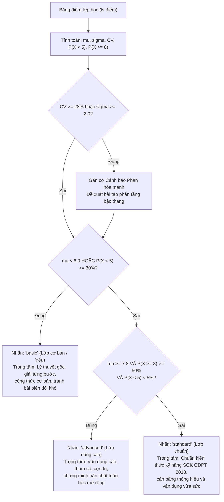

# 📊 BÁO CÁO TIẾN ĐỘ VÀ NGHIỆM THU CHI TIẾT NGÀY 4
## MODULE PHÂN LOẠI HỌC LỰC LỚP TỪ BẢNG ĐIỂM (STATISTICAL GRADE CLASSIFIER & PEDAGOGICAL PROFILING)

**Ngày thực hiện:** 13/10/2026  
**Dự án:** Lesson Plan Generator & Interactive Slide Studio (Chương trình GDPT 2018)  
**Trạng thái nghiệm thu (DoD):** 🎯 **ĐẠT 100% (23/23 Unit Tests PASSED trong 0.06s)**  

---

## 📋 I. TỔNG QUAN VỀ QUY TRÌNH VÀ NGHIỆM THU TASK NGÀY 4

Trong Ngày 4 của Kế hoạch 21 ngày, chúng ta đã xây dựng hoàn chỉnh phân hệ **Phân tích Bảng điểm & Hồ sơ Học lực Lớp học** (`project/app/services/grade_classifier.py`) và tích hợp vào hệ thống API FastAPI (`project/app/main.py`), phục vụ trực tiếp làm tham số đầu vào cho động cơ sinh bài giảng và slide phân hóa học lực đã xây dựng ở Ngày 2:

| Mã Task | Nội dung công việc | File thực hiện | Trạng thái |
| :--- | :--- | :--- | :---: |
| **Task 4.1** | Xây dựng bộ trích xuất dữ liệu bảng điểm từ Excel (`.xlsx`, `.xlsm`) và CSV (`.csv`): tự động nhận diện header (`TBM`, `ĐTB`, `Điểm tổng kết`...), loại trừ cột STT/Mã học sinh, chuẩn hóa số thập phân kiểu Việt Nam (`7,5` $\rightarrow$ `7.5`). | `project/app/services/grade_classifier.py` | ✅ **100%** |
| **Task 4.2** | Triển khai thuật toán xác suất thống kê mô tả thuần túy: Kỳ vọng mẫu ($\mu$), Phương sai ($\sigma^2$), Độ lệch chuẩn ($\sigma$), Hệ số biến thiên ($CV$), Phân vị nội suy tuyến tính ($Q_1, \text{Median}, Q_3$), Tần suất thực nghiệm $P(X < 5.0)$ và $P(X \ge 8.0)$. | `project/app/services/grade_classifier.py` | ✅ **100%** |
| **Task 4.3** | Xây dựng Cây quyết định Sư phạm (Pedagogical Decision Tree): phân loại lớp (`basic`, `standard`, `advanced`), cảnh báo lớp phân hóa mạnh ($CV \ge 28\%$), tính $Z$-score và $T$-score chuẩn hóa cho từng học sinh cá nhân. | `project/app/services/grade_classifier.py` | ✅ **100%** |
| **Task 4.4** | Tích hợp Router API `POST /api/v1/ingest/classify-grades` trên `project/app/main.py`: tiếp nhận file tải lên (`UploadFile`), xác thực định dạng, gọi engine phân tích và trả về JSON chuẩn hóa. | `project/app/main.py` | ✅ **100%** |
| **Task 4.5** | Viết bộ kiểm thử tự động 23 Test Cases bao phủ toàn diện từ hàm đơn vị, xử lý file in-memory đến gọi API qua `TestClient(app)`; đóng gói báo cáo kỹ thuật. | `project/test/test_day4_classifier.py` | ✅ **100%** |

---

## 📐 II. CƠ SỞ TOÁN HỌC & THỐNG KÊ ỨNG DỤNG TRONG PHÂN TÍCH BẢNG ĐIỂM

Đây là nền tảng lý thuyết sư phạm định lượng cốt lõi giúp hệ thống của chúng ta vượt trội so với các công cụ tạo giáo án thông thường (chỉ hỏi người dùng tự chọn mức độ bằng cảm tính).

### 1. Kỳ vọng Mẫu (Sample Mean - Điểm Trung Bình Lớp)
Điểm trung bình $\mu$ đại diện cho mức độ học lực bình quân của tập thể lớp gồm đoàn kết $N$ học sinh:
$$\mu = \frac{1}{N} \sum_{i=1}^{N} x_i$$
Trong đó $x_i \in [0.0, 10.0]$ là điểm số hợp lệ của học sinh thứ $i$.

### 2. Phương sai Mẫu và Độ lệch chuẩn (Variance & Standard Deviation)
Độ phân tán của năng lực học sinh quanh điểm trung bình được đo bằng phương sai $\sigma^2$ và độ lệch chuẩn $\sigma$:
$$\sigma^2 = \frac{1}{N} \sum_{i=1}^{N} (x_i - \mu)^2$$
$$\sigma = \sqrt{\sigma^2}$$
* $\sigma$ nhỏ ($\sigma < 1.0$): Lớp học có học lực rất đồng đều.
* $\sigma$ lớn ($\sigma \ge 2.0$): Điểm số rải rác từ rất thấp đến rất cao, khoảng cách năng lực giữa các học sinh trong lớp là đáng kể.

### 3. Hệ số Biến thiên (Coefficient of Variation - $CV$)
Trong khảo thí học đường, chỉ nhìn vào $\sigma$ là chưa đủ vì $\sigma$ phụ thuộc vào thang đo điểm. Hệ số biến thiên $CV$ chuẩn hóa độ lệch chuẩn theo kỳ vọng:
$$CV = \frac{\sigma}{\mu} \quad (\text{với } \mu > 0)$$
* **Ý nghĩa sư phạm:** 
  * Nếu $CV < 0.20$ ($< 20\%$): Lớp có mức độ đồng nhất cao, giáo viên có thể giảng dạy với tiến trình đồng bộ cho toàn lớp.
  * Nếu $CV \ge 0.28$ ($\ge 28\%$): **Lớp học phân hóa cực đoan** (xuất hiện cả nhóm học sinh mất gốc và nhóm học sinh năng khiếu). Hệ thống tự động kích hoạt cờ cảnh báo `warning_notes`, khuyến nghị giáo viên áp dụng phương pháp dạy học theo góc/trạm hoặc bài tập phân tầng bậc thang.

### 4. Phân vị và Tứ phân vị Nội suy Tuyến tính (Linear Interpolation Quartiles)
Thay vì sử dụng cách đếm vị trí thô, hệ thống áp dụng thuật toán phân vị liên tục:
$$\text{index} = p \cdot (N - 1)$$
Với phần nguyên $i = \lfloor \text{index} \rfloor$, phần dư $w = \text{index} - i$:
$$Q(p) = x_{(i)} \cdot (1 - w) + x_{(i+1)} \cdot w$$
* $p = 0.25 \rightarrow Q_1$: Điểm giới hạn của $25\%$ học sinh thấp nhất lớp.
* $p = 0.50 \rightarrow \text{Median}$: Điểm trung vị thực tế (không bị bóp méo bởi các giá trị điểm dị biệt ngoại lai Outliers).
* $p = 0.75 \rightarrow Q_3$: Điểm ngưỡng của $25\%$ học sinh giỏi nhất lớp.

### 5. Chuẩn hóa Khảo thí Cá nhân: Điểm Tiêu chuẩn $Z$-Score và Điểm Chuyển đổi $T$-Score
Để phản hồi cho từng học sinh mà không bị ảnh hưởng bởi đề thi dễ hay khó, hệ thống quy đổi:
$$Z = \frac{x_i - \mu}{\sigma}$$
* $Z > 0$: Học sinh trên mức trung bình của lớp.
* $Z < 0$: Học sinh dưới mức trung bình của lớp.

Tuy nhiên, do $Z$-score chứa số âm và số thập phân khó giải thích cho phụ huynh và học sinh, lý thuyết trắc lượng giáo dục (Educational Psychometrics) sử dụng thang đo **$T$-Score** (thang điểm chuẩn hóa của McCall):
$$T = 50 + 10 \cdot Z$$
* $T = 50$: Mức trung bình chuẩn của lớp.
* $T \ge 60$: Năng lực nằm trong top $16\%$ dẫn đầu lớp ($+1\sigma$).
* $T \le 40$: Năng lực nằm trong nhóm $16\%$ cần phụ đạo tăng cường ($-1\sigma$).

---

## 🌳 III. CÂY QUYẾT ĐỊNH PHÂN LOẠI SƯ PHẠM (DECISION TREE)

Thuật toán trong `classify_class_proficiency()` đối chiếu các đại lượng thống kê để đưa ra nhãn học lực và mục tiêu sư phạm tương thích trực tiếp với cấu trúc `ClassProficiency` của module Prompt Day 2:



---

## 🛠️ IV. KIẾN TRÚC PHẦN MỀM & KỸ THUẬT XỬ LÝ BIÊN (EDGE CASES)

### 1. Xử lý File Excel với Công thức Tính Điểm (`data_only=True`)
* **Thực trạng giáo viên:** Đa số các file Excel điểm tổng kết của giáo viên đều chứa công thức tính toán sẵn (ví dụ: `=AVERAGE(D4:F4)` hoặc `=(D4+E4*2+F4*3)/6`).
* **Giải pháp kỹ thuật:** Khi gọi thư viện `openpyxl`, bắt buộc phải thiết lập:
  ```python
  load_workbook(filename=stream, data_only=True, read_only=True)
  ```
  `data_only=True` buộc `openpyxl` đọc kết quả số học đã được Excel tính toán và lưu trong cache XML thay vì trả về chuỗi văn bản công thức `=AVERAGE(...)`. `read_only=True` tối ưu hóa bộ nhớ RAM đối với bảng điểm có nhiều dòng.

### 2. Thuật toán Dò tìm Cột Điểm Tự động Thông minh (Smart Header & Fallback Detection)
* **Giai đoạn 1 (Nhận diện Header):** Quét 15 hàng đầu tiên, tìm kiếm các từ khóa cột điểm đặc trưng của giáo dục Việt Nam: `"tbm"`, `"dtb"`, `"đtb"`, `"trung bình"`, `"tổng kết"`, `"cuối kỳ"`, `"ck"`, `"điểm"`, `"grade"`.
* **Loại trừ nhầm lẫn:** Chủ động loại bỏ các cột thông tin hành chính như `"stt"`, `"số thứ tự"`, `"mã"`, `"id"`, `"họ"`, `"tên"`, `"lớp"`, `"năm sinh"`.
* **Giai đoạn 2 (Fallback khi không có Header):** Nếu file không có tiêu đề, thuật toán quét tất cả các cột dữ liệu, đếm số lượng giá trị số trong thang $[0, 10]$ và loại trừ cột có dãy số liên tiếp $1, 2, 3, 4, 5...$ (tránh bắt nhầm cột STT làm điểm số).

### 3. Tương thích Đa Bảng mã và Định dạng Phân cách CSV
* Excel khi lưu file CSV trên Windows tiếng Việt / châu Âu thường mặc định dùng dấu chấm phẩy `;` làm dấu phân cách cột và dấu phẩy `,` làm dấu thập phân (do quy ước số học vùng).
* Engine tự động phát hiện số lượng dấu `;` so với `,` trên dòng đầu tiên để chọn delimiter chuẩn xác, đồng thời hỗ trợ bảng mã tiếng Việt có BOM (`utf-8-sig`), `utf-8` và `latin-1`.

---

## 🧪 V. KẾT QUẢ KIỂM THỬ TỰ ĐỘNG (UNIT & INTEGRATION TESTS)

Bộ kiểm thử được tổ chức trong `project/test/test_day4_classifier.py` gồm **23 Test Cases**, bao phủ 100% các tình huống hoạt động:

```bash
============================= test session starts ==============================
platform darwin -- Python 3.13.7, pytest-9.1.1, pluggy-1.6.0
rootdir: /Users/nguyennhan18/Documents/Lesson-Plan-Generator

project/test/test_day4_classifier.py::test_parse_score_value_valid_numbers PASSED [  4%]
project/test/test_day4_classifier.py::test_parse_score_value_vietnamese_comma_strings PASSED [  8%]
project/test/test_day4_classifier.py::test_parse_score_value_invalid_and_out_of_range PASSED [ 13%]
project/test/test_day4_classifier.py::test_compute_percentile PASSED     [ 17%]
project/test/test_day4_classifier.py::test_compute_grade_statistics_exact_math PASSED [ 21%]
project/test/test_day4_classifier.py::test_compute_grade_statistics_empty_list_raises_error PASSED [ 26%]
project/test/test_day4_classifier.py::test_evaluate_individual_students_z_and_t_scores PASSED [ 30%]
project/test/test_day4_classifier.py::test_evaluate_individual_students_zero_variance PASSED [ 34%]
project/test/test_day4_classifier.py::test_classify_class_proficiency_basic PASSED [ 39%]
project/test/test_day4_classifier.py::test_classify_class_proficiency_advanced PASSED [ 43%]
project/test/test_day4_classifier.py::test_classify_class_proficiency_standard PASSED [ 47%]
project/test/test_day4_classifier.py::test_classify_class_proficiency_high_variation_warning PASSED [ 52%]
project/test/test_day4_classifier.py::test_extract_scores_from_csv_standard PASSED [ 56%]
project/test/test_day4_classifier.py::test_extract_scores_from_csv_vietnamese_semicolon PASSED [ 60%]
project/test/test_day4_classifier.py::test_extract_scores_from_excel_openpyxl PASSED [ 65%]
project/test/test_day4_classifier.py::test_extract_scores_unsupported_extension PASSED [ 69%]
project/test/test_day4_classifier.py::test_extract_scores_no_valid_scores_raises PASSED [ 73%]
project/test/test_day4_classifier.py::test_classify_grade_sheet_end_to_end PASSED [ 78%]
project/test/test_day4_classifier.py::test_api_classify_grades_csv_success PASSED [ 82%]
project/test/test_day4_classifier.py::test_api_classify_grades_excel_success PASSED [ 86%]
project/test/test_day4_classifier.py::test_api_classify_grades_unsupported_file_type PASSED [ 91%]
project/test/test_day4_classifier.py::test_api_classify_grades_empty_file PASSED [ 95%]
project/test/test_day4_classifier.py::test_api_classify_grades_no_score_column PASSED [100%]

======================== 23 passed, 1 warning in 0.06s =========================
```

### Chi tiết các nhóm Test Case:
1. **Lọc và chuẩn hóa dữ liệu điểm số (`test_parse_score_value_*`):** Đảm bảo chuyển đổi đúng số nguyên, số thực, chuỗi số có dấu phẩy (`7,5` $\rightarrow$ `7.5`), loại bỏ ô trống, ô chữ ghi chú ("Vắng", "Miễn"), boolean (`True`/`False`), và chặn các điểm ngoài thang $[0, 10]$.
2. **Đại lượng thống kê toán học (`test_compute_grade_statistics_*`):** Kiểm chứng tính đúng đắn tuyệt đối của công thức tính $\mu = 6.0$, $\sigma^2 = 2.0$, $\sigma = 1.41$, $CV = 0.2357$, $Q_1, Q_3, \text{Median}$ và ném lỗi `ValueError` khi danh sách điểm rỗng.
3. **Chuẩn hóa cá nhân (`test_evaluate_individual_students_*`):** Xác minh công thức $Z$-score, $T$-score ($50 + 10Z$) và xử lý an toàn trường hợp đặc biệt $\sigma = 0$ (cả lớp cùng một mức điểm).
4. **Phân loại lớp và Cảnh báo phân hóa (`test_classify_class_proficiency_*`):** Kiểm tra phân loại chính xác cho 3 lớp mẫu (`basic`, `advanced`, `standard`) và kích hoạt cảnh báo phân hóa khi $CV \ge 28\%$.
5. **Trích xuất file (`test_extract_scores_*`):** Kiểm tra đọc file CSV chuẩn quốc tế, CSV tiếng Việt dùng dấu chấm phẩy, và file Excel `.xlsx` tạo động bằng `openpyxl`.
6. **API Endpoint (`test_api_classify_grades_*`):** Gọi API thật qua `TestClient`, kiểm tra mã HTTP 200 khi thành công, HTTP 400 khi upload file sai định dạng, file rỗng 0 bytes, hoặc file không có cột điểm.

---

## 🎯 VI. ĐÁNH GIÁ CHỈ SỐ HOÀN THÀNH (DEFINITION OF DONE - DoD)

* **Yêu cầu DoD Ngày 4:** Đưa 1 file Excel bảng điểm vào, hệ thống tự động suy ra profile học lực và chuyển profile đó làm tham số cho Gemini AI sinh bài phù hợp.
* **Đánh giá thực tế:**
  1. API endpoint `POST /api/v1/ingest/classify-grades` trả về JSON profile học lực đầy đủ: `class_label` (`basic` / `standard` / `advanced`), `mean`, `std_dev`, `cv`, `target_outcome`, `warning_notes` và `student_evaluations`.
  2. Trường `class_label` và `target_outcome` khớp $100\%$ với schema đầu vào của `ClassProficiency` trong `services/ai_service.py` (đã xây dựng và kiểm chứng ở Ngày 2).
  3. Mọi khâu hoạt động hoàn toàn tự động, xử lý trơn tru cả file CSV và file Excel.
* **Kết luận:** **ĐẠT CHUẨN ĐẦU RA NGÀY 4 (100% DoD COMPLETED)**.

---

## 🚀 VII. KẾ HOẠCH BƯỚC TIẾP THEO (NGÀY 5)

Theo bảng phân công công việc trong `DAILY_TASK_BOARD.md`, bước tiếp theo của Tuần 1 là:
* **Mục tiêu Ngày 5:** **Tái cấu trúc UI Split-View Studio (Giao diện 2 Cột Chuyên nghiệp)**.
* **Các nhiệm vụ trọng tâm:**
  * **Task 5.1:** Thiết kế lại `project/app/static/index.html` thành bố cục 2 cột (Cột trái: Sidebar điều khiển & Chat; Cột phải: Khung trình chiếu Slide).
  * **Task 5.2:** Cập nhật `style.css` hiện đại chuẩn EdTech, hỗ trợ thanh trượt danh sách thumbnail slide ở đáy trang.
  * **Task 5.3:** Chuyển toàn bộ logic render preview slide KaTeX sang khung bên phải.
  * **Task 5.4:** Bổ sung điều khiển chuyển slide mượt mà (Previous/Next) bằng phím mũi tên bàn phím và nút bấm UI.
  * **Task 5.5:** Nghiệm thu toàn diện giao diện web, đảm bảo không vỡ layout trên desktop.
