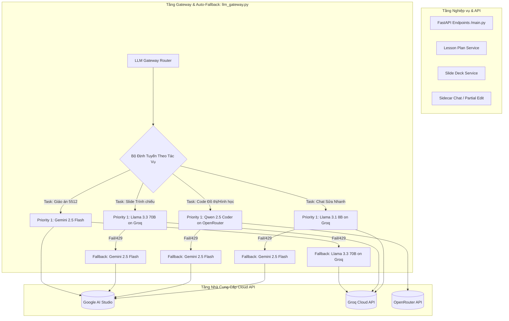

# Kế hoạch Triển khai Kiến trúc Multi-Provider LLM Gateway & Auto-Fallback
## Dự án: LessonAI-5512 (Hệ thống Sinh Giáo án 5512 & Slide Bài giảng)

---

## 🎯 1. Mục tiêu & Định hướng Kiến trúc

### 1.1. Mục tiêu
- **Triệt tiêu điểm nghẽn đơn lẻ (Single Point of Failure - SPOF)**: Đảm bảo hệ thống không bao giờ bị gián đoạn khi một nhà cung cấp LLM gặp lỗi 429 (hết quota), 500/503 (quá tải máy chủ), hoặc sự cố mạng.
- **Tối ưu hóa Chi phí & Độ trễ (Cost-Latency Optimization)**: Phân bổ tác vụ phù hợp với thế mạnh của từng mô hình (Tác vụ viết dài cần hiểu sâu tiếng Việt vs. Tác vụ tóm tắt Slide cần tốc độ siêu tốc).
- **Chuẩn hóa Giao tiếp (OpenAI-compatible Standardization)**: Sử dụng một Client duy nhất (`openai.OpenAI`) để tương thích với tất cả các nhà cung cấp (Google Gemini, Groq, OpenRouter, DeepSeek).

---

## 🏗️ 2. Sơ đồ Kiến trúc Hệ thống (System Architecture)

---

## 📊 3. Ma trận Phân bổ Mô hình & Nhà Cung Cấp (Routing Matrix)

| Tác vụ (Task ID) | Yêu cầu Kỹ thuật | Mô hình Ưu tiên 1 (Primary) | Mô hình Dự phòng (Fallback) | Giao thức / Endpoint |
| :--- | :--- | :--- | :--- | :--- |
| **TASK-01: Soạn Giáo án 5512** | Văn phong sư phạm Việt Nam, ngữ cảnh lớn, ép kiểu Pydantic phức tạp. | `gemini-2.5-flash` *(Provider: Google)* | `llama-3.3-70b-versatile` *(Provider: Groq)* | `https://generativelanguage.googleapis.com/v1beta/openai/` |
| **TASK-02: Bóc tách Slide & Lời thoại GV** | Tốc độ xuất slide cực nhanh (< 2s), chắt lọc bullet points, sinh kịch bản nói. | `llama-3.3-70b-versatile` *(Provider: Groq)* | `gemini-2.5-flash` *(Provider: Google)* | `https://api.groq.com/openai/v1` |
| **TASK-03: Vẽ Đồ thị & Hình học** | Sinh code Python Matplotlib / TikZ chính xác, không ảo giác tọa độ. | `qwen/qwen-2.5-coder-32b-instruct` *(Provider: OpenRouter)* | `gemini-2.5-flash` *(Provider: Google)* | `https://openrouter.ai/api/v1` |
| **TASK-04: Chatbot Sửa Từng Phần** | Độ trễ thấp (phản hồi tức thì), chi phí 0đ cho các lệnh sửa vi mô. | `llama-3.1-8b-instant` *(Provider: Groq)* | `gemini-2.5-flash` *(Provider: Google)* | `https://api.groq.com/openai/v1` |

---

## 📅 4. Lộ trình Triển khai Chi tiết (Phased Execution Roadmap)

### 📌 Giai đoạn 1: Chuẩn bị Môi trường & Quản trị Cấu hình
- [ ] **Bước 1.1**: Đăng ký và thu thập API Key miễn phí từ:
  - Google AI Studio (đã có).
  - Groq Cloud Console (`gsk_...`).
  - OpenRouter API (`sk-or-v1-...`).
- [ ] **Bước 1.2**: Chuẩn hóa tệp `.env` và `app/core/config.py` để nạp các Endpoint và Model Name linh hoạt.

### 📌 Giai đoạn 2: Xây dựng Bộ lõi LLM Gateway (`services/llm_gateway.py`)
- [ ] **Bước 2.1**: Định nghĩa cấu trúc `ProviderConfig` (tên, `base_url`, `api_key`, `default_model`).
- [ ] **Bước 2.2**: Thiết kế hàm lõi `call_llm_with_fallback(prompt, system_prompt, response_schema, task_type)`:
  - Nhận diện `task_type` để tra cứu thứ tự ưu tiên.
  - Sử dụng phương thức chuẩn `client.beta.chat.completions.parse()` để ép kiểu Pydantic.
  - Bắt các lỗi ngoại lệ: `openai.RateLimitError` (429), `openai.APITimeoutError`, `openai.InternalServerError` (500/503).
  - Ghi log chuyển mạch tự động (Circuit Transition Log).

### 📌 Giai đoạn 3: Tái cấu trúc Dịch vụ Nghiệp vụ (Refactoring Services)
- [ ] **Bước 3.1**: Cập nhật `services/ai_service.py`:
  - Hàm `generate_lesson_plan()` gọi Gateway với `task_type="lesson_plan"`.
  - Hàm `generate_slide_deck()` gọi Gateway với `task_type="slide"`.
- [ ] **Bước 3.2**: Cập nhật `exporters/graph_generator.py`:
  - Chuyển logic sinh mã đồ thị qua Gateway với `task_type="math_code"`.
- [ ] **Bước 3.3**: Giữ nguyên toàn bộ Pydantic Schemas (`schemas.py`, `slide_schema.py`) và Validator (`validation.py`).

### 📌 Giai đoạn 4: Kiểm thử Sự cố & Giả lập Fallback (Chaos Testing)
- [ ] **Bước 4.1**: *Test Case 1 (Happy Path)*: Gọi bình thường qua Provider chính, kiểm tra thời gian phản hồi và tính hợp lệ của schema.
- [ ] **Bước 4.2**: *Test Case 2 (Provider 1 Fails)*: Giả lập sai Key hoặc hết Quota ở Provider 1, kiểm tra xem hệ thống có tự động fallback sang Provider 2 trong vòng dưới 2 giây hay không.
- [ ] **Bước 4.3**: *Test Case 3 (All Providers Fail)*: Đảm bảo có thông báo lỗi rõ ràng thân thiện với người dùng, không làm sập server FastAPI.

---

## 🛡️ 5. Quản trị Rủi ro & Chiến lược Khắc phục

| Rủi ro | Mức độ | Biện pháp Khắc phục |
| :--- | :---: | :--- |
| **Lệch chuẩn Structured Output giữa các Provider** | Trung bình | Sử dụng Pydantic `BaseModel` chặt chẽ; nếu model không hỗ trợ native parse thì fallback qua JSON mode + `model_validate_json()`. |
| **Độ trễ khi phải thử lại (Retry Latency)** | Thấp | Đặt `timeout=10.0` giây cho mỗi Provider; nếu quá 10s tự động nhảy sang fallback, không để người dùng chờ lâu. |
| **Hết hạn ngạch đồng thời ở cả 2 bên** | Rất thấp | Cấu hình tối thiểu 3 Provider (Google + Groq + OpenRouter); xác suất cả 3 cùng sập < 0.1%. |

---

## 🏆 6. Kết quả Đầu ra Dự kiến (Deliverables)

1. Tệp `project/app/services/llm_gateway.py` hoạt động độc lập, quản lý đa luồng Provider.
2. Tệp `.env.example` hoàn chỉnh hướng dẫn điền key đa nhà cung cấp.
3. Kịch bản kiểm thử tự động `project/app/tests/test_fallback.py` chứng minh cơ chế chịu lỗi phục vụ báo cáo/demo đồ án.
