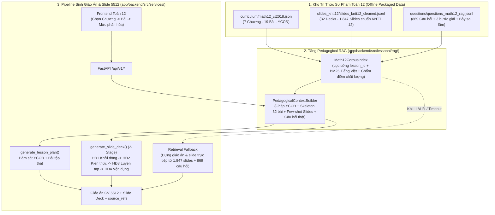

# Kế hoạch Chuyển đổi Dự án `Lesson-Plan-Generator` sang Chuyên sâu Toán 12 & Tích hợp Pedagogical RAG

**Dự án mục tiêu:** [Lesson-Plan-Generator](file:///Users/nguyennhan18/Documents/Lesson-Plan-Generator) (LessonAI-5512)
**Bộ dữ liệu đã đóng gói sẵn sàng:** [/Users/nguyennhan18/Documents/data](file:///Users/nguyennhan18/Documents/data)

---

## 1. Tổng quan những gì đã hoàn tất chuẩn bị vs. những gì cần thay đổi trong `Lesson-Plan-Generator`

Qua toàn bộ quá trình thảo luận và xử lý dữ liệu vừa qua, **bài toán khó nhất về dữ liệu đã được giải quyết triệt để**:

| Hạng mục | Trạng thái hiện tại | Chi tiết |
| :--- | :--- | :--- |
| **Khung chương trình Toán 12 (CT GDPT 2018)** | ✅ **Đã có sẵn** | [`math12_ct2018.json`](file:///Users/nguyennhan18/Documents/data/curriculum/math12_ct2018.json): 7 chương (6 chương bắt buộc + Chuyên đề học tập), 19 bài học (`M12-C1-B1` $\rightarrow$ `M12-C6-B2`), kèm đầy đủ Yêu cầu cần đạt (YCCĐ) và từ khóa. |
| **Kho Slide Giáo viên chuẩn CT 2018 (KNTT 12)** | ✅ **Đã có sẵn** | [`slides_kntt12_cleaned.jsonl`](file:///Users/nguyennhan18/Documents/data/slides_kntt12/slides_kntt12_cleaned.jsonl) & [`decks_kntt12.json`](file:///Users/nguyennhan18/Documents/data/slides_kntt12/decks_kntt12.json): **32 bài giảng (1.847 slides)** phủ kín cả Học kỳ 1 & Học kỳ 2 (Chương 1 $\rightarrow$ Chương 6 + Hoạt động thực hành GeoGebra + Ôn tập), đã khử nhiễu hiệu ứng và gán nhãn `lesson_id`, `activity_type`, `layout_hint`, `quality_score`. |
| **Ngân hàng câu hỏi Toán 12 chuẩn RAG** | ✅ **Đã có sẵn** | [`questions_math12_rag.jsonl`](file:///Users/nguyennhan18/Documents/data/questions/questions_math12_rag.jsonl): **869 câu hỏi** đã ánh xạ `lesson_id`, chuyển sẵn lời giải thành 3 bước `worked_solution_steps` (`step`, `math`, `note`) và `quiz_options` kèm `distractor_rationale`. |
| **Cơ chế thu thập dữ liệu (Bài học từ `DATN`)** | ✅ **Đã chốt kiến trúc** | **Không dùng** `scraping_agent` chạy ngầm liên tục (tránh độ trễ 5–20s và phụ thuộc RabbitMQ/Postgres). Thay vào đó dùng **Offline Packaged Corpus** (như nhánh `Bot/` của `DATN`) truy xuất trực tiếp trong `< 50ms`. |

> [!IMPORTANT]
> Nhờ bộ dữ liệu tại [`/Users/nguyennhan18/Documents/data`](file:///Users/nguyennhan18/Documents/data) đã chuẩn hóa xong 100% theo **CT GDPT 2018 (SGK Kết nối tri thức Toán 12)**, dự án [`Lesson-Plan-Generator`](file:///Users/nguyennhan18/Documents/Lesson-Plan-Generator) **không cần** viết lại các script OCR/bóc tách `.pptx` phức tạp nữa, mà đi thẳng vào **5 Pha thay đổi cốt lõi** dưới đây.

---

## 2. Kiến trúc hệ thống `Lesson-Plan-Generator` sau khi nâng cấp

---

## 3. Kế hoạch thay đổi chi tiết theo 5 Pha

### Pha 1: Tích hợp Bộ dữ liệu `/Users/nguyennhan18/Documents/data` vào Backend
**Mục tiêu:** Đưa kho dữ liệu đã đóng gói vào cây thư mục của [`Lesson-Plan-Generator`](file:///Users/nguyennhan18/Documents/Lesson-Plan-Generator) và bổ sung câu hỏi cho Chương 3 (Thống kê ghép nhóm) từ chính các slide Luyện tập của Chương 3.

1. **Liên kết / Sao chép dữ liệu vào `app/backend/data/`:**
   - `app/backend/data/curriculum/math12_ct2018.json` & `nls_catalog.json`
   - `app/backend/data/slides_kntt12/slides_kntt12_cleaned.jsonl` & `decks_kntt12.json`
   - `app/backend/data/questions/questions_math12_rag.jsonl`
2. **Trích xuất thêm bài tập trắc nghiệm từ 1.847 slides sang ngân hàng câu hỏi (Tăng cường Chương 3 & Chương 6):**
   - Trong `slides_kntt12_cleaned.jsonl` hiện có **118 slides `QUIZ_OPTION`** và **738 slides `luyen_tap`** (trong đó Chương 3 có 143 slides nhưng `questions_math12_rag.jsonl` mới có 2 câu Chương 3).
   - Viết 1 script nhẹ `app/backend/scripts/enrich_questions_from_slides.py` rút các câu hỏi trắc nghiệm có sẵn trong slide Chương 3 & Chương 6 bổ sung vào `questions_math12_rag.jsonl` để **mọi bài học từ Bài 1 $\rightarrow$ Bài 19 đều có tối thiểu 15–20 câu hỏi chuẩn**.

---

### Pha 2: Thu hẹp phạm vi (Scope Lock) về Toán 12 CT GDPT 2018
**Mục tiêu:** Chuyển đổi giao diện và API từ hệ thống "Đa môn – Đa khối" chung chung sang hệ thống **Chuyên sâu Toán 12 chuẩn CT 2018**.

1. **Cập nhật Schema ([`app/backend/src/lessonai/schemas/schemas.py`](../../app/backend/src/lessonai/schemas/schemas.py) & [`slide_schema.py`](../../app/backend/src/lessonai/schemas/slide_schema.py)):**
   - Trong [`LessonRequest`](../../app/backend/src/lessonai/schemas/schemas.py):
     - Thêm trường `lesson_id: Optional[str] = Field(default=None, description="Mã bài học Toán 12 CT 2018, VD: M12-C1-B1")` và `use_rag: bool = Field(default=True)`.
     - Đặt mặc định `subject = "Toán học"`, `grade = 12` và khóa validator chỉ chấp nhận Toán 12.
     - Tự động suy luận `lesson_id` từ `topic` nếu người dùng hoặc test cũ chỉ truyền `topic` (đảm bảo tương thích ngược 100%).
   - Trong [`SlideSchema`](../../app/backend/src/lessonai/schemas/slide_schema.py):
     - Thêm `source_refs: Optional[List[Dict[str, Any]]] = None` (lưu `slide_id` hoặc `question_id` gốc để minh bạch nguồn truy xuất).
     - Thêm `pedagogical_mode: Optional[str] = None` (VD: `"Hoạt động cặp đôi (3 phút)"`, `"Thảo luận nhóm 4"`).
2. **Cập nhật Bộ dữ liệu Test ([`app/backend/src/test_cases.json`](../../app/backend/src/test_cases.json)):**
   - Thay các ca test Vật lý / Hóa học / Toán 10–11 bằng **10 ca test chuẩn Toán 12 CT 2018** trải đều 6 chương (`M12-C1-B1` $\rightarrow$ `M12-C6-B2`).

---

### Pha 3: Xây dựng Tầng Pedagogical RAG (`app/backend/src/lessonai/rag/`)
**Mục tiêu:** Xây dựng bộ truy xuất lai (Hybrid Retriever) tốc độ cao (`< 30ms`) không cần phụ thuộc Database ngoài, đọc trực tiếp từ bộ JSONL đã đóng gói.

Tạo thư mục `app/backend/src/lessonai/rag/` gồm 3 module gọn nhẹ:

1. **`src/rag/curriculum_registry.py`:**
   - Nạp [`math12_ct2018.json`](file:///Users/nguyennhan18/Documents/data/curriculum/math12_ct2018.json) và [`decks_kntt12.json`](file:///Users/nguyennhan18/Documents/data/slides_kntt12/decks_kntt12.json).
   - Cung cấp hàm tra cứu danh sách Chương $\rightarrow$ Bài, Yêu cầu cần đạt (`yccd`), và **Dàn ý bài giảng gốc (`deck_skeleton`)** của từng bài trong 32 file KNTT 12.
   - Hỗ trợ ánh xạ tự động `topic` bất kỳ sang `lesson_id` gần nhất bằng so khớp từ khóa + tiêu đề.
2. **`src/rag/retriever.py` (`Math12HybridRetriever`):**
   - Nạp **1.847 slides** (`slides_kntt12_cleaned.jsonl`) và **869 câu hỏi** (`questions_math12_rag.jsonl`) vào bộ nhớ khi khởi động server (chỉ tốn ~4 MB RAM).
   - Kết hợp **Lọc cứng theo Metadata** (`lesson_id`, `activity_type`, `layout_hint`, `difficulty`) + **Điểm BM25 Tiếng Việt** + **Điểm `quality_score`** (ưu tiên các slide có ví dụ giải mẫu `has_worked_example=True` và không bị vỡ công thức).
   - Cung cấp 3 hàm truy xuất chính:
     - `retrieve_lesson_skeleton(lesson_id)`: Lấy YCCĐ + cấu trúc 4 hoạt động thực tế của bài đó từ `decks_kntt12.json`.
     - `retrieve_exemplar_slides(lesson_id, activity_type, k=2)`: Lấy 2 slide mẫu đẹp nhất của đúng bài học và đúng hoạt động (`khoi_dong`, `hinh_thanh_kien_thuc`, `luyen_tap`, `van_dung`).
     - `retrieve_questions(lesson_id, proficiency_level, k=4)`: Lấy câu hỏi thực tế kèm sẵn `worked_solution_steps` 3 bước và `quiz_options` có `distractor_rationale`.
3. **`src/rag/context_builder.py` (`PedagogicalContextBuilder`):**
   - Đóng gói kết quả truy xuất thành khối văn bản có cấu trúc rõ ràng (`=== NGỮ CẢNH SƯ PHẠM TOÁN 12 (CT GDPT 2018 - KNTT) ===`) để bơm vào Prompt của LLM, đồng thời trả về danh sách `source_refs`.

---

### Pha 4: Nâng cấp Pipeline Sinh Giáo Án & Slide trong `ai_service.py` và `fallback_service.py`
**Mục tiêu:** Biến LLM từ "người tự nghĩ bài tập và tự bịa kịch bản" thành "người biên tập sư phạm dựa trên dữ liệu thật".

1. **Nâng cấp [`generate_lesson_plan()`](../../app/backend/src/services/ai_service.py) trong [`ai_service.py`](../../app/backend/src/services/ai_service.py):**
   - Bơm ngữ cảnh RAG của `lesson_id` vào prompt:
     - Phần **I. Mục tiêu** bắt buộc bám sát danh sách `yccd` của [`math12_ct2018.json`](file:///Users/nguyennhan18/Documents/data/curriculum/math12_ct2018.json).
     - Phần **Hoạt động 1 (Mở đầu)** lấy tình huống thực tế từ slide `khoi_dong` của bộ KNTT 12 (VD: bài toán hộp không nắp, bài toán tối ưu chi phí, bài toán drone 3D...).
     - Phần **Hoạt động 3 (Luyện tập) & Hoạt động 4 (Vận dụng)** sử dụng trực tiếp đề bài và lời giải từ `questions_math12_rag.jsonl` và slide `luyen_tap`/`van_dung`.
2. **Nâng cấp [`generate_slide_deck()`](../../app/backend/src/services/ai_service.py) trong [`ai_service.py`](../../app/backend/src/services/ai_service.py):**
   - Cung cấp Few-shot Exemplars từ `slides_kntt12_cleaned.jsonl` tương ứng với từng hoạt động.
   - Nhúng trực tiếp cấu trúc `worked_solution_steps` (3 bước: *Phương pháp / Nhận dạng* $\rightarrow$ *Biến đổi đại số* $\rightarrow$ *Kết luận & Lưu ý sai lầm*) và `quiz_options` (kèm `distractor_rationale`) từ câu hỏi truy xuất được vào slide.
   - Gắn `source_refs` vào từng slide để giao diện hiển thị nguồn tham chiếu (VD: `KNTT12-Bai-01#Slide14`, `QBank#M12-C1-B1-042`).
3. **Nâng cấp [`fallback_service.py`](../../app/backend/src/lessonai/services/generation/fallback.py) thành Retrieval-based Fallback:**
   - Khi LLM hết quota hoặc mất mạng, thay vì trả về 1 bài giáo án mẫu cố định cứng nhắc, `fallback_service.py` sẽ **lắp ghép trực tiếp** các slide đã làm sạch của đúng `lesson_id` từ `slides_kntt12_cleaned.jsonl` + câu hỏi từ `questions_math12_rag.jsonl` thành một `SlideDeckSchema` và `LessonPlan` hoàn chỉnh của đúng bài học đó!

---

### Pha 5: Cập nhật API Backend (`main.py`), Giao diện (`LessonPlanScreen.jsx`) & Kiểm thử
**Mục tiêu:** Giúp giáo viên chọn bài học Toán 12 trực quan và xem được nguồn dữ liệu RAG trên giao diện. ✅ **[ĐÃ HOÀN THÀNH 100%]**

1. **Thêm Endpoints trong [`app/backend/src/main.py`](../../app/backend/src/main.py):**
   - `GET /api/v1/curriculum/math12`: Trả về cây 7 Chương $\rightarrow$ 19 Bài $\rightarrow$ YCCĐ từ `math12_ct2018.json` kèm số lượng slide và bài tập có sẵn trong kho RAG.
   - `POST /api/v1/rag/preview`: Cho phép xem trước các slide mẫu và câu hỏi được RAG truy xuất cho `lesson_id` đã chọn (hoặc suy luận từ `topic`).
2. **Cập nhật Giao diện ([`app/frontend/src/features/lesson-plan/LessonPlanScreen.jsx`](../../app/frontend/src/features/lesson-plan/LessonPlanScreen.jsx)):**
   - Cố định môn **Toán học – Lớp 12 (CT GDPT 2018 - Kết nối tri thức)**.
   - Thêm bộ chọn **Chương $\rightarrow$ Bài học** (tự động nạp `topic`, `lesson_id`, hiển thị YCCĐ + số lượng slide mẫu & bài tập có sẵn trong kho RAG).
   - Thêm Modal **"Xem trước kho RAG"** trực quan (hiển thị YCCĐ, dàn ý bài giảng, slide mẫu và câu hỏi trắc nghiệm kèm bẫy sai lầm).
   - Hiển thị huy hiệu (badge) **"Nguồn RAG: KNTT 12"** trên từng trang slide trong `PresentationStage.jsx` và `SlideEditorScreen.jsx`.
3. **Cập nhật và chạy bộ Test (`app/backend/tests/`):**
   - Tạo file test mới [`app/backend/tests/test_phase5_e2e_rag_system.py`](../../app/backend/tests/test_phase5_e2e_rag_system.py) kiểm tra toàn bộ luồng: `CurriculumRegistry` $\rightarrow$ `Math12HybridRetriever` $\rightarrow$ `PedagogicalContextBuilder` $\rightarrow$ `RetrievalFallback` $\rightarrow$ API `/api/v1/curriculum/math12` và `/api/v1/rag/preview` $\rightarrow$ Gói kép Dual Package.
   - Kết quả kiểm thử hồi quy: **270/270 test cases PASSED (100%)**.

---

## 4. Bảng tổng kết trạng thái thực hiện toàn bộ 5 Pha

| Pha | Nội dung chuyển đổi | Trạng thái | Chi tiết triển khai |
| :--- | :--- | :---: | :--- |
| **Pha 1** | Đồng bộ dữ liệu & Làm giàu Chương 3 | ✅ **HOÀN THÀNH** | Đồng bộ 1.847 slides, tăng số câu hỏi Chương 3 từ 2 $\rightarrow$ 27 câu (tổng 894 câu hỏi có 3 bước giải và bẫy sai lầm). |
| **Pha 2** | Scope Lock Toán 12 CT GDPT 2018 | ✅ **HOÀN THÀNH** | Schema `LessonRequest` (mặc định grade=12, tự suy luận `lesson_id`), `SlideSchema` (thêm `source_refs`, `activity_type`, `pedagogical_mode`), cập nhật 10 test cases chuẩn Toán 12. |
| **Pha 3** | Xây dựng Tầng Pedagogical RAG | ✅ **HOÀN THÀNH** | `CurriculumRegistry`, `Math12HybridRetriever` (In-Memory Okapi BM25 thuần Python, tốc độ $< 0.3\text{ms}$), `PedagogicalContextBuilder`. |
| **Pha 4** | Nâng cấp Pipeline Sinh Bài & Fallback | ✅ **HOÀN THÀNH** | Neo prompt LLM theo dữ liệu thật; Dynamic Retrieval Fallback tự động lắp ghép bài giảng 5512 và 8 slide KNTT 12 khi offline. |
| **Pha 5** | API Khung CT, Giao diện RAG & E2E Testing | ✅ **HOÀN THÀNH** | API `/api/v1/curriculum/math12`, `/api/v1/rag/preview`, UI Dropdown Chương/Bài, Preview Modal, RAG Badges, 270/270 test cases passed. |

