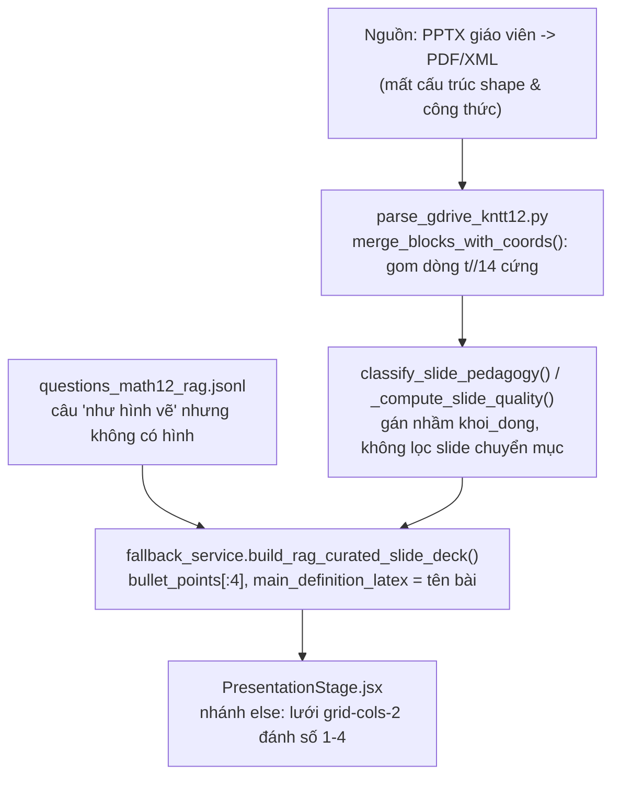
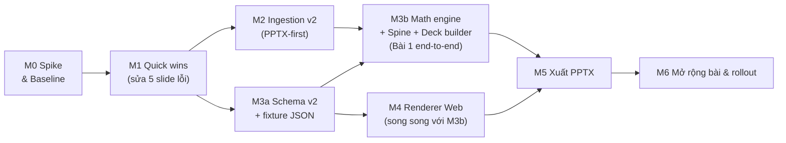

# PLAN v2: TÁI KIẾN TRÚC DỮ LIỆU, BỘ SINH BÀI GIẢNG & TRÌNH BÀY SLIDE TOÁN HỌC

> **Mục tiêu:** Slide sinh ra (Web Studio và file `.pptx`) đạt chuẩn giảng dạy như bộ dữ liệu của giáo viên trong `data/`: không vỡ công thức, không mất đề bài/hình, đúng trình tự sư phạm, không rập khuôn "4 chiếc hộp".
>
> **Nguyên tắc dẫn đường của v2**
> 1. **Dữ liệu trước, giao diện sau.** Sửa tận nguồn (đọc PPTX gốc) thay vì vá triệu chứng.
> 2. **Không bao giờ xuất toán sai.** Mọi con số/bảng do SymPy tính và tự kiểm; không chắc thì bỏ, không đoán.
> 3. **Cắt dọc, giao sớm.** Có kết quả nhìn thấy được sau vài ngày (M1), rồi mới làm sâu.
> 4. **Đo được.** Mỗi mốc có bộ lint và golden set; "0% lỗi" phải có công cụ đo.
> 5. **Có đường lui.** Feature flag `SLIDE_PIPELINE=v1|v2`, adapter cho dữ liệu cũ, phương án thay thế cho hạng mục rủi ro cao.

---

## 0. NHỮNG GÌ THAY ĐỔI SO VỚI PLAN v1 (VÀ VÌ SAO)

| # | Thay đổi | Lý do |
| :-- | :--- | :--- |
| 1 | Thêm **M0 (spike + baseline)** và các **cổng quyết định (Gate)** | Plan v1 giả định đúng hướng ngay từ đầu; nhiều hạng mục (đọc PPTX, SymPy parse, công thức trong PPTX) cần kiểm chứng trước khi đầu tư |
| 2 | **Ưu tiên đọc thẳng PPTX gốc** (`python-pptx` + OMML); thuật toán gom dòng theo tọa độ PDF hạ xuống thành *đường dự phòng* | Phân số, căn, chỉ số trên PDF không khôi phục được bằng tọa độ; PPTX đã có sẵn shape, thứ tự đọc, công thức |
| 3 | Thêm **M1 Quick wins** (≤3 ngày) trước khi đổi schema | Giải quyết cả 5 slide lỗi đang thấy bằng thay đổi nhỏ, giảm rủi ro và có demo sớm |
| 4 | Schema v2 bổ sung **`FIGURE/PlotSpec`, `QUIZ`**, thiết kế lại `VariationTableSpec` (bỏ công thức độ dài `2n-3`) | v1 nêu lỗi "mất hình vẽ" nhưng chỉ giải quyết bảng; thiếu block trắc nghiệm/đồ thị; spec cũ dễ lệch pha và không biểu diễn được điểm gián đoạn |
| 5 | **Spine dạng dữ liệu (YAML)** theo loại bài, không hard-code Bài 1 | Mở rộng sang chương khác không phải viết lại thuật toán |
| 6 | **LLM chỉ viết lời dẫn; số liệu toán do SymPy cung cấp** | Chặn LLM bịa kết quả; đường LLM và đường fallback dùng chung một bộ validator |
| 7 | **Bảng biến thiên chỉ sinh từ biểu thức tường minh**; bỏ nhánh "đoán bảng từ văn xuôi lời giải" | Bảng sai còn tệ hơn không có bảng |
| 8 | PPTX: **slide build-up là mặc định**, animation `<p:timing>` là tùy chọn sau cùng; bảng biến thiên vẽ bằng **shape native từ layout dùng chung** với web | `<p:timing>` viết tay dễ làm PowerPoint báo lỗi; Matplotlib/SVG không nhúng vector tốt vào PPTX |
| 9 | Sửa các lỗi trong code mẫu v1 (regex `\i` gây `re.error`, nối nhầm tiêu đề vào thân, ngưỡng 12px cứng, lọc quá tay slide ngắn, lọc nhầm slide "Vận dụng") | Xem mục III-M1 và Phụ lục A |
| 10 | Thêm **QA tự động** (lint, KaTeX, snapshot LibreOffice), golden set, đánh giá bởi giáo viên | Tiêu chí nghiệm thu đo được |

---

## I. CHẨN ĐOÁN (RÚT GỌN, THAM CHIẾU THEO TÊN HÀM)

Số dòng trong code sẽ lệch sau vài commit nên plan này chỉ tham chiếu theo tên hàm.



| Lỗi quan sát | Hàm/file | Nguyên nhân gốc |
| :--- | :--- | :--- |
| **S2:** tiêu đề đứt ngang, mất $s(t)$, ô 4 chỉ còn "Giải:" | `classify_slide_pedagogy`, `build_rag_curated_slide_deck` | Slide "Vận dụng 1 …" khớp từ khóa "tình huống mở đầu" nên bị gán `khoi_dong`; cắt `bullet_points[:4]` chặt đúng chữ "Giải:" |
| **S3:** khung công thức hiện tên bài; định lý bị chặt thành 4 ô | `merge_blocks_with_coords`, `build_rag_curated_slide_deck` | Ký hiệu `′` và chỉ số có tọa độ lệch nên bị tách dòng; fallback `main_definition_latex = tên bài học` |
| **S4:** 4 ô chữ trang trí ("BÀI HỌC", "01"…) | `_compute_slide_quality` | Không có bộ lọc slide chuyển mục |
| **S5:** đề "như hình vẽ" nhưng không có hình; lặp "Đáp án đúng là D" | `build_worked_steps_from_solution`, `retrieve_questions` | Không lọc câu phụ thuộc hình; nhét trắc nghiệm vào layout tự luận; mẫu câu cứng ở mọi bước |
| **Mọi slide:** 4 hộp đen đánh số | `PresentationStage.jsx` (nhánh `else`) | Mọi layout rơi chung một vòng lặp lưới |
| **Gốc rễ #0** | Pipeline ingest | Dữ liệu bị đưa qua PDF rồi dựng lại bằng tọa độ, trong khi file PPTX gốc có sẵn cấu trúc |

---

## II. LỘ TRÌNH TỔNG THỂ



| Mốc | Kết quả nhìn thấy được | Công sức ước lượng* | Điều kiện qua mốc |
| :-- | :--- | :--- | :--- |
| **M0** | Báo cáo baseline + golden set + quyết định 3 Gate | 1–2 ngày | G1, G2, G3 có quyết định |
| **M1** | 5 slide lỗi hiện tại được sửa, hết lưới 4 hộp | 2–3 ngày | Snapshot 5 slide đạt; pytest cũ vẫn pass |
| **M2** | Dữ liệu `slides_v2.jsonl` sạch, có `lint` từng slide | 4–6 ngày | Gate G1; golden set ≥ 90% slide 0 lỗi lint |
| **M3** | Bài 1 (đơn điệu & cực trị) sinh end-to-end, toán đúng | 6–8 ngày | 100% ví dụ tự luận được SymPy kiểm; deck 10 slide qua `validate_deck` |
| **M4** | Web: khối sư phạm, bảng biến thiên, đồ thị, hiện từng bước | 4–5 ngày | Demo bấm Space hiện lần lượt; snapshot FE |
| **M5** | `.pptx` tương đương bản web | 5–7 ngày | Mở được bằng PowerPoint + LibreOffice; snapshot khớp |
| **M6** | Thêm các loại bài khác, bật flag cho người dùng | liên tục | Đạt DoD (mục VII) |

\*Ước lượng thô theo ngày công của một lập trình viên; điều chỉnh sau M0.

**Cổng quyết định (Gate) ở M0**
- **G1 – PPTX gốc dùng được?** Nếu ≥ 85% slide trong golden set đọc được từ PPTX với 0 lỗi lint, thì chọn đường PPTX-first. Ngược lại, giữ đường PDF (Phụ lục A) và cân nhắc OCR công thức.
- **G2 – SymPy parse được bao nhiêu câu?** Đo tỉ lệ câu có biểu thức hàm số tường minh chuyển được sang SymPy. Nếu < 60%, ưu tiên ngân hàng "ví dụ mẫu" do mình biên soạn thay vì lấy từ câu hỏi RAG.
- **G3 – Công thức trong PPTX dùng gì?** So sánh (a) ảnh PNG 300 dpi từ LaTeX, (b) OMML native. Chọn theo độ phủ và chất lượng trên golden set; mặc định (a) kèm alt-text LaTeX, nâng cấp (b) nếu đủ thời gian.

---

## III. CHI TIẾT TỪNG MỐC

### M0 – Spike & Baseline (1–2 ngày)

1. **Kiểm kê `data/`:** có bao nhiêu PPTX gốc, bao nhiêu chỉ có PDF; công thức trong PPTX là OMML (`a14:m` / `m:oMath`), text thuần hay ảnh/OLE (MathType).
2. **Chọn golden set 10 bài** (ít nhất: 3 bài hàm số, 2 hình học, 2 xác suất/thống kê, 2 tích phân, 1 bài "khó" nhiều hình), kèm 5 deck mẫu giáo viên làm chuẩn tham chiếu.
3. **Đo baseline** bằng bộ lint ở mục VI cho pipeline hiện tại (số slide lỗi theo từng loại).
4. **Spike 3 Gate** (G1, G2, G3) ở trên; ghi quyết định vào `docs/decisions.md`.

### M1 – Quick wins (2–3 ngày): sửa 5 slide lỗi mà chưa đụng schema

Mục đích: giao kết quả nhìn thấy được sớm và tạo "lưới an toàn" cho các mốc sau.

1. **Frontend:** thay nhánh `else` (lưới 4 hộp) bằng `BlockRenderer` + adapter `legacyToBlocks(slide)`:
   - Tiêu đề rỗng/chỉ có title → Hero; `bullet_points` → đoạn văn/danh sách (không đánh số hộp).
   - Chỉ vẽ khung công thức khi `main_definition_latex` thật sự có. **Bỏ fallback "tên bài học"** ở `build_rag_curated_slide_deck`.
2. **Bộ lọc slide chuyển mục** (bản đã sửa so với v1, xem Phụ lục A.4): dựa trên tỉ lệ chữ IN HOA, không có công thức/câu hỏi, rất ít chữ. **Không** loại slide ngắn nói chung (Định lí/Chú ý ngắn vẫn hợp lệ).
3. **Phân loại vai trò slide:** slide có tiêu đề bắt đầu bằng "Vận dụng/Luyện tập/Bài tập" **không bao giờ** là `khoi_dong`. Slide tham chiếu "tình huống mở đầu" được giữ với vai trò `apply_ref` để dùng cho khối "Giải bài toán mở đầu" ở M3.
4. **Ngân hàng câu hỏi:** gắn cờ `has_image` / `has_missing_visual` lúc build dữ liệu (regex mở rộng + cờ ảnh từ nguồn); tách `question_type` (`essay` | `mcq`); câu tự luận không dùng mẫu "Đáp án đúng là X"; câu trắc nghiệm hiển thị đủ A/B/C/D và chỉ nêu đáp án một lần ở phần giải thích.
5. **Test snapshot** cho đúng 5 slide lỗi cũ (fixture JSON → render → so snapshot).

### M2 – Ingestion v2, PPTX-first (4–6 ngày)

**Đầu ra:** `slides_v2.jsonl`, mỗi slide gồm các khối có kiểu rõ ràng và báo cáo lint.

```python
# data/scripts/pptx_reader.py (phác thảo)
{
  "slide_no": 7, "source": "Tiet-1-Bai-1.pptx",
  "title": "Định lí 1",                       # từ placeholder TITLE, fallback: shape trên cùng/chữ lớn nhất
  "role": "theorem",                           # luật theo tiêu đề + vị trí + khung viền, không chỉ từ khóa
  "blocks": [
    {"kind": "text",    "text": "Cho hàm số $y=f(x)$ có đạo hàm trên $K$."},
    {"kind": "math",    "latex": "f'(x) > 0, \\forall x \\in K \\Rightarrow ...", "origin": "omml"},
    {"kind": "picture", "asset": "assets/a1b2c3.png", "bbox": [0.5, 0.2, 0.9, 0.8]}
  ],
  "lint": {"errors": [], "warnings": []}
}
```

- **Duyệt shape** theo cây (xử lý group), sắp theo (top, left); nối câu **chỉ trong cùng một shape/đoạn văn**. Cách này loại bỏ lỗi "tiêu đề rớt chữ xuống thân bài".
- **Công thức:** trích `m:oMath` (bọc trong `a14:m`) bằng `lxml`, tự viết bộ chuyển OMML → LaTeX cho tập con thường gặp (`m:f`, `m:sSup`, `m:sSub`, `m:sSubSup`, `m:rad`, `m:d`, `m:nary`, `m:r/m:t`). Phần chưa hỗ trợ ghi `warnings` và giữ text thô. Công thức ở dạng ảnh/OLE được giữ làm `picture` (kèm cờ `math_image`).
- **Hình/đồ thị của giáo viên** được xuất ra `assets/` (băm nội dung để khử trùng) và có thể dùng lại làm `FIGURE`.
- **Đường dự phòng PDF:** giữ `merge_blocks_with_coords` nhưng thay bằng các hàm ở Phụ lục A, và bắt buộc qua lint.
- **Ngân hàng câu hỏi:** trích `function_expr` (nếu có biểu thức tường minh), tách phương án A–D, cờ `has_image`.

### M3 – Schema v2, Math engine, Spine, Deck builder (6–8 ngày)

**Ngày đầu của M3: đóng băng schema (M3a) và viết fixture JSON** để frontend (M4) làm song song mà không chờ backend.

#### M3a. Schema v2 (`slide_schema.py`)

```python
from enum import Enum
from typing import List, Literal, Optional
from pydantic import BaseModel, Field, model_validator   # Pydantic v2; nếu đang dùng v1 đổi sang @root_validator

class TableNode(BaseModel):
    x: str                                        # LaTeX: "-\\infty", "0", "2", "+\\infty"
    fprime: Literal["0", "||", ""] = ""           # "0": f'=0; "||": không xác định; "": tại ±∞
    y_left: Optional[str] = None                  # giá trị/giới hạn bên trái (LaTeX)
    y_right: Optional[str] = None                 # bên phải; bằng y_left nếu hàm liên tục tại nút

class VariationTableSpec(BaseModel):
    variable: str = "x"
    function_name: str = "y"                      # y, f, s ...
    nodes: List[TableNode] = Field(min_length=2)
    intervals: List[Literal["+", "-"]]            # dấu của f' trên từng khoảng; chiều biến thiên suy ra từ dấu
    only_sign_row: bool = False                   # True: bảng xét dấu (không vẽ dòng f(x))

    @model_validator(mode="after")
    def _check(self):
        if len(self.intervals) != len(self.nodes) - 1:
            raise ValueError("len(intervals) phải bằng len(nodes) - 1")
        return self

class PlotSpec(BaseModel):
    expr: str                                     # biểu thức dạng SymPy-an-toàn, ví dụ "x**3 - 3*x**2 + 2"
    x_range: List[float] = Field(min_length=2, max_length=2)
    marked_points: List[float] = []               # hoành độ cần đánh dấu (cực trị, giao điểm)
    show_tangent_at: Optional[float] = None       # phục vụ bước "khám phá"

class QuizOption(BaseModel):
    id: Literal["A", "B", "C", "D"]
    text: str

class QuizSpec(BaseModel):
    options: List[QuizOption] = Field(min_length=4, max_length=4)
    correct_id: Literal["A", "B", "C", "D"]
    distractor_notes: dict = {}                   # id -> vì sao sai (bẫy thường gặp)

class BlockType(str, Enum):
    PROBLEM_BOX = "PROBLEM_BOX"
    EXPLORE_PROMPT = "EXPLORE_PROMPT"
    DERIVATION_STEP = "DERIVATION_STEP"
    THEOREM_BOX = "THEOREM_BOX"
    CAUTION_BOX = "CAUTION_BOX"
    WORKED_STEP = "WORKED_STEP"
    PRACTICE_TASK = "PRACTICE_TASK"
    FIGURE = "FIGURE"
    QUIZ = "QUIZ"
    SUMMARY = "SUMMARY"

class SlideBlock(BaseModel):
    block_type: BlockType
    label: Optional[str] = None                   # "ĐỊNH LÍ", "CHÚ Ý", "BƯỚC 1" ...
    content: str = ""                             # văn bản + LaTeX trong $...$
    formula_latex: Optional[str] = None
    table: Optional[VariationTableSpec] = None
    plot: Optional[PlotSpec] = None
    figure_asset: Optional[str] = None            # đường dẫn ảnh từ assets/ (ảnh của giáo viên)
    quiz: Optional[QuizSpec] = None
    reveal_order: int = 0                         # 0: hiện ngay; 1,2,3...: hiện dần
    wait_seconds: int = 0                         # PRACTICE_TASK: thời gian đếm ngược
    verified: bool = True                         # False nếu toán chưa được SymPy kiểm

    @model_validator(mode="after")
    def _check(self):
        t = self.block_type
        if t == BlockType.FIGURE and not (self.plot or self.figure_asset or self.table):
            raise ValueError("FIGURE cần plot, figure_asset hoặc table")
        if t == BlockType.QUIZ and not self.quiz:
            raise ValueError("QUIZ cần quiz")
        return self

class SlideSchema(BaseModel):
    # ... giữ các trường hiện có (slide_index, type, layout, title, bullet_points, ...)
    schema_version: int = 2
    blocks: List[SlideBlock] = Field(default_factory=list)
```

**Hợp đồng tương thích:** nếu `blocks` rỗng, renderer dùng adapter `legacy_to_blocks(slide)` (không bao giờ quay lại lưới 4 hộp). Có test "slide v1 cũ vẫn render".

#### M3b. Math engine (`src/math_engine/analyze.py`)

Mục tiêu: nhận một biểu thức hàm số, trả về phân tích *đã tự kiểm* hoặc `None` kèm lý do.

1. **`safe_parse(expr_str)`:** làm sạch LaTeX (`\left \right`, `\cdot`, `\frac{a}{b}` → `(a)/(b)`, `^{...}` → `**(...)`, `\sqrt{}`), chỉ cho phép danh sách ký tự/hàm trắng, dùng `parse_expr` với `implicit_multiplication_application`. Nếu `sympy.parsing.latex` (cần antlr4) có sẵn thì dùng làm đường thứ hai.
2. **Phân tích:** tập xác định bằng `continuous_domain`, các điểm gián đoạn bằng `singularities`, `f'` bằng `diff`, điểm tới hạn bằng `solveset` (chỉ nhận tập hữu hạn thực, tối đa 5 nút).
3. **Xét dấu bằng điểm thử** (thay giá trị đại diện giữa hai nút kề nhau, sắp theo giá trị số) thay vì giải bất phương trình tổng quát, vì ổn định hơn.
4. **Giá trị và giới hạn** tại các nút bằng `subs`/`limit`, rồi dựng `VariationTableSpec`.
5. **Tự kiểm (bắt buộc):**
   - So khớp với trường `solution` của câu hỏi (khoảng đơn điệu, cực trị) khi có.
   - Property test: với đa thức ngẫu nhiên, dấu `f'` khớp sai phân số học tại các điểm thử.
   - Không khớp/không chắc → trả `None`, ghi lý do; **không** dựng bảng và không dùng ví dụ đó cho slide tự luận.
6. **Hỗ trợ ban đầu:** đa thức, hữu tỉ đơn giản, căn đơn giản. Hàm khác → bỏ qua có chủ đích.

#### M3c. Spine theo loại bài (`src/spines/*.yaml`)

Mỗi loại bài là một file dữ liệu liệt kê các "ô" (slot) với block bắt buộc/tùy chọn, truy vấn RAG, số slide tối thiểu/tối đa. Ví dụ loại `function_monotonic_extrema` (đánh số **một lần duy nhất**, dùng cho mọi tài liệu về sau):

| Slot | Nội dung | Block chính | Nguồn nội dung |
| :-- | :--- | :--- | :--- |
| S1 | Tình huống mở đầu (hàm số cụ thể) | PROBLEM_BOX, FIGURE (đồ thị), EXPLORE_PROMPT | slide `khoi_dong` thật, nếu thiếu thì ví dụ mẫu (vd: chất điểm $s(t)=t^3-9t^2+15t$) |
| S2 | Khám phá: dấu $f'$ ↔ chiều đồ thị | DERIVATION_STEP (hiện dần), FIGURE | engine + slide `explore` |
| S3 | Định lí tính đơn điệu + Chú ý | THEOREM_BOX, CAUTION_BOX | slide `theorem` |
| S4 | Ví dụ mẫu 1 (đơn điệu) | WORKED_STEP ×3, FIGURE(bảng biến thiên) | engine |
| S5 | Tự luyện 1 | PRACTICE_TASK (đếm ngược), lời giải hiện sau | engine |
| S6 | Khám phá cực trị (đổi dấu $f'$) | DERIVATION_STEP, FIGURE | engine |
| S7 | Định lí cực trị + bẫy ($f'(x_0)=0$ nhưng không đổi dấu, ví dụ $y=x^3$) | THEOREM_BOX, CAUTION_BOX | slide `theorem` + ví dụ phản chứng |
| S8 | Ví dụ mẫu 2 (cực trị) + bảng biến thiên | WORKED_STEP ×3, FIGURE | engine (vd $y=x^3-3x^2+2$: cực đại $y(0)=2$, cực tiểu $y(2)=-2$) |
| S9 | Trắc nghiệm | QUIZ (kèm phân tích bẫy) | ngân hàng câu hỏi đã lọc |
| S10 | Giải trọn bài toán mở đầu + tổng kết | WORKED_STEP, SUMMARY | slide `apply_ref` + engine |

Các loại khác (hình học không gian, tích phân, xác suất…) dùng cùng khung nhưng ít bảng biến thiên; loại `generic` là phương án dự phòng.

#### M3d. Deck builder (`src/services/deck_builder.py`) – thay thế dần `fallback_service` (strangler pattern)

```
chọn spine -> với mỗi slot: SlotFiller -> validate_slide -> (sửa | fallback) -> validate_deck
```

- **SlotFiller deterministic:** chọn slide giáo viên phù hợp vai trò + điền khối.
- **SlotFiller LLM:** nhận ngữ cảnh RAG và JSON schema của block, chỉ viết **lời dẫn/câu hỏi**. Số liệu (đạo hàm, nghiệm, bảng) là *placeholder* `{{y_prime}}`, `{{table_1}}` do engine điền. LLM không được tự viết kết quả tính toán.
- **Validator dùng chung** cho cả hai đường: JSON hợp lệ theo schema, lint mục VI, đủ block bắt buộc của slot; lỗi thì thử lại tối đa 2 lần rồi rơi về deterministic.
- `ai_service.py` chỉ gọi `deck_builder`, không giữ logic ghép slide riêng.

### M4 – Renderer Web (4–5 ngày, song song với M3b sau khi có fixture)

1. **`BlockRenderer`** theo `block_type`: `THEOREM_BOX` (nhãn gắn viền trên), `CAUTION_BOX` (viền hổ phách), `PROBLEM_BOX` (nền xanh nhạt, chữ lớn), `QUIZ`, `PRACTICE_TASK` (đồng hồ), `FIGURE`.
2. **Bố cục theo vai trò slide** (Title / WarmUp / Concept / Worked / Quiz / Summary), xóa hẳn lưới `grid-cols-2` đánh số.
3. **Bảng biến thiên dùng layout dùng chung.** Backend có hàm `layout_variation_table(spec) -> List[Primitive]` (đường, chữ, mũi tên với tọa độ chuẩn hóa 0–1), đính kèm vào JSON slide khi serialize. Frontend (`VariationTable.jsx`) chỉ vẽ lại các primitive bằng SVG; exporter PPTX (M5) vẽ cùng primitive bằng shape native. **Một nguồn bố cục, hai nơi vẽ**, tránh lệch nhau.
4. **Đồ thị `PlotSpec`:** vẽ bằng SVG/`function-plot` từ `expr` (hàm đã qua `safe_parse` ở backend, không `eval` trong trình duyệt).
5. **Hiện từng bước:** `revealedStepCount` reset khi đổi slide; `Space`/`Enter`/nút "Bước tiếp" tăng bước, có `preventDefault` để không cuộn trang; nút "Hiện tất cả"; chế độ soạn bài/in/xuất luôn hiện đủ.
6. Kiểm tra truy cập: điều hướng bằng bàn phím, độ tương phản các hộp.

### M5 – Xuất PPTX (5–7 ngày, `slide_exporter.py`)

1. **Hiện từng bước = slide build-up (mặc định):** mỗi mức `reveal_order` sinh một slide cộng dồn. Chạy được trên PowerPoint, Keynote, Google Slides, LibreOffice.
2. **Bảng biến thiên:** vẽ từ primitive bằng shape native (đường, textbox, mũi tên có đầu mũi tên). Có thể chỉnh sửa trong PowerPoint, sắc nét khi chiếu.
3. **Hộp Định lí/Chú ý:** hình chữ nhật bo góc + shape nhãn đè viền trên (theo cấu trúc file mẫu của giáo viên).
4. **Công thức:** theo kết quả Gate G3 (ảnh 300 dpi kèm alt-text LaTeX, hoặc OMML).
5. **Animation `<p:timing>`:** hạng mục tùy chọn sau cùng, bật bằng cờ `EXPORT_ANIMATIONS=1`. Chỉ phát hành khi đã mở thử bằng PowerPoint thật (không kiểm thử được trong CI).
6. **Kiểm thử:** nạp lại bằng `python-pptx`, chuyển LibreOffice → PDF → PNG để so snapshot với bản web, chạy toàn bộ pytest.

### M6 – Mở rộng & phát hành

- Viết thêm spine cho từng chương Toán 12 KNTT trước, sau đó Toán 10/11; mỗi loại bài thêm vào golden set.
- Bật `SLIDE_PIPELINE=v2` theo giai đoạn: nội bộ → nhóm giáo viên thử → mặc định; vẫn giữ `v1` một thời gian.
- Vòng phản hồi: nút "bài giảng tốt/chưa tốt", lưu các chỉnh sửa tay của giáo viên để cải thiện spine và prompt.

---

## IV. THIẾT KẾ KIỂM THỬ

| Lớp | Công cụ | Nội dung |
| :-- | :--- | :--- |
| Unit | pytest | `join_wrapped_lines`, `normalize_math` (bảng ví dụ vào/ra), OMML→LaTeX, `safe_parse`, `analyze_function`, `layout_variation_table` |
| Property | `hypothesis` | Đa thức ngẫu nhiên: dấu `f'` từ engine khớp sai phân số học; `len(intervals)==len(nodes)-1` |
| Lint nội dung | `deck_lint.py` | Xem mục VI |
| Snapshot FE | Playwright/Jest | 5 slide lỗi cũ + mỗi loại block + bảng biến thiên |
| Snapshot PPTX | LibreOffice headless → PNG | So với bản web (ngưỡng sai khác) |
| Thủ công | PowerPoint thật | Mở file, kiểm animation (nếu bật) |

---

## V. TIÊU CHÍ ĐO (VI)

**`deck_lint.py` – mỗi slide/deck phải qua (lỗi chặn)**
- Số `$` cân bằng; mọi công thức render được bằng KaTeX (không có lỗi parse).
- Không có dòng "mảnh vỡ" (< 3 từ và không phải công thức/nhãn hợp lệ).
- Không chứa token chuyển mục ("BÀI HỌC", số thứ tự rời rạc).
- Slide tự luận không chứa "Đáp án đúng là"; mọi đề "như hình vẽ" phải có `FIGURE` đi kèm, nếu không loại.
- Mọi `WORKED_STEP` có `verified=True`; `reveal_order` liên tục từ 0.
- Mỗi slide có ít nhất một block không phải danh sách gạch đầu dòng; không có block rỗng.
- Số slide theo spine nằm trong khoảng cho phép.

**Chỉ số theo dõi:** % slide qua lint (mục tiêu ≥ 98% golden set), % ví dụ tự luận được SymPy tự kiểm (100% với slide đánh dấu đã kiểm), tỉ lệ rơi về fallback, thời gian sinh một deck, điểm đánh giá của giáo viên (thang 1–5: đúng toán, mạch sư phạm, dễ trình chiếu) trên 5 deck mỗi vòng.

---

## VI. RỦI RO & PHƯƠNG ÁN

| Rủi ro | Mức | Giảm thiểu |
| :--- | :-- | :--- |
| PPTX gốc thiếu hoặc công thức là ảnh/OLE | Cao | Gate G1; đường PDF dự phòng; giữ ảnh công thức làm `picture`; cân nhắc OCR công thức cho phần còn lại |
| SymPy không parse được nhiều câu | Trung bình | Gate G2; ngân hàng ví dụ mẫu tự biên soạn; luôn trả `None` thay vì đoán |
| LLM bịa kết quả toán | Cao | Placeholder do engine điền + validator + thử lại/fallback |
| `<p:timing>` làm hỏng PPTX | Cao | Build-up slide mặc định; animation sau cờ, kiểm thử thủ công |
| Lệch bố cục web và PPTX | Trung bình | Layout primitive dùng chung |
| Phạm vi quá lớn | Cao | Cắt dọc theo M1→M6, mỗi mốc có demo và điều kiện qua mốc; Bài 1 làm xong end-to-end trước khi mở rộng |
| Hồi quy slide cũ | Trung bình | Adapter `legacy_to_blocks`, feature flag, test slide v1 |

---

## VII. ĐỊNH NGHĨA HOÀN THÀNH (DEFINITION OF DONE)

1. Golden set 10 bài: ≥ 98% slide qua `deck_lint`, 0 slide dùng lưới 4 hộp.
2. Bài 1 (đơn điệu & cực trị) sinh đủ 10 slide theo spine, có đề bài gốc, đồ thị, bảng biến thiên, ví dụ giải bằng SymPy và trắc nghiệm đủ A–D.
3. `.pptx` xuất ra mở được bằng PowerPoint và LibreOffice, giống bản web (snapshot), có bảng biến thiên và hộp Định lí/Chú ý.
4. Toàn bộ pytest pass; test slide v1 cũ vẫn pass.
5. Giáo viên đánh giá trung bình ≥ 4/5 ở cả 3 tiêu chí trên ≥ 5 deck.

---

## PHỤ LỤC A – CODE ĐƯỜNG DỰ PHÒNG PDF (ĐÃ SỬA LỖI SO VỚI v1)

> Chỉ dùng khi Gate G1 không đạt hoặc với tài liệu chỉ có PDF. Mọi kết quả vẫn phải qua `deck_lint`.

### A.1 Gom dòng theo độ lệch tương đối (không dùng hằng số cứng)

```python
import statistics
from typing import Any, Dict, List

def group_visual_lines(items: List[Dict[str, Any]]) -> List[List[Dict[str, Any]]]:
    """items: [{l, t, w, h, text}] -> danh sách dòng, mỗi dòng sắp trái -> phải."""
    if not items:
        return []
    med_h = statistics.median(b["h"] for b in items)       # đơn vị theo chính file, không cứng 12/14 px
    tol = 0.6 * med_h
    items = sorted(items, key=lambda b: (b["t"] + b["h"] / 2, b["l"]))
    lines: List[Dict[str, Any]] = []
    for b in items:
        cy = b["t"] + b["h"] / 2
        for line in reversed(lines[-3:]):                   # chỉ so với vài dòng gần nhất
            if abs(cy - line["cy"]) <= tol:
                right_edge = max(x["l"] + x["w"] for x in line["items"])
                # cùng dòng chỉ khi không nhảy cột: khoảng hở ngang nhỏ (hoặc chồng lấn)
                if b["l"] - right_edge <= 3 * med_h:
                    line["items"].append(b)
                    line["cy"] = sum(x["t"] + x["h"] / 2 for x in line["items"]) / len(line["items"])
                    break
        else:
            lines.append({"cy": cy, "items": [b]})
    for line in lines:
        line["items"].sort(key=lambda x: x["l"])
    return [line["items"] for line in lines]
```

Với slide nhiều cột (chữ trái, hình phải), hãy chia cột trước (khe trắng dọc kéo suốt chiều cao) rồi mới gom dòng trong từng cột.

### A.2 Chuẩn hóa ký hiệu toán (bảo vệ vùng đã là `$...$`, chỉ dùng quy tắc có ngữ cảnh)

```python
import re

_MATH = re.compile(r"\$[^$]*\$")
_D0 = re.compile(r"\b([fgy])\s*[′’']\s*\(?\s*([xt])\s*_?\s*0\s*\)?")
_D1 = re.compile(r"\b([fgy])\s*[′’']\s*(?:\(\s*([xt])\s*\)|([xt])\b)")
_FUNC_AFTER_CUE = re.compile(r"(?<=hàm số )([fgy])\s+([xt])\b")
_FUNC_EQ = re.compile(r"\b([sv])\s+(t)\s*(?==)")
_SUB = re.compile(r"\b([xy])([0-3])\b(?=\s*[=<>≤≥,;.)]|\s+(?:là|và|thì)\b)")

def normalize_math(text: str) -> str:
    spans: List[str] = []
    def stash(m):
        spans.append(m.group(0))
        return f"\x00{len(spans) - 1}\x00"
    t = _MATH.sub(stash, text)                              # không động vào vùng đã là $...$
    t = _D0.sub(lambda m: f"${m.group(1)}'({m.group(2)}_0)$", t)
    t = _D1.sub(lambda m: f"${m.group(1)}'({m.group(2) or m.group(3)})$", t)
    t = _FUNC_AFTER_CUE.sub(lambda m: f"${m.group(1)}({m.group(2)})$", t)
    t = _FUNC_EQ.sub(lambda m: f"${m.group(1)}({m.group(2)})$", t)
    t = _SUB.sub(lambda m: f"${m.group(1)}_{m.group(2)}$", t)
    return re.sub(r"\x00(\d+)\x00", lambda m: spans[int(m.group(1))], t)
```

Ghi chú: bỏ bước "gộp hai cặp `$`" của v1 vì regex đó vừa không đạt mục đích vừa chứa `\i` (lỗi `re.error`). Việc hai khối `$...$` đứng cạnh nhau vẫn hiển thị đúng; lint KaTeX sẽ bắt lỗi thật sự.

### A.3 Nối dòng bị ngắt (chỉ trong cùng một khối văn bản)

```python
HEADING_RE = re.compile(
    r"^(Giải\s*:|Lời giải|Chú ý|Nhận xét|Định lí|Định nghĩa|Ví dụ|Luyện tập|Vận dụng|"
    r"HĐ\s*\d+|Bước\s*\d+|[a-d]\)|\d+[.)])", re.I)
END_RE = re.compile(r"[.!?:;]\s*$")

def join_wrapped_lines(lines: List[str], *, is_title: bool = False) -> List[str]:
    lines = [l.strip() for l in lines if l and l.strip()]
    if is_title:
        return [" ".join(lines)] if lines else []           # tiêu đề là một câu liền mạch
    out: List[str] = []
    for cur in lines:
        if not out:
            out.append(cur)
            continue
        prev = out[-1]
        starts_item = bool(HEADING_RE.match(cur))
        prev_is_heading = bool(HEADING_RE.fullmatch(prev.rstrip(": ").strip()))
        ended = bool(END_RE.search(prev))
        continues = cur[0].islower() or cur[0] in "′'’$=+-−"
        prev_is_short_title = len(prev.split()) <= 6 and cur[0].isupper()
        if (not starts_item and not prev_is_heading and not ended
                and (continues or not prev_is_short_title)):
            out[-1] = f"{prev} {cur}"
        else:
            out.append(cur)
    return [normalize_math(l) for l in out]
```

### A.4 Bộ lọc slide chuyển mục (không loại slide ngắn hợp lệ)

```python
def is_divider_slide(slide: Dict[str, Any]) -> bool:
    texts = [t.strip() for t in [slide.get("title", "")] + (slide.get("bullet_points") or []) if t and t.strip()]
    if not texts:
        return True
    letters = [c for t in texts for c in t if c.isalpha()]
    upper_ratio = sum(c.isupper() for c in letters) / max(1, len(letters))
    has_math = any("$" in t or re.search(r"[=<>′'^]", t) for t in texts)
    words = sum(len(t.split()) for t in texts)
    only_marks = all(re.fullmatch(r"\d{1,2}", t) or t.isupper() for t in texts)
    return words <= 12 and not has_math and (upper_ratio > 0.8 or only_marks)
```

Slide chỉ tham chiếu "tình huống mở đầu" **không** bị loại; nó được gán `role="apply_ref"` để dùng ở slot S10.
