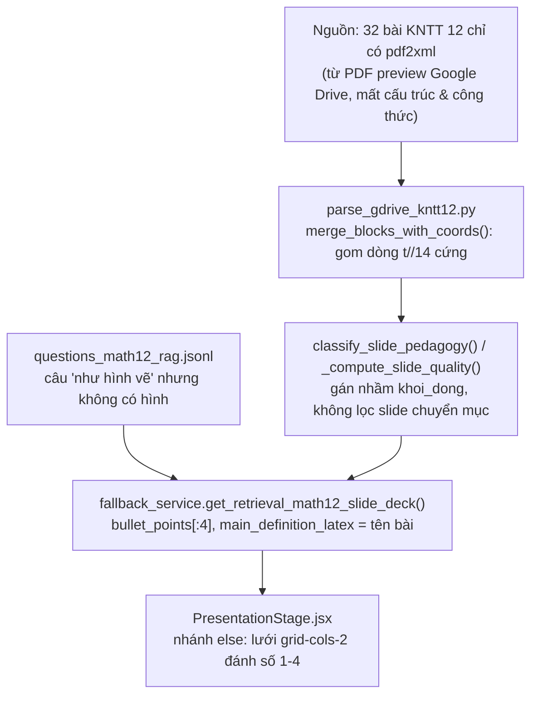
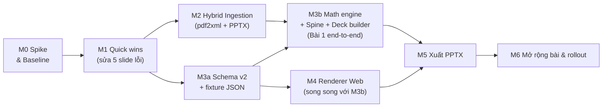

# PLAN v3.1: TÁI KIẾN TRÚC DỮ LIỆU, BỘ SINH BÀI GIẢNG & TRÌNH BÀY SLIDE TOÁN HỌC

> **Mục tiêu:** Slide sinh ra (Web Studio và file `.pptx`) đạt chuẩn giảng dạy như bộ dữ liệu của giáo viên trong `data/`: không vỡ công thức, không mất đề bài/hình, đúng trình tự sư phạm, không rập khuôn "4 chiếc hộp".
>
> **Nguyên tắc dẫn đường của v2**
> 1. **Dữ liệu trước, giao diện sau.** Sửa tận nguồn (làm sạch ở bước ingest; dùng PPTX gốc khi có) thay vì vá triệu chứng.
> 2. **Không bao giờ xuất toán sai.** Mọi con số/bảng do SymPy tính và tự kiểm; không chắc thì bỏ, không đoán.
> 3. **Cắt dọc, giao sớm.** Có kết quả nhìn thấy được sau vài ngày (M1), rồi mới làm sâu.
> 4. **Đo được.** Mỗi mốc có bộ lint và golden set; "0% lỗi" phải có công cụ đo.
> 5. **Có đường lui.** Feature flag `SLIDE_PIPELINE=v1|v2`, adapter cho dữ liệu cũ, phương án thay thế cho hạng mục rủi ro cao.

---

## 0A. CẬP NHẬT v3: ĐỐI CHIẾU VỚI DỮ LIỆU THỰC TẾ TRONG `data/`

Bản đánh giá plan v2 (đối chiếu trực tiếp repo) cho thấy **dữ liệu thực tế khác giả định của v2**. v3 sửa các điểm dưới đây; phần còn lại của v2 giữ nguyên.

**Baseline dữ liệu thực tế**

| Nguồn | Hiện trạng | Hệ quả cho plan |
| :--- | :--- | :--- |
| Toán 12 KNTT (CT 2018), 32 bài, `data/slides_kntt12/` | Chỉ có **32 file pdf2xml** trong `xml/` (từ bản PDF preview Google Drive, qua `fetch_all_gdrive_xml.py`); **không có pptx/pdf gốc** trong repo | Đây là nguồn sinh ra các slide lỗi S2–S5. **Đường pdf2xml (Phụ lục A) là đường chính**, không phải đường dự phòng |
| 59 pptx lớp 12: `Giáo án PPT-GT12 HKI` (38 file), `Dự án PPT-HH12 kì I` (21 pptx + 1 ppt) | Thuộc **CT 2006**. Có Chương I Giải tích (đơn điệu, cực trị, GTLN–GTNN, tiệm cận, khảo sát hàm số) và hình học HKI | Dùng tốt cho Bài 1–4 (hàm số) và làm mẫu sư phạm. **Không có** slide cho Oxyz, Thống kê ghép nhóm, Nguyên hàm–Tích phân, Xác suất có điều kiện/Bayes |
| Toàn bộ 193 pptx (3.953 slide) | 76,1% slide (3.009) dùng OMML; 11,7% slide (463) dùng OLE MathType/.wmf | Parser PPTX xử lý trực tiếp khoảng ba phần tư công thức; khoảng 1/8 cần phương án riêng (giữ ảnh, OCR sau) |

**Thay đổi chính của v3 so với v2**

| # | Thay đổi | Lý do |
| :-- | :--- | :--- |
| 1 | **M2 thành Hybrid Ingestion**: pdf2xml (làm sạch bằng Phụ lục A) cho 32 bài KNTT 12; parser PPTX cho Chương I, hình học, Toán 10–11. Thêm tag `curriculum` (`ct2018`/`ct2006`) cho mọi slide | 32 bài KNTT 12 không có nguồn PPTX; kho PPTX khác chương trình |
| 2 | **Gate G1 đổi nghĩa**: từ "PPTX dùng được không" thành "chương nào dùng nguồn nào"; thêm spike **tải/xuất PPTX gốc của 32 bài từ Google Drive** theo file id trong `manifest.json` | Nếu tải được thì có nguồn có cấu trúc với chi phí rất thấp |
| 3 | **Golden set chia theo nguồn** (pdf2xml và PPTX), không giả định có PPTX cho mọi chương | Chương Oxyz/Thống kê/Tích phân/Xác suất chỉ có pdf2xml |
| 4 | **Tái sử dụng module có sẵn**: nâng cấp `pptx_parser.py` (đã đệ quy group, xử lý `is_spanned`, fallback tiêu đề theo tọa độ) thay vì viết `pptx_reader.py` mới; G3/M5 dùng `latex2mathml`, `mathml2omml`, `render_latex_to_bytes` | Tránh hai bộ đọc PPTX song song |
| 5 | **Sửa tên hàm và vị trí trong code**: `get_retrieval_math12_slide_deck` (gọi qua `get_curated_slide_deck`), không phải `get_retrieval_math12_slide_deck` | Đồng bộ với code thực tế |
| 6 | **Schema**: tách "không xác định" của $f'(x)$ và của $f(x)$ (`y_break`); `intervals` thêm `undef`; dùng lại `ChartSpec` thay vì tạo `PlotSpec` song song; sửa `validate_quiz_options`; thêm `block_id` ổn định | Biểu diễn đúng $y=\lvert x\rvert$, $y=\sqrt[3]{x}$, tiệm cận đứng, hàm căn/logarit; tránh trùng lặp và xung đột validator |
| 7 | **Math engine an toàn**: whitelist lớp hàm, kiểm `FiniteSet`, timeout cứng bằng tiến trình con, precompute và cache | SymPy có thể treo hoặc trả `ConditionSet` với hàm lượng giác/mũ/căn phức tạp |
| 8 | **Frontend**: máy trạng thái phím cho reveal; chặn phím khi mở MathLive/Whiteboard/TeacherChatDock; sửa công thức theo **đường dẫn tới block** | `Space` đang dùng để chuyển slide; double-click sửa công thức và nhảy từ cảnh báo sư phạm (Task 8, Task 10) hiện chỉ đọc/ghi `main_definition_latex` và `bullet_points[i]` |
| 9 | **Phụ lục A: sửa 3 lỗi logic** (A.1 gom cột, A.3 nối dòng, A.4 ngưỡng chuyển mục) | Đánh giá chỉ ra lỗi thật trong code mẫu v2 |
| 10 | **Chương không có slide giáo viên**: spine chạy bằng nội dung SGK (pdf2xml đã làm sạch) cộng thư viện định lí đã duyệt; không giả định có slide mẫu | Tránh phụ thuộc vào dữ liệu không tồn tại |

---

## 0A+. BẢN VÁ v3.1: BỐN LỖI PHỤ LỤC A TỪ LẦN CHẠY THỬ TRÊN DỮ LIỆU THẬT (BÀI 1, PAGE 1–7)

| # | Lỗi (hiện tượng) | Nguyên nhân | Cách sửa (xem Phụ lục A) |
| :-- | :--- | :--- | :--- |
| 1 | `order_by_columns` đẩy công thức căn giữa ($s(t)=\dots$, $l=251$) và chữ "Trả lời:" ($l=182$) xuống cuối slide | Thụt đầu dòng/căn giữa bị coi là cột 2 chỉ vì khe ngang ≥ 12% bề rộng trang | **Chỉ chia cột khi ≥ 2 đoạn bên phải giao theo chiều dọc với đoạn bên trái**; nếu không giao thì giữ thứ tự trên xuống theo `t` (A.1) |
| 2 | `is_divider_slide` trả `False` trên chính slide lỗi S4 (Page 4) và Page 3 | Các dòng IN HOA không được nối nên `len(texts)` = 4–5, vượt giới hạn `<= 2` | `words <= 25 and len(texts) <= 6`, kết hợp `not has_math and (upper_ratio > 0.85 or only_marks)`; slide Định lí/Chú ý (chữ thường) không bị ảnh hưởng (A.4) |
| 3 | Mất số mũ: `y = x^2` thành `y = x 2`, `t^3` thành `t 3` | Mảnh số mũ nằm cùng hàng (lệch tâm dọc ~2 px) nên bị nối bằng khoảng trắng | Hàm `stitch_segment`: mảnh **nhô cao hơn** (đỉnh cao hơn block đầu hàng) hoặc **nhỏ hơn và nằm nửa trên** thì chèn `^` (hạ thấp thì `_`), rồi `wrap_math_runs` gộp cả cụm thành một `$...$` (A.1, A.2) |
| 4 | `x2` đứng trước `∈`/`?` không thành chỉ số dưới; `y x1`, `y x2`, `s t` chưa được bọc hàm | Lookahead của `_SUB` thiếu `∈ ? : ]`, cuối chuỗi, `$`; hàm chưa được bọc **trước** khi xử lý chỉ số | Bọc hàm (`_FUNC`) **trước** `_SUB`; mở rộng lookahead; `x0/y0` luôn là chỉ số dưới (A.2) |

Các ca trên được đưa vào **fixture test** (`tests/fixtures/kntt12_bai1_pages.json`, `page_w=720`) và là điều kiện chạy của CI cho Phụ lục A.

---

## 0B. NHỮNG GÌ THAY ĐỔI SO VỚI PLAN v1 (VÀ VÌ SAO)

| # | Thay đổi | Lý do |
| :-- | :--- | :--- |
| 1 | Thêm **M0 (spike + baseline)** và các **cổng quyết định (Gate)** | Plan v1 giả định đúng hướng ngay từ đầu; nhiều hạng mục (đọc PPTX, SymPy parse, công thức trong PPTX) cần kiểm chứng trước khi đầu tư |
| 2 | ~~Ưu tiên đọc thẳng PPTX gốc~~ → (v3) **Hybrid**: pdf2xml cho 32 bài KNTT 12, PPTX cho chương có file | Xem mục 0A |
| 3 | Thêm **M1 Quick wins** (≤3 ngày) trước khi đổi schema | Giải quyết cả 5 slide lỗi đang thấy bằng thay đổi nhỏ, giảm rủi ro và có demo sớm |
| 4 | Schema v2 bổ sung **`FIGURE/PlotSpec`, `QUIZ`**, thiết kế lại `VariationTableSpec` (bỏ công thức độ dài `2n-3`) | v1 nêu lỗi "mất hình vẽ" nhưng chỉ giải quyết bảng; thiếu block trắc nghiệm/đồ thị; spec cũ dễ lệch pha và không biểu diễn được điểm gián đoạn |
| 5 | **Spine dạng dữ liệu (YAML)** theo loại bài, không hard-code Bài 1 | Mở rộng sang chương khác không phải viết lại thuật toán |
| 6 | **LLM chỉ viết lời dẫn; số liệu toán do SymPy cung cấp** | Chặn LLM bịa kết quả; đường LLM và đường fallback dùng chung một bộ validator |
| 7 | **Bảng biến thiên chỉ sinh từ biểu thức tường minh**; bỏ nhánh "đoán bảng từ văn xuôi lời giải" | Bảng sai còn tệ hơn không có bảng |
| 8 | PPTX: **slide build-up là mặc định**, animation `<p:timing>` là tùy chọn sau cùng; bảng biến thiên vẽ bằng **shape native từ layout dùng chung** với web | `<p:timing>` viết tay dễ làm PowerPoint báo lỗi; Matplotlib/SVG không nhúng vector tốt vào PPTX |
| 9 | Sửa các lỗi trong code mẫu v1 (regex `\i` gây `re.error`, nối nhầm tiêu đề vào thân, ngưỡng 12px cứng, lọc quá tay slide ngắn, lọc nhầm slide "Vận dụng") | Xem mục III-M1 và Phụ lục A |
| 10 | Thêm **QA tự động** (lint, KaTeX, snapshot LibreOffice), golden set, đánh giá bởi giáo viên | Tiêu chí nghiệm thu đo được |

---

## I. CHẨN ĐOÁN (RÚT GỌN, THAM CHIẾU THEO TÊN HÀM)

Số dòng trong code sẽ lệch sau vài commit nên plan này chỉ tham chiếu theo tên hàm.



| Lỗi quan sát | Hàm/file | Nguyên nhân gốc |
| :--- | :--- | :--- |
| **S2:** tiêu đề đứt ngang, mất $s(t)$, ô 4 chỉ còn "Giải:" | `classify_slide_pedagogy`, `get_retrieval_math12_slide_deck` | Slide "Vận dụng 1 …" khớp từ khóa "tình huống mở đầu" nên bị gán `khoi_dong`; cắt `bullet_points[:4]` chặt đúng chữ "Giải:" |
| **S3:** khung công thức hiện tên bài; định lý bị chặt thành 4 ô | `merge_blocks_with_coords`, `get_retrieval_math12_slide_deck` | Ký hiệu `′` và chỉ số có tọa độ lệch nên bị tách dòng; fallback `main_definition_latex = tên bài học` |
| **S4:** 4 ô chữ trang trí ("BÀI HỌC", "01"…) | `_compute_slide_quality` | Không có bộ lọc slide chuyển mục |
| **S5:** đề "như hình vẽ" nhưng không có hình; lặp "Đáp án đúng là D" | `build_worked_steps_from_solution`, `retrieve_questions` | Không lọc câu phụ thuộc hình; nhét trắc nghiệm vào layout tự luận; mẫu câu cứng ở mọi bước |
| **Mọi slide:** 4 hộp đen đánh số | `PresentationStage.jsx` (nhánh `else`) | Mọi layout rơi chung một vòng lặp lưới |
| **Gốc rễ #0** | Pipeline ingest | 32 bài KNTT 12 chỉ còn pdf2xml (không có file gốc) nên buộc dựng lại dòng/câu bằng tọa độ; kho PPTX có cấu trúc nhưng thuộc CT 2006 |

**Vị trí trong code (theo đối chiếu repo; số dòng sẽ lệch sau commit):** gán tên bài học vào khung công thức tại `fallback_service.py#L1293`; các chỗ cắt cứng `bullet_points[:4]` tại `#L1250`, `#L1279`, `#L1302`; hàm vào là `get_retrieval_math12_slide_deck`, gọi qua `get_curated_slide_deck`.

---

## II. LỘ TRÌNH TỔNG THỂ



| Mốc | Kết quả nhìn thấy được | Công sức ước lượng* | Điều kiện qua mốc |
| :-- | :--- | :--- | :--- |
| **M0** | Báo cáo baseline + golden set + quyết định 3 Gate | 1–2 ngày | G1, G2, G3 có quyết định |
| **M1** | 5 slide lỗi hiện tại được sửa, hết lưới 4 hộp | 2–3 ngày | Snapshot 5 slide đạt; pytest cũ vẫn pass |
| **M2** | `slides_v2.jsonl` sạch: 32 bài KNTT 12 (đường pdf2xml) + Chương I/hình học (đường PPTX), có `lint` và tag `curriculum` | 6–8 ngày | Golden set ≥ 90% slide 0 lỗi lint trên cả hai đường |
| **M3** | Bài 1 (đơn điệu & cực trị) sinh end-to-end, toán đúng | 6–8 ngày | 100% ví dụ tự luận được SymPy kiểm; deck 10 slide qua `validate_deck` |
| **M4** | Web: khối sư phạm, bảng biến thiên, đồ thị, hiện từng bước | 4–5 ngày | Demo bấm Space hiện lần lượt; snapshot FE |
| **M5** | `.pptx` tương đương bản web | 5–7 ngày | Mở được bằng PowerPoint + LibreOffice; snapshot khớp |
| **M6** | Thêm các loại bài khác, bật flag cho người dùng | liên tục | Đạt DoD (mục VII) |

\*Ước lượng thô theo ngày công của một lập trình viên; điều chỉnh sau M0.

**Cổng quyết định (Gate) ở M0**
- **G1 – Nguồn dữ liệu cho từng chương (kết quả sơ bộ: Hybrid).** 32 bài KNTT 12 chỉ có pdf2xml nên đường PDF (Phụ lục A) là đường chính; PPTX (CT 2006) dùng cho Chương I Giải tích, hình học HKI và Toán 10–11. Việc cần làm ở M0: (a) thử tải/xuất PPTX gốc của 32 bài từ Google Drive theo file id trong `manifest.json`; (b) bài nào tải được thì chuyển sang đường PPTX, bài nào không thì giữ pdf2xml; (c) ghi bảng `chương → nguồn` vào `docs/decisions.md`.
- **G2 – SymPy parse được bao nhiêu câu, và mất bao lâu?** Đo tỉ lệ câu chuyển được sang SymPy **và** tỉ lệ timeout/`ConditionSet` trên ngân hàng câu hỏi. Nếu parse < 60% hoặc timeout nhiều, ưu tiên ngân hàng ví dụ mẫu tự biên soạn và precompute offline.
- **G3 – Công thức trong PPTX xuất ra dùng gì?** Hạ tầng đã có: `latex2mathml`, `mathml2omml`, `render_latex_to_bytes` (PNG 300 DPI, 3 tầng fallback). Spike: thử chèn OMML native (theo hiểu biết của mình, PowerPoint lưu công thức trong `a14:m`, thường kèm `mc:AlternateContent` có ảnh fallback; cần kiểm chứng) và kiểm tra hiển thị ở PowerPoint lẫn LibreOffice. Mặc định giữ PNG hiện có kèm alt-text LaTeX; chỉ chuyển sang OMML khi spike đạt trên golden set.

---

## III. CHI TIẾT TỪNG MỐC

### M0 – Spike & Baseline (1–2 ngày)

1. **Kiểm kê `data/`:** kết quả sơ bộ nằm ở mục 0A; M0 chỉ cần đóng gói thành script tái lập được (`scripts/inventory_data.py`: số file theo nguồn, tỉ lệ slide OMML/OLE/ảnh/text thuần, chương trình CT 2006/2018). Kèm spike **tải PPTX gốc của 32 bài KNTT 12 từ Google Drive** theo `manifest.json`.
2. **Chọn golden set 10 bài chia theo nguồn:** 6 bài KNTT 12 từ pdf2xml (hàm số, Oxyz, thống kê ghép nhóm, tích phân, xác suất có điều kiện, 1 bài nhiều hình) và 4 bài từ PPTX (Chương I Giải tích CT 2006, hình học). Mỗi bài ghi `curriculum` và nguồn; 5 deck mẫu giáo viên làm chuẩn tham chiếu sư phạm.
3. **Đo baseline** bằng bộ lint ở mục V cho pipeline hiện tại (số slide lỗi theo từng loại).
4. **Spike 3 Gate** (G1, G2, G3) và ghi quyết định vào `docs/decisions.md`.

### M1 – Quick wins (2–3 ngày): sửa 5 slide lỗi mà chưa đụng schema

Mục đích: giao kết quả nhìn thấy được sớm và tạo "lưới an toàn" cho các mốc sau.

1. **Frontend:** thay nhánh `else` (lưới 4 hộp) bằng `BlockRenderer` + adapter `legacyToBlocks(slide)`:
   - Tiêu đề rỗng/chỉ có title → Hero; `bullet_points` → đoạn văn/danh sách (không đánh số hộp).
   - Chỉ vẽ khung công thức khi `main_definition_latex` thật sự có. **Bỏ fallback "tên bài học"** ở `get_retrieval_math12_slide_deck`.
2. **Bộ lọc slide chuyển mục** (bản đã sửa so với v1, xem Phụ lục A.4): dựa trên tỉ lệ chữ IN HOA, không có công thức/câu hỏi, rất ít chữ. **Không** loại slide ngắn nói chung (Định lí/Chú ý ngắn vẫn hợp lệ).
3. **Phân loại vai trò slide:** slide có tiêu đề bắt đầu bằng "Vận dụng/Luyện tập/Bài tập" **không bao giờ** là `khoi_dong`. Slide tham chiếu "tình huống mở đầu" được giữ với vai trò `apply_ref` để dùng cho khối "Giải bài toán mở đầu" ở M3.
4. **Ngân hàng câu hỏi:** gắn cờ `has_image` / `has_missing_visual` lúc build dữ liệu (regex mở rộng + cờ ảnh từ nguồn); tách `question_type` (`essay` | `mcq`); câu tự luận không dùng mẫu "Đáp án đúng là X"; câu trắc nghiệm hiển thị đủ A/B/C/D và chỉ nêu đáp án một lần ở phần giải thích.
5. **Bỏ cắt cứng:** thay các chỗ `bullet_points[:4]` trong `get_retrieval_math12_slide_deck` (khoảng `#L1250`, `#L1279`, `#L1302`) bằng chọn theo vai trò slide; không còn chặt mất lời giải (lỗi "Giải:" ở S2).
6. **Test snapshot** cho đúng 5 slide lỗi cũ (fixture JSON → render → so snapshot).

### M2 – Hybrid Ingestion (6–8 ngày)

**Đầu ra:** `slides_v2.jsonl` thống nhất cho hai nguồn, mỗi slide có khối có kiểu rõ ràng, tag nguồn/chương trình và báo cáo lint.

```python
{
  "slide_no": 7, "source": "kntt12_bai1.xml", "source_kind": "pdf2xml",   # hoặc "pptx"
  "curriculum": "ct2018",                                                  # hoặc "ct2006"
  "title": "Định lí 1",
  "role": "theorem",                           # luật theo tiêu đề + vị trí + khung viền, không chỉ từ khóa
  "quality": "ok",                             # ok | low (công thức nghi ngờ)
  "blocks": [
    {"kind": "text",    "text": "Cho hàm số $y=f(x)$ có đạo hàm trên $K$."},
    {"kind": "math",    "latex": "f'(x) > 0, \\forall x \\in K \\Rightarrow ...", "origin": "omml"},
    {"kind": "picture", "asset": "assets/a1b2c3.png", "math_image": false}
  ],
  "lint": {"errors": [], "warnings": []}
}
```

**Đường A – pdf2xml (32 bài KNTT 12, đường chính cho CT 2018)**
- Áp dụng Phụ lục A vào `parse_gdrive_kntt12.py` và `build_packaged_data.py`: gom dòng và cột (A.1), nối câu trong cùng một đoạn (A.3), chuẩn hóa ký hiệu toán (A.2), lọc slide chuyển mục (A.4), phân loại vai trò slide.
- PDF không khôi phục được phân số/căn xếp chồng. Slide có công thức nghi ngờ được gắn `quality=low` và chỉ dùng làm ngữ cảnh RAG, **không** đưa nguyên văn lên slide.
- **Thư viện định lí/định nghĩa đã duyệt** (`data/curated/theorems_ct2018.yaml`): với các phát biểu quan trọng nhất của từng bài (ước lượng vài mục mỗi bài), LLM khôi phục LaTeX từ pdf2xml rồi **người duyệt xác nhận một lần**. Spine lấy `THEOREM_BOX` từ thư viện này, không phụ thuộc chất lượng trích xuất tự động ở phần quan trọng nhất.

**Đường B – PPTX (CT 2006 Chương I, hình học, Toán 10–11 và mọi PPTX bổ sung)**
- **Nâng cấp `pptx_parser.py` hiện có** (đã đệ quy `MSO_SHAPE_TYPE.GROUP`, xử lý `is_spanned`, fallback tiêu đề theo tọa độ `top`), không tạo module thứ hai.
- Bổ sung: trích `m:oMath` (trong `a14:m`) bằng `lxml` và chuyển OMML → LaTeX cho tập con thường gặp (`m:f`, `m:sSup`, `m:sSub`, `m:sSubSup`, `m:rad`, `m:d`, `m:nary`, `m:r/m:t`), phần chưa hỗ trợ ghi `warnings`.
- **OLE MathType / `.wmf` (11,7% slide):** giữ làm `picture` kèm cờ `math_image`, không tái dàn chữ; lint cảnh báo. OCR công thức là việc cân nhắc sau.
- Nối câu **chỉ trong cùng một shape/đoạn văn**; hình xuất ra `assets/` (băm nội dung để khử trùng).

**Quy tắc dùng chéo chương trình**
- Retrieval ưu tiên `curriculum` khớp bài. Slide `ct2006` chỉ dùng cho slot có nội dung tương đương (đơn điệu, cực trị, GTLN–GTNN, tiệm cận…) và đóng vai **mẫu sư phạm/bố cục**; khác thuật ngữ so với SGK 2018 thì ghi `warnings`, không chép nguyên.
- **Chương không có slide giáo viên** (Oxyz, Thống kê ghép nhóm, Nguyên hàm–Tích phân, Xác suất có điều kiện/Bayes): spine vẫn chạy bằng nội dung SGK từ Đường A cộng SlotFiller LLM. Muốn nâng chất lượng thì thu thập thêm PPTX CT 2018 rồi bổ sung vào golden set.

**Ngân hàng câu hỏi:** trích `function_expr` (khi có biểu thức tường minh), tách phương án A–D, cờ `has_image`, `question_type`; thêm trường `analysis` được precompute ở M3b.

### M3 – Schema v2, Math engine, Spine, Deck builder (6–8 ngày)

**Ngày đầu của M3: đóng băng schema (M3a) và viết fixture JSON** để frontend (M4) làm song song mà không chờ backend.

#### M3a. Schema v2 (`slide_schema.py`)

```python
from enum import Enum
from typing import List, Literal, Optional
from pydantic import BaseModel, Field, model_validator   # Pydantic v2; nếu đang dùng v1 đổi sang @root_validator

# ChartSpec: dùng lại class hiện có (cùng nơi FunctionPlotter.jsx / graph_generator.py đang dùng),
# KHÔNG tạo PlotSpec song song. Thêm hàm chuyển trong graph_generator.py:
#   chart_from_expr(expr, x_range, marked_points, tangent_at) -> ChartSpec

class TableNode(BaseModel):
    x: str                                        # LaTeX: "-\\infty", "0", "2", "+\\infty"
    fprime: Literal["0", "||", ""] = ""           # dòng f'(x): "0", "||" (f' không xác định), "" (tại ±∞)
    y_break: bool = False                         # dòng f(x): True = kẻ sọc đôi (f gián đoạn/không xác định)
    y_left: Optional[str] = None                  # giá trị/giới hạn bên trái (LaTeX)
    y_right: Optional[str] = None                 # bên phải; bằng y_left nếu liên tục tại nút

class VariationTableSpec(BaseModel):
    variable: str = "x"
    function_name: str = "y"
    nodes: List[TableNode] = Field(min_length=2)
    intervals: List[Literal["+", "-", "undef"]]   # dấu f' trên từng khoảng; "undef" = khoảng ngoài tập xác định
    only_sign_row: bool = False                   # True: bảng xét dấu (không vẽ dòng f(x))

    @model_validator(mode="after")
    def _check(self):
        if len(self.intervals) != len(self.nodes) - 1:
            raise ValueError("len(intervals) phải bằng len(nodes) - 1")
        return self

class QuizOption(BaseModel):
    id: Literal["A", "B", "C", "D"]
    text: str

class QuizSpec(BaseModel):
    options: List[QuizOption] = Field(min_length=4, max_length=4)
    correct_id: Literal["A", "B", "C", "D"]
    distractor_notes: dict = {}                   # id -> vì sao sai (bẫy thường gặp)

class BlockType(str, Enum):
    PROBLEM_BOX = "PROBLEM_BOX"
    EXPLORE_PROMPT = "EXPLORE_PROMPT"
    DERIVATION_STEP = "DERIVATION_STEP"
    THEOREM_BOX = "THEOREM_BOX"
    CAUTION_BOX = "CAUTION_BOX"
    WORKED_STEP = "WORKED_STEP"
    PRACTICE_TASK = "PRACTICE_TASK"
    FIGURE = "FIGURE"
    QUIZ = "QUIZ"
    SUMMARY = "SUMMARY"

class SlideBlock(BaseModel):
    block_id: str                                 # ổn định, do deck_builder gán: "s{slide}-b{n}"; dùng để định vị khi sửa/cảnh báo
    block_type: BlockType
    label: Optional[str] = None
    content: str = ""                             # văn bản + LaTeX trong $...$
    formula_latex: Optional[str] = None
    table: Optional[VariationTableSpec] = None
    chart: Optional["ChartSpec"] = None           # ChartSpec hiện có
    figure_asset: Optional[str] = None            # ảnh từ assets/
    quiz: Optional[QuizSpec] = None
    reveal_order: int = 0
    wait_seconds: int = 0
    verified: bool = True                         # False nếu toán chưa được SymPy kiểm

    @model_validator(mode="after")
    def _check(self):
        if self.block_type == BlockType.FIGURE and not (self.chart or self.figure_asset or self.table):
            raise ValueError("FIGURE cần chart, figure_asset hoặc table")
        if self.block_type == BlockType.QUIZ and not self.quiz:
            raise ValueError("QUIZ cần quiz")
        return self

class SlideSchema(BaseModel):
    # ... giữ các trường hiện có (slide_index, type, layout, title, bullet_points, quiz_options, ...)
    schema_version: int = 2
    blocks: List[SlideBlock] = Field(default_factory=list)
```

**Cách điền `y_break` và `fprime` (kiểm bằng test):**

| Trường hợp | `fprime` tại nút | `y_break` |
| :--- | :--- | :--- |
| $y=x^3-3x^2+2$ tại $x=0$ | `"0"` | `False` |
| $y=\lvert x\rvert$ tại $x=0$ ($f$ liên tục, $f'$ không xác định) | `"\|\|"` | `False` |
| $y=\sqrt[3]{x}$ tại $x=0$ | `"\|\|"` | `False` |
| $y=\dfrac{1}{x}$ tại $x=0$ (tiệm cận đứng) | `"\|\|"` | `True` |
| Hàm căn/logarit, khoảng ngoài tập xác định | khoảng là `"undef"` | tùy nút biên |

**Sửa validator hiện có `validate_quiz_options`:** hiện bắt buộc slide `layout == QUIZ_OPTION` phải có `quiz_options`. Đổi thành: hợp lệ nếu có `quiz_options` **hoặc** có ít nhất một block `QUIZ`. Thêm test cho cả hai nhánh.

**Hợp đồng tương thích:** nếu `blocks` rỗng, renderer dùng adapter `legacy_to_blocks(slide)` để tạo block với `block_id` ảo (`legacy-main`, `legacy-b{i}`), không bao giờ quay lại lưới 4 hộp. Test "slide v1 cũ vẫn render và vẫn hợp lệ".

#### M3b. Math engine (`src/math_engine/analyze.py`)

Mục tiêu: nhận một biểu thức hàm số, trả về phân tích **đã tự kiểm** hoặc `None` kèm `reason`.

1. **`safe_parse(expr_str)`:** làm sạch LaTeX (`\left \right`, `\cdot`, `\frac{a}{b}` → `(a)/(b)`, `^{...}` → `**(...)`, `\sqrt{}`), chỉ cho phép danh sách ký tự/hàm trắng, dùng `parse_expr` với `implicit_multiplication_application`. Nếu `sympy.parsing.latex` (cần antlr4) có sẵn thì dùng làm đường thứ hai.
2. **Whitelist lớp hàm (giai đoạn 1), kiểm TRƯỚC khi gọi SymPy nặng:** đa thức bậc ≤ 4; hàm hữu tỉ có tử/mẫu bậc ≤ 3; căn bậc hai của đa thức bậc ≤ 2. Lượng giác, mũ, logarit chưa hỗ trợ ở giai đoạn 1 (mở rộng sau với miền hạn chế). Ngoài whitelist trả `None`, `reason="unsupported"`.
3. **Chặn kết quả lạ:** chỉ nhận `isinstance(crit, sp.FiniteSet)` với mọi phần tử thực; gặp `ConditionSet`/`Complement`/`Union` lạ hoặc quá 5 nút thì `None`.
4. **Timeout cứng 2 giây/câu bằng tiến trình con** (`ProcessPoolExecutor`, `future.result(timeout=2.0)`, hết giờ thì dừng/tái tạo pool). Không dùng `signal.alarm` vì không chạy được trong worker thread của FastAPI. Hết giờ trả `None`, `reason="timeout"`.
5. **Precompute và cache:** chạy `analyze_function` hàng loạt lúc build dữ liệu rồi lưu `analysis` vào ngân hàng câu hỏi; lúc chạy chỉ phân tích biểu thức do LLM/giáo viên chọn từ whitelist, có LRU cache theo biểu thức chuẩn hóa.
6. **Phân tích:** tập xác định (`continuous_domain`), điểm gián đoạn (`singularities`), `f'` (`diff`), điểm tới hạn (`solveset`). **Xét dấu bằng điểm thử** (thay giá trị đại diện giữa hai nút kề nhau, sắp theo giá trị số), giá trị và giới hạn tại nút bằng `subs`/`limit`, rồi dựng `VariationTableSpec` với `y_break` và `undef` đúng ngữ nghĩa ở M3a.
7. **Tự kiểm (bắt buộc):** đối chiếu với `solution` của câu hỏi khi có; property test với đa thức ngẫu nhiên (dấu `f'` khớp sai phân số học). Không khớp/không chắc thì `None`, **không** dựng bảng và không dùng ví dụ đó cho slide tự luận.
8. **Test đối kháng:** các biểu thức như `sin(x**x)`, `tan(x)**x`, bậc cao, hàm không giải được phải trả `None` trong ≤ 2,5 giây.

#### M3c. Spine theo loại bài (`src/spines/*.yaml`)

Mỗi loại bài là một file dữ liệu liệt kê các "ô" (slot) với block bắt buộc/tùy chọn, truy vấn RAG, số slide tối thiểu/tối đa. Ví dụ loại `function_monotonic_extrema` (đánh số **một lần duy nhất**, dùng cho mọi tài liệu về sau):

| Slot | Nội dung | Block chính | Nguồn nội dung |
| :-- | :--- | :--- | :--- |
| S1 | Tình huống mở đầu (hàm số cụ thể) | PROBLEM_BOX, FIGURE (đồ thị), EXPLORE_PROMPT | slide `khoi_dong` thật, nếu thiếu thì ví dụ mẫu (vd: chất điểm $s(t)=t^3-9t^2+15t$) |
| S2 | Khám phá: dấu $f'$ ↔ chiều đồ thị | DERIVATION_STEP (hiện dần), FIGURE | engine + slide `explore` |
| S3 | Định lí tính đơn điệu + Chú ý | THEOREM_BOX, CAUTION_BOX | slide `theorem` |
| S4 | Ví dụ mẫu 1 (đơn điệu) | WORKED_STEP ×3, FIGURE(bảng biến thiên) | engine |
| S5 | Tự luyện 1 | PRACTICE_TASK (đếm ngược), lời giải hiện sau | engine |
| S6 | Khám phá cực trị (đổi dấu $f'$) | DERIVATION_STEP, FIGURE | engine |
| S7 | Định lí cực trị + bẫy ($f'(x_0)=0$ nhưng không đổi dấu, ví dụ $y=x^3$) | THEOREM_BOX, CAUTION_BOX | slide `theorem` + ví dụ phản chứng |
| S8 | Ví dụ mẫu 2 (cực trị) + bảng biến thiên | WORKED_STEP ×3, FIGURE | engine (vd $y=x^3-3x^2+2$: cực đại $y(0)=2$, cực tiểu $y(2)=-2$) |
| S9 | Trắc nghiệm | QUIZ (kèm phân tích bẫy) | ngân hàng câu hỏi đã lọc |
| S10 | Giải trọn bài toán mở đầu + tổng kết | WORKED_STEP, SUMMARY | slide `apply_ref` + engine |

Các loại khác (hình học không gian, tích phân, xác suất…) dùng cùng khung nhưng ít bảng biến thiên; loại `generic` là phương án dự phòng.

#### M3d. Deck builder (`src/services/deck_builder.py`) – thay thế dần `fallback_service` (strangler pattern)

```
chọn spine -> với mỗi slot: SlotFiller -> validate_slide -> (sửa | fallback) -> validate_deck
```

- **SlotFiller deterministic:** chọn slide giáo viên phù hợp vai trò + điền khối.
- **SlotFiller LLM:** nhận ngữ cảnh RAG và JSON schema của block, chỉ viết **lời dẫn/câu hỏi**. Số liệu (đạo hàm, nghiệm, bảng) là *placeholder* `{{y_prime}}`, `{{table_1}}` do engine điền. LLM không được tự viết kết quả tính toán.
- **Validator dùng chung** cho cả hai đường: JSON hợp lệ theo schema, lint mục V, đủ block bắt buộc của slot; lỗi thì thử lại tối đa 2 lần rồi rơi về deterministic.
- `ai_service.py` chỉ gọi `deck_builder`, không giữ logic ghép slide riêng.
- `get_curated_slide_deck` / `get_retrieval_math12_slide_deck` giữ làm điểm vào (wrapper) và ủy quyền cho `deck_builder` khi `SLIDE_PIPELINE=v2`.
- `deck_builder` gán `block_id` xác định (`s{slide}-b{n}`) cho mọi block để phục vụ sửa công thức và cảnh báo sư phạm (M4).

### M4 – Renderer Web (4–5 ngày, song song với M3b sau khi có fixture)

1. **`BlockRenderer`** theo `block_type`: `THEOREM_BOX` (nhãn gắn viền trên), `CAUTION_BOX` (viền hổ phách), `PROBLEM_BOX` (nền xanh nhạt, chữ lớn), `QUIZ`, `PRACTICE_TASK` (đồng hồ), `FIGURE`.
2. **Bố cục theo vai trò slide** (Title / WarmUp / Concept / Worked / Quiz / Summary); xóa hẳn lưới `grid-cols-2` đánh số.
3. **Bảng biến thiên dùng layout dùng chung.** Backend có `layout_variation_table(spec) -> List[Primitive]` (đường, chữ, mũi tên, sọc đôi cho `fprime="||"` và `y_break`, vùng gạch cho `undef`; tọa độ chuẩn hóa 0–1), đính vào JSON slide khi serialize. `VariationTable.jsx` chỉ vẽ lại primitive bằng SVG; exporter PPTX (M5) vẽ cùng primitive bằng shape native.
4. **Đồ thị:** dùng `FunctionPlotter.jsx` với `ChartSpec` (tạo bởi `chart_from_expr`); backend đã qua `safe_parse`, trình duyệt không `eval` biểu thức.
5. **Máy trạng thái phím và hiện từng bước** (`PresentationStage.jsx`, hiện `Space` đang chuyển slide ở khoảng `#L1692`):
   - **Chặn phím:** bỏ qua `Space`/`Enter`/mũi tên khi đang mở `MathLiveModal`, `WhiteboardOverlay`, hoặc focus đang ở ô nhập (`input`, `textarea`, `contenteditable`, `math-field`, `TeacherChatDock`).
   - **Tiến:** `Space`/`Enter`/`→`: nếu `revealedStepCount < maxReveal` thì tăng 1 (có `preventDefault`); khi đã hiện hết mới sang slide kế.
   - **Lùi:** `←`: nếu `revealedStepCount > 0` thì giảm 1; ngược lại về slide trước và hiện đầy đủ.
   - **Đổi slide:** tiến thì `revealedStepCount = 0`, lùi thì `= maxReveal`. Slide không có `reveal_order > 0` giữ hành vi cũ. Chế độ soạn/in/xuất luôn hiện đủ; có nút "Hiện tất cả".
6. **Sửa công thức hai chiều (Task 8 và Task 10) không được gãy.** `handleOpenMathModal` (khoảng `#L432–#L450`) hiện chỉ đọc/ghi `main_definition_latex` và `bullet_points[i]`. Đổi sang **đích sửa theo đường dẫn**: `editTarget = { slideIndex, blockId, field }` với `field ∈ {content, formula_latex}`; slide v1 dùng `block_id` ảo của adapter và **ghi ngược đúng trường gốc** (`main_definition_latex`, `bullet_points[i]`). Cảnh báo sư phạm từ backend trả `target: {block_id, field}` thay vì chỉ số bullet.
7. **Truy cập:** điều hướng bằng bàn phím, độ tương phản các hộp.

### M5 – Xuất PPTX (5–7 ngày, `slide_exporter.py`)

1. **Hiện từng bước = slide build-up (mặc định):** mỗi mức `reveal_order` sinh một slide cộng dồn. Chạy được trên PowerPoint, Keynote, Google Slides, LibreOffice.
2. **Bảng biến thiên:** vẽ từ primitive bằng shape native (đường, textbox, mũi tên có đầu mũi tên). Có thể chỉnh sửa trong PowerPoint, sắc nét khi chiếu.
3. **Hộp Định lí/Chú ý:** hình chữ nhật bo góc + shape nhãn đè viền trên (theo cấu trúc file mẫu của giáo viên).
4. **Công thức:** dùng lại `render_latex_to_bytes` trong `slide_exporter.py` (PNG 300 DPI, 3 tầng fallback, kèm alt-text LaTeX) làm mặc định; chuyển sang OMML native (`latex2mathml` → `mathml2omml`) chỉ khi Gate G3 đạt. Công thức MathType/OLE (`math_image`) được chèn lại như ảnh.
5. **Animation `<p:timing>`:** hạng mục tùy chọn sau cùng, bật bằng cờ `EXPORT_ANIMATIONS=1`. Chỉ phát hành khi đã mở thử bằng PowerPoint thật (không kiểm thử được trong CI).
6. **Kiểm thử:** nạp lại bằng `python-pptx`, chuyển LibreOffice → PDF → PNG để so snapshot với bản web, chạy toàn bộ pytest.

### M6 – Mở rộng & phát hành

- Viết thêm spine cho từng chương Toán 12 KNTT trước, sau đó Toán 10/11; mỗi loại bài thêm vào golden set.
- Bật `SLIDE_PIPELINE=v2` theo giai đoạn: nội bộ → nhóm giáo viên thử → mặc định; vẫn giữ `v1` một thời gian.
- Vòng phản hồi: nút "bài giảng tốt/chưa tốt", lưu các chỉnh sửa tay của giáo viên để cải thiện spine và prompt.

---

## IV. THIẾT KẾ KIỂM THỬ

| Lớp | Công cụ | Nội dung |
| :-- | :--- | :--- |
| Unit | pytest | `join_wrapped_lines`, `normalize_math` (bảng ví dụ vào/ra), OMML→LaTeX, `safe_parse`, `analyze_function`, `layout_variation_table` |
| Fixture dữ liệu thật | pytest | Page 1–7 Bài 1 (`page_w=720`): công thức căn giữa/"Trả lời:" giữ đúng thứ tự; hai cột thật vẫn tách cột; Page 3/4 là divider, Định lí/Chú ý thì không; `s t = t 3 − 9t 2 + 15t` → `$s(t) = t^3 − 9t^2 + 15t$`; `y = x 2` → `$y = x^2$`; câu Page 7 về `x1, x2 ∈ R` → `$x_1$, $x_2$ ∈ R … $y(x_1)$ và $y(x_2)$` |
| Property | `hypothesis` | Đa thức ngẫu nhiên: dấu `f'` từ engine khớp sai phân số học; `len(intervals)==len(nodes)-1` |
| Lint nội dung | `deck_lint.py` | Xem mục V |
| Snapshot FE | Playwright/Jest | 5 slide lỗi cũ + mỗi loại block + bảng biến thiên |
| Snapshot PPTX | LibreOffice headless → PNG | So với bản web (ngưỡng sai khác) |
| Thủ công | PowerPoint thật | Mở file, kiểm animation (nếu bật) |
| Timeout/an toàn | pytest + `pytest-timeout` | Biểu thức đối kháng (lượng giác lồng, mũ tháp, hàm không giải được) trả `None` trong ≤ 2,5 giây |
| E2E tương tác | Playwright | `Space`/`→`/`←` với reveal; chặn phím khi mở MathLiveModal/Whiteboard/TeacherChatDock; double-click sửa công thức trên block và trên slide v1; nhảy từ cảnh báo sư phạm tới công thức |
| Schema | pytest | Slide v1 cũ hợp lệ; `validate_quiz_options` chấp nhận `quiz_options` hoặc block `QUIZ`; `len(intervals)==len(nodes)-1`; bảng ngữ nghĩa `fprime`/`y_break` ở M3a |

---

## V. TIÊU CHÍ ĐO LƯỜNG & LINT

**`deck_lint.py` – mỗi slide/deck phải qua (lỗi chặn)**
- Số `$` cân bằng; mọi công thức render được bằng KaTeX (không có lỗi parse).
- Không có dòng "mảnh vỡ" (< 3 từ và không phải công thức/nhãn hợp lệ).
- Không chứa token chuyển mục ("BÀI HỌC", số thứ tự rời rạc).
- Slide tự luận không chứa "Đáp án đúng là"; mọi đề "như hình vẽ" phải có `FIGURE` đi kèm, nếu không loại.
- Mọi `WORKED_STEP` có `verified=True`; `reveal_order` liên tục từ 0.
- Mỗi slide có ít nhất một block không phải danh sách gạch đầu dòng; không có block rỗng.
- Số slide theo spine nằm trong khoảng cho phép.

**Chỉ số theo dõi:** % slide qua lint (mục tiêu ≥ 98% golden set), % ví dụ tự luận được SymPy tự kiểm (100% với slide đánh dấu đã kiểm), tỉ lệ rơi về fallback, thời gian sinh một deck, điểm đánh giá của giáo viên (thang 1–5: đúng toán, mạch sư phạm, dễ trình chiếu) trên 5 deck mỗi vòng.

---

## VI. RỦI RO & PHƯƠNG ÁN

| Rủi ro | Mức | Giảm thiểu |
| :--- | :-- | :--- |
| PPTX gốc thiếu hoặc công thức là ảnh/OLE | Cao | Gate G1; đường PDF dự phòng; giữ ảnh công thức làm `picture`; cân nhắc OCR công thức cho phần còn lại |
| SymPy không parse được nhiều câu | Trung bình | Gate G2; ngân hàng ví dụ mẫu tự biên soạn; luôn trả `None` thay vì đoán |
| LLM bịa kết quả toán | Cao | Placeholder do engine điền + validator + thử lại/fallback |
| `<p:timing>` làm hỏng PPTX | Cao | Build-up slide mặc định; animation sau cờ, kiểm thử thủ công |
| Lệch bố cục web và PPTX | Trung bình | Layout primitive dùng chung |
| Phạm vi quá lớn | Cao | Cắt dọc theo M1→M6, mỗi mốc có demo và điều kiện qua mốc; Bài 1 làm xong end-to-end trước khi mở rộng |
| Hồi quy slide cũ | Trung bình | Adapter `legacy_to_blocks`, feature flag, test slide v1 |
| Lệch chương trình (CT 2006 ↔ CT 2018) khi dùng chéo slide | Trung bình | Tag `curriculum`, ưu tiên khớp chương trình, `warnings` khi khác thuật ngữ; slide CT 2006 chỉ làm mẫu sư phạm |
| Chương không có slide giáo viên (Oxyz, Thống kê, Tích phân, Xác suất) | Cao | Spine + nội dung SGK pdf2xml + thư viện định lí đã duyệt + LLM; thu thập thêm PPTX CT 2018 |
| 11,7% slide dùng công thức OLE MathType | Trung bình | Giữ ảnh `math_image`, không tái dàn; cân nhắc OCR công thức sau |
| SymPy treo hoặc trả `ConditionSet` | Cao | Whitelist lớp hàm + kiểm `FiniteSet` + timeout tiến trình + precompute |
| Hỏng sửa công thức/nhảy cảnh báo (Task 8, 10) | Trung bình | `block_id` + `editTarget` theo đường dẫn + E2E |

---

## VII. ĐỊNH NGHĨA HOÀN THÀNH (DEFINITION OF DONE)

1. Golden set 10 bài: ≥ 98% slide qua `deck_lint`, 0 slide dùng lưới 4 hộp.
2. Bài 1 (đơn điệu & cực trị) sinh đủ 10 slide theo spine, có đề bài gốc, đồ thị, bảng biến thiên, ví dụ giải bằng SymPy và trắc nghiệm đủ A–D.
3. `.pptx` xuất ra mở được bằng PowerPoint và LibreOffice, giống bản web (snapshot), có bảng biến thiên và hộp Định lí/Chú ý.
4. Toàn bộ pytest pass; test slide v1 cũ vẫn pass.
5. Giáo viên đánh giá trung bình ≥ 4/5 ở cả 3 tiêu chí trên ≥ 5 deck.
6. Ít nhất một chương không có slide giáo viên (Oxyz hoặc Xác suất) sinh được deck qua spine và nội dung SGK, qua `deck_lint`.
7. Task 8 và Task 10 (sửa công thức hai chiều, nhảy từ cảnh báo sư phạm) vẫn hoạt động trên cả slide v1 và slide dùng `blocks`.

---

## PHỤ LỤC A – CODE ĐƯỜNG PDF/pdf2xml (ĐƯỜNG CHÍNH CHO 32 BÀI KNTT 12; ĐÃ SỬA LỖI SO VỚI v1 VÀ v2)

> Đường chính cho 32 bài KNTT 12 (chỉ có pdf2xml) và mọi tài liệu chỉ có PDF. Mọi kết quả vẫn phải qua `deck_lint`.

### A.1 Gom dòng, ghép số mũ/chỉ số và sắp thứ tự cột (v3.1)

Hai thay đổi so với v3, đều từ dữ liệu thật Bài 1:
- `order_by_columns` chỉ chia cột khi có **≥ 2 đoạn bên phải giao theo chiều dọc** với đoạn bên trái. Công thức căn giữa hoặc dòng thụt đầu dòng nằm xen giữa các dòng văn bản không giao dọc, nên giữ thứ tự trên xuống. Hạn chế đã biết: lưới phương án A/B, C/D hai cột có thể bị đọc theo cột; trường hợp này cần xử lý riêng ở lớp `QUIZ`.
- `stitch_segment` ghép số mũ/chỉ số: mảnh nhô cao hơn block đầu hàng (hoặc nhỏ hơn và nằm nửa trên) được nối bằng `^`; mảnh hạ thấp bằng `_`. Chỉ nhận mảnh có dạng ngắn (tối đa 2 ký tự chữ-số, có thể kèm dấu); ghi `warnings` khi có ghép để lint lưu ý. Gom cụm toán thành `$...$` do `normalize_math` (A.2) đảm nhiệm.

```python
import re
import statistics
from typing import Any, Dict, List, Optional

def group_visual_lines(items: List[Dict[str, Any]]) -> List[List[Dict[str, Any]]]:
    # items: [{l, t, w, h, text}] -> danh sách "đoạn dòng", mỗi đoạn sắp trái -> phải
    if not items:
        return []
    med_h = statistics.median(b["h"] for b in items)       # đơn vị theo chính file, không cứng 12/14 px
    tol = 0.6 * med_h

    # 1) gom theo tâm dọc, không phụ thuộc thứ tự cột
    rows: List[Dict[str, Any]] = []
    for b in sorted(items, key=lambda b: b["t"] + b["h"] / 2):
        cy = b["t"] + b["h"] / 2
        if rows and abs(cy - rows[-1]["cy"]) <= tol:
            rows[-1]["items"].append(b)
            rows[-1]["cy"] = sum(x["t"] + x["h"] / 2 for x in rows[-1]["items"]) / len(rows[-1]["items"])
        else:
            rows.append({"cy": cy, "items": [b]})

    # 2) trong mỗi hàng: sắp theo l, tách khi khe ngang giữa hai phần tử liên tiếp > 3 * med_h
    segments: List[List[Dict[str, Any]]] = []
    for row in rows:
        seg: List[Dict[str, Any]] = []
        prev_right = None
        for b in sorted(row["items"], key=lambda x: x["l"]):
            if prev_right is not None and b["l"] - prev_right > 3 * med_h:
                segments.append(seg)
                seg = []
            seg.append(b)
            right = b["l"] + b["w"]
            prev_right = right if prev_right is None else max(prev_right, right)
        segments.append(seg)
    return segments

def _box(seg):
    # (lề trái, đỉnh, đáy) của một đoạn
    return (min(b["l"] for b in seg),
            min(b["t"] for b in seg),
            max(b["t"] + b["h"] for b in seg))

def order_by_columns(segments: List[List[Dict[str, Any]]], page_w: float) -> List[List[Dict[str, Any]]]:
    # Chỉ coi là 2 cột khi có >= 2 đoạn bên phải GIAO THEO CHIỀU DỌC với đoạn bên trái.
    # Công thức căn giữa, thụt đầu dòng ("Trả lời:") nằm xen giữa các dòng, không giao dọc -> giữ thứ tự trên xuống.
    boxes = [_box(s) for s in segments]
    lefts = sorted({round(b[0], 1) for b in boxes})
    cuts = []
    for a, b in zip(lefts, lefts[1:]):
        if b - a < 0.12 * page_w:
            continue
        c = (a + b) / 2
        left_idx = [i for i, x in enumerate(boxes) if x[0] <= c]
        right_idx = [i for i, x in enumerate(boxes) if x[0] > c]
        stacked = sum(
            any(min(boxes[r][2], boxes[l][2]) - max(boxes[r][1], boxes[l][1]) > 0 for l in left_idx)
            for r in right_idx)
        if stacked >= 2:
            cuts.append(c)
    def column(i):
        return sum(boxes[i][0] > c for c in cuts)
    order = sorted(range(len(segments)), key=lambda i: (column(i), boxes[i][1]))
    return [segments[i] for i in order]

_SCRIPT = re.compile(r"^([−\-+]?[0-9a-z]{1,2})(?=\s|$)\s*(.*)$", re.S)

def stitch_segment(seg: List[Dict[str, Any]]) -> str:
    # Ghép các block cùng hàng; mảnh nhô cao/hạ thấp so với block đầu hàng thành ^ hoặc _ (số mũ/chỉ số).
    seg = sorted(seg, key=lambda b: b["l"])
    ref = seg[0]
    ref_cy = ref["t"] + ref["h"] / 2
    parts = [ref["text"].strip()]
    for cur in seg[1:]:
        txt = cur["text"].strip()
        cy = cur["t"] + cur["h"] / 2
        small = cur["h"] <= 0.85 * ref["h"]
        raised = cur["t"] <= ref["t"] - 0.15 * ref["h"] or (small and cy < ref_cy - 0.1 * ref["h"])
        lowered = small and cy > ref_cy + 0.1 * ref["h"]
        m = _SCRIPT.match(txt)
        if parts[-1] and re.search(r"[A-Za-z0-9)\]]$", parts[-1]) and m and (raised or lowered):
            parts[-1] += ("^" if raised else "_") + m.group(1)
            if m.group(2):
                parts.append(m.group(2))
        else:
            parts.append(txt)
    return " ".join(p for p in parts if p)
```

Cách dùng: `segments = group_visual_lines(items)` → `order_by_columns(segments, page_w)` → `[stitch_segment(s) for s in ...]` → `join_wrapped_lines` (A.3).

### A.2 Chuẩn hóa ký hiệu toán (v3.1: bọc hàm trước chỉ số, gộp cụm toán)

Thay đổi so với v3: (1) bọc hàm (`y x1` → `$y(x_1)$`, `s t =` → `$s(t)$`) **trước** khi xử lý chỉ số dưới; (2) lookahead nhận thêm `∈ ∉ ? : ]`, cuối chuỗi và `$`; (3) `x0/y0` luôn là chỉ số dưới; (4) `wrap_math_runs` gộp chuỗi token toán liên tiếp (biến đơn, số, toán tử, `^`, ký hiệu đã bọc) thành **một** cặp `$...$`, nên `s(t) = t^3 − 9t^2 + 15t` ra một khối thay vì nhiều mảnh.

Lưu ý: `x2` có thể nghĩa là $x^2$ do PDF làm phẳng số mũ. `stitch_segment` đã xử lý phần lớn trường hợp này từ tọa độ; những chỗ còn mơ hồ phải đi qua lint (A.3 không tự suy đoán thêm).

```python
import re
from typing import List

_MATH = re.compile(r"\$[^$]*\$")
_PH = re.compile(r"\x00\d+\x00")
_D0 = re.compile(r"\b([fgy])\s*[′’']\s*\(?\s*([xt])\s*_?\s*0(?:\s*\))?")
_D1 = re.compile(r"\b([fgy])\s*[′’']\s*(?:\(\s*([xt])\s*\)|([xt])\b)")
# ranh giới "hết một ký hiệu": dấu câu/quan hệ, ∈, ?, ], $, cuối chuỗi, hoặc từ nối thường gặp
_END = (r"(?=\s*(?:[=<>≤≥,;.:?)\]∈∉]|$|\$)"
        r"|\s+(?:là|và|hoặc|với|thì|không|mà|sao|nằm|thuộc|có|trên|tại)\b)")
_FUNC_AFTER_CUE = re.compile(r"(?<=hàm số )([fgy])\s+([xt])\b")
_FUNC = re.compile(r"\b([fghsvy])\s+([xt])([0-3])?" + _END)       # "y x1" -> y(x_1), "s t =" -> s(t)
_SUB0 = re.compile(r"\b([xy])0\b")                                  # x0, y0 gần như luôn là chỉ số dưới
_SUB = re.compile(r"\b([xy])([1-3])\b" + _END)
_TOK = re.compile(r"(?:\d+(?:[.,]\d+)?[a-z]?|[a-z](?:\([a-z0-9_]{1,3}\))?)(?:\^\{?[−-]?[0-9a-z]{1,3}\}?)?")
_OPS = set("=<>≤≥∈+−*/-")
_RELS = set("=<>≤≥∈")

def wrap_math_runs(t: str, spans: List[str]) -> str:
    # Gộp chuỗi token toán liên tiếp (biến đơn, số, toán tử, ^, ký hiệu đã bọc) thành MỘT cặp $...$.
    out: List[str] = []
    run: List[tuple] = []
    def inner(core: str) -> str:
        m = re.fullmatch(r"\x00(\d+)\x00", core)
        return spans[int(m.group(1))].strip("$") if m else core
    def flush():
        if not run:
            return
        cores = [c for c, _ in run]
        has_pow = any("^" in c for c in cores)
        has_rel = any(c in _RELS for c in cores)
        if has_pow or (has_rel and len(cores) >= 3):
            out.append("$" + " ".join(inner(c) for c in cores) + "$" + run[-1][1])
        else:
            out.append(" ".join(c + tr for c, tr in run))
        run.clear()
    for w in t.split(" "):
        m = re.match(r"^(.*?)([.,;:?!]*)$", w)
        core, trail = m.group(1), m.group(2)
        is_math = bool(core) and (_PH.fullmatch(core) or core in _OPS or _TOK.fullmatch(core))
        if is_math:
            run.append((core, trail))
            if trail:                      # dấu câu kết thúc một cụm toán
                flush()
        else:
            flush()
            out.append(w)
    flush()
    return " ".join(out)

def normalize_math(text: str) -> str:
    spans: List[str] = []
    def stash(m):
        spans.append(m.group(0))
        return f"\x00{len(spans) - 1}\x00"
    t = _MATH.sub(stash, text)                              # không động vào vùng đã là $...$
    t = _D0.sub(lambda m: f"${m.group(1)}'({m.group(2)}_0)$", t)
    t = _D1.sub(lambda m: f"${m.group(1)}'({m.group(2) or m.group(3)})$", t)
    t = _FUNC_AFTER_CUE.sub(lambda m: f"${m.group(1)}({m.group(2)})$", t)
    # BỌC HÀM TRƯỚC khi xử lý chỉ số dưới: "y x1" -> $y(x_1)$ rồi mới đến x1, x2 còn lại
    t = _FUNC.sub(lambda m: f"${m.group(1)}({m.group(2)}{'_' + m.group(3) if m.group(3) else ''})$", t)
    t = _SUB0.sub(lambda m: f"${m.group(1)}_0$", t)
    t = _SUB.sub(lambda m: f"${m.group(1)}_{m.group(2)}$", t)
    t = _MATH.sub(stash, t)                                 # cất cả các cụm vừa tạo, rồi gộp thành cụm toán lớn
    t = wrap_math_runs(t, spans)
    return re.sub(r"\x00(\d+)\x00", lambda m: spans[int(m.group(1))], t)
```

### A.3 Nối dòng bị ngắt (sửa lỗi nối dính hai ý độc lập)

Lỗi ở v2: nếu dòng trước dài hơn 6 từ, không có dấu kết câu, và dòng sau bắt đầu bằng chữ hoa (một ý mới), điều kiện `not prev_is_short_title` làm hai bullet bị nối thành một. Quy tắc mới: **chữ hoa đầu dòng mặc định là ý mới**; chỉ nối khi có dấu hiệu câu còn tiếp (chữ thường/ký hiệu toán, dòng trước kết thúc bằng dấu phẩy hoặc từ nối) hoặc có căn cứ tọa độ cùng một đoạn.

```python
HEADING_RE = re.compile(
    r"^(Giải\s*:|Lời giải|Chú ý|Nhận xét|Định lí|Định nghĩa|Ví dụ|Luyện tập|Vận dụng|"
    r"HĐ\s*\d+|Bước\s*\d+|[a-d]\)|\d+[.)])", re.I)
END_RE = re.compile(r"[.!?:;]\s*$")
DANGLING_RE = re.compile(r"(,|\b(và|hoặc|của|các|là|thì|với|để|khi|nếu|có|được|trong|tại|theo|bởi))\s*$", re.I)

def paragraph_hints(boxes: List[Dict[str, Any]], med_h: float) -> List[bool]:
    # boxes: bbox mỗi dòng theo thứ tự đọc; hints[i] = dòng i cùng đoạn với dòng i-1
    hints = [False]
    for a, b in zip(boxes, boxes[1:]):
        gap = b["t"] - (a["t"] + a["h"])
        hints.append(gap <= 0.35 * med_h and abs(b["l"] - a["l"]) <= med_h)
    return hints

def join_wrapped_lines(lines: List[str], *, is_title: bool = False,
                       same_para: Optional[List[bool]] = None) -> List[str]:
    lines = [l.strip() for l in lines if l and l.strip()]
    if is_title:
        return [" ".join(lines)] if lines else []           # tiêu đề là một câu liền mạch
    out: List[str] = []
    for i, cur in enumerate(lines):
        if not out:
            out.append(cur)
            continue
        prev = out[-1]
        starts_item = bool(HEADING_RE.match(cur))
        prev_is_heading = bool(HEADING_RE.fullmatch(prev.rstrip(": ").strip()))
        ended = bool(END_RE.search(prev))
        continues = cur[0].islower() or cur[0] in "′'’$=+-−"
        dangling = bool(DANGLING_RE.search(prev))
        geometric = bool(same_para and i < len(same_para) and same_para[i])
        if (not starts_item and not prev_is_heading and not ended
                and (continues or dangling or geometric)):
            out[-1] = f"{prev} {cur}"
        else:
            out.append(cur)
    return [normalize_math(l) for l in out]
```

Ví dụ phải đúng: `["…lần lượt các", "yêu cầu sau:"]` → nối (dòng trước kết thúc bằng "các"); `["Một chất điểm chuyển động theo phương trình", "Hãy tìm vận tốc"]` → **không** nối khi không có tọa độ cùng đoạn.

### A.4 Bộ lọc slide chuyển mục (v3.1: bắt cả bìa bị tách nhiều dòng IN HOA)

Lỗi ở v3: `len(texts) <= 2` làm Page 3 và Page 4 (các dòng IN HOA như `NỘI DUNG`, `BÀI HỌC TÍNH ĐƠN ĐIỆU 01`, `02`, `CỦA HÀM SỐ`, `CỰC TRỊ CỦA HÀM SỐ`) trả `False`. Quy tắc mới: tối đa 25 từ và 6 dòng, không có công thức, và gần như toàn chữ IN HOA (hoặc chỉ là số thứ tự). Slide Định lí/Chú ý có chữ thường nên `upper_ratio` thấp và không bị loại.

```python
def is_divider_slide(slide: Dict[str, Any]) -> bool:
    texts = [t.strip() for t in [slide.get("title", "")] + (slide.get("bullet_points") or []) if t and t.strip()]
    if not texts:
        return True
    letters = [c for t in texts for c in t if c.isalpha()]
    upper_ratio = sum(c.isupper() for c in letters) / max(1, len(letters))
    has_math = any("$" in t or re.search(r"[=<>′'^]", t) for t in texts)
    words = sum(len(t.split()) for t in texts)
    only_marks = all(re.fullmatch(r"\d{1,2}", t) or t.isupper() for t in texts)
    # bìa/chuyển mục thường bị tách thành nhiều dòng IN HOA rời nhau, nên không giới hạn số dòng quá chặt
    short_enough = words <= 25 and len(texts) <= 6
    return short_enough and not has_math and (upper_ratio > 0.85 or only_marks)
```

Slide chỉ tham chiếu "tình huống mở đầu" **không** bị loại; nó được gán `role="apply_ref"` để dùng ở slot S10.
